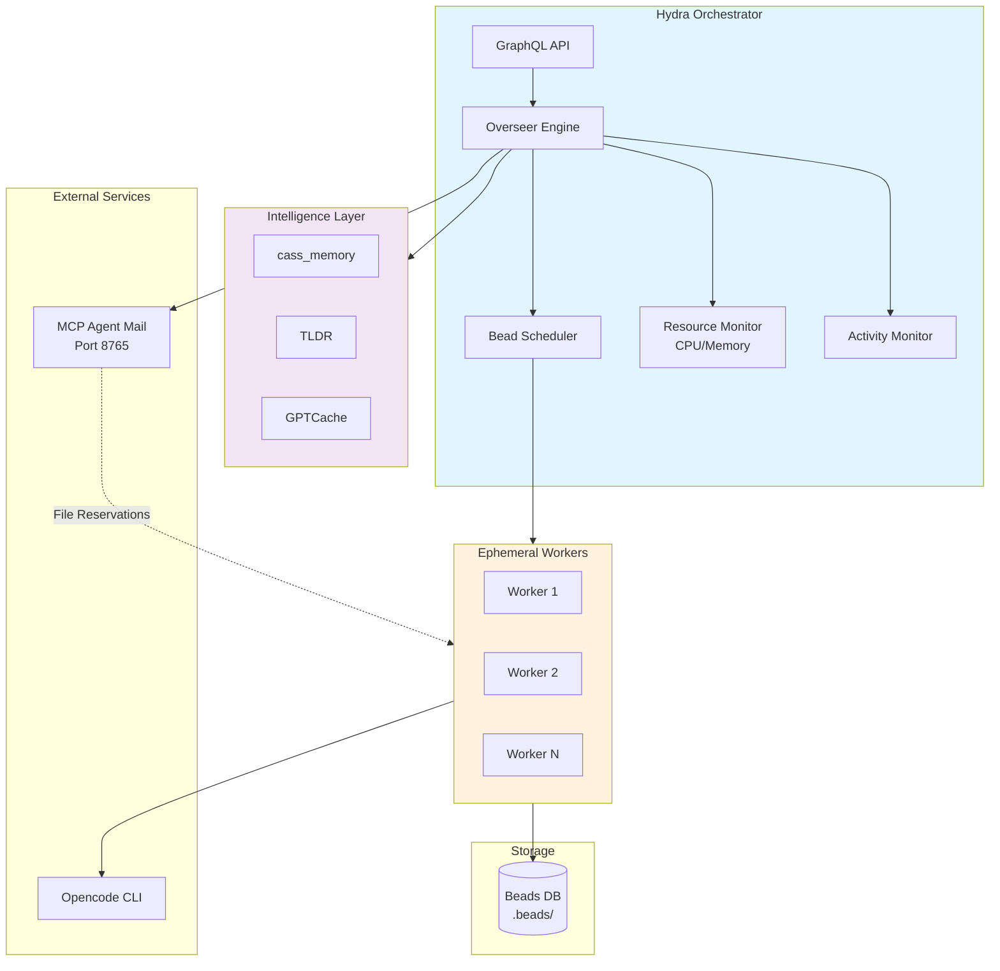

# Hydra Orchestrator

> AI-native orchestration platform for autonomous software engineering agents

[](https://golang.org/)
[]()
[]()

Hydra is an intelligent orchestration system that manages ephemeral workers to process software engineering tasks (represented as "beads"). It coordinates AI agents through the [MCP Agent Mail](https://github.com/Dicklesworthstone/mcp_agent_mail) protocol and optimizes resource usage based on system load.

## 🚀 Quick Start

```bash
# Clone and build
git clone https://github.com/haulmatic-dev/hydra.git
cd hydra
go build -o bin/hydra ./cmd/hydra

# Configure
cat > hydra.yaml << 'EOF'
overseer:
  poll_interval: 5s
  max_workers: 10
  worker_timeout: 5m

projects:
  - name: my-project
    path: /path/to/project
    type: single

mcp:
  enabled: true
  url: http://127.0.0.1:8765
EOF

# Run
./bin/hydra -config hydra.yaml
```

## 📊 System Overview



## ✨ Key Features

- **🔄 Activity-Based Timeout**: Workers only timeout after 5 minutes of inactivity, not fixed duration
- **📊 Resource-Based Scaling**: Automatically limits workers when CPU/Memory > 70%
- **🔗 MCP Integration**: HTTP-based protocol for agent coordination and file reservations
- **🧠 Intelligence Layer**: Context-aware execution with cass_memory, TLDR, and GPTCache
- **📈 GraphQL API**: Real-time monitoring and control
- **🎯 Smart Scheduling**: Processes beads in dependency order using DAG analysis

## 📚 Documentation Structure

### 🏗️ Architecture
- [System Architecture](docs/architecture/system-architecture-20260309.md) - High-level design and components
- [Worker Lifecycle](docs/architecture/worker-lifecycle-20260309.md) - How workers are spawned, monitored, and terminated
- [Bead Processing Flow](docs/architecture/bead-processing-flow-20260309.md) - End-to-end bead execution flow

### ⚙️ Operations
- [Configuration Guide](docs/operations/configuration-guide-20260309.md) - hydra.yaml reference
- [Monitoring & Metrics](docs/operations/monitoring-metrics-20260309.md) - Observability and alerting
- [Troubleshooting](docs/operations/troubleshooting-20260309.md) - Common issues and solutions

### 💻 Development
- [Contributing Guide](docs/development/contributing-guide-20260309.md) - How to contribute
- [Testing Strategy](docs/development/testing-strategy-20260309.md) - Test suite and practices
- [Performance Optimization](docs/development/performance-optimization-20260309.md) - Tuning guidelines

### 📖 Guides
- [Quick Start](docs/guides/quick-start-20260309.md) - Get up and running in 5 minutes
- [Deployment](docs/guides/deployment-20260309.md) - Production deployment checklist
- [MCP Setup](docs/guides/mcp-setup-20260309.md) - Configure MCP Agent Mail integration

## 🔧 Configuration Example

```yaml
# hydra.yaml
overseer:
  poll_interval: 5s          # Check for ready beads every 5 seconds
  max_workers: 10            # Maximum parallel workers
  max_retries: 2             # Retry failed beads twice
  worker_timeout: 5m         # Activity-based timeout (5 min inactivity)
  resource_limits:
    max_cpu_percent: 70      # Don't spawn if CPU > 70%
    max_memory_percent: 70   # Don't spawn if Memory > 70%

projects:
  - name: my-project
    path: /path/to/project
    type: single

intelligence:
  cass_memory:
    enabled: true
  tldr:
    enabled: true
  gptcache:
    enabled: true

mcp:
  enabled: true
  url: http://127.0.0.1:8765
  port: 8765
  heartbeat_interval: 30s
```

## 📈 Performance

| Metric | Value |
|--------|-------|
| Processing Rate | ~3 beads/minute |
| Success Rate | 73% (89/122 beads) |
| Peak Workers | 30 active processes |
| Resource Usage | Monitored at 70% threshold |

## 🤝 Contributing

1. Fork the repository
2. Create a feature branch (`git checkout -b feature/amazing-feature`)
3. Commit changes (`git commit -m 'Add amazing feature'`)
4. Push to branch (`git push origin feature/amazing-feature`)
5. Open a Pull Request

See [Contributing Guide](docs/development/contributing-guide-20260309.md) for details.

## 📄 License

MIT License - see [LICENSE](LICENSE) file for details.

## 🙏 Acknowledgments

- [MCP Agent Mail](https://github.com/Dicklesworthstone/mcp_agent_mail) - Agent coordination protocol
- [Opencode](https://opencode.ai) - AI-powered CLI for code generation
- [Beads](https://github.com/haulmatic-dev/beads) - Task management system

---

**Status**: Production Ready  
**Last Updated**: March 2026  
**Maintainers**: Swyftflo
