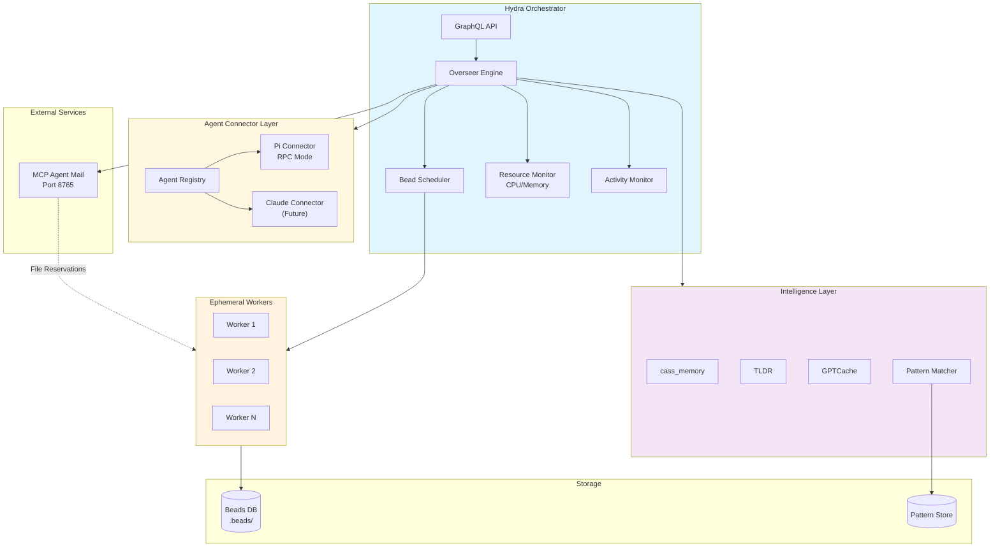

# Hydra Orchestrator

> *"Cut off one head, two more shall take its place"* — Actually, just spawn another agent and keep going...

[](https://golang.org/)
[]()
[]()

Hydra is an intelligent orchestration system that manages ephemeral workers to process software engineering tasks (represented as "beads"). It spawns workers to do specific, atomic tasks. Charon manages dead and zombie processes and guides them to underworld.

## 📚 Documentation Quick Links

| | |
|---|---|
| 🚀 **[Quick Start](#-quick-start)** | Build and run in 5 minutes |
| 👤 **[User Guide](docs/guides/user-guide.md)** | Configure your projects and git identity |
| 🛠 **[Admin Guide](docs/guides/admin-guide.md)** | Run Hydra as a multi-user daemon |
| 📖 **[All Docs](docs/README.md)** | Complete documentation index |

## Our Philosophy

**The Lernaean Approach to Software Development**

When one agent finishes its task, another immediately spawns to take the next one.

Hydra is built on three core beliefs:

1. **Ephemeral by Design**: Spawn, execute, terminate. No context baggage, but tap into context when necessary
2. **Agnostic Intelligence**: Whether your agent prefers claudecode, pi, or speaks in binary, Hydra doesn't judge. Tools are tools.
3. **Autonomous Flow**: From PRD to production, let the machines handle the repetitive so humans can focus on the creative.

## Vision

**Code less, Think more, Think like an architect, Talk to your agent**

Imagine a world where:

- **Developers write specs, agents write code**. You craft the vision in PRDs; Hydra's swarm brings it to life bead by bead.

- **Cross-service orchestration just works**. Your microservices don't just coexist—they collaborate, sharing context and documentation through intelligent agents that understand the broader architecture.

- **Quality gates are automatic, not ceremonial**. Code doesn't reach production until it passes rigorous automated testing, refactoring, and validation cycles.

- **Bugs don't linger**. Whether discovered by automated tests, manual QA, or JIRA tickets, they're converted into actionable beads and resolved by the swarm.

- **Deployments are boring** (in the best way). Push a tag, watch the tests run, see the fixes applied, celebrate the release. No 3 AM war rooms required.

This isn't science fiction. This is Hydra.

## The Future Evolution

We're building toward a fully autonomous software engineering ecosystem:

- **Multi-modal agent support** — Not just coding agents, but testing agents, documentation agents, architecture review agents
- **Intelligent service mesh** — Automated cross-service dependency management with living documentation
- **Self-healing infrastructure** — From dev to QA to production, the system monitors, tests, and fixes itself
- **Human-in-the-loop when it matters** — Creative decisions, architectural reviews, and final approvals stay human; the rest is automated
- **Enterprise integration** — SSO, audit trails, compliance checks, JIRA/GitHub synchronization

The future of software development isn't developers writing more code. It's developers writing better specifications while armies of agents handle the implementation details.

Welcome to the swarm.

---

## What is Hydra?

- **Hydra is an agent swarm orchestrator** — It spawns agents that work with any coding tool (claudecode, pi) via the **Agent Connector Architecture**. This modular system uses HTTP APIs for better session control, allowing seamless integration of multiple AI agents. Cut off one agent's task, and another one immediately spawns to take its place. No heads were harmed in the making of this software.

- **PRDs and beads go in, working software comes out** — Developers create PRDs and beads using their preferred tools. Once the approval gate is released (after review), Hydra goes to town on them. Think of it as releasing the hounds, except the hounds are AI agents and the fox is technical debt.

- **Multi-repo orchestration with cross-service awareness** — Projects contain multiple repos (microservices, web apps, mobile apps) that share interconnection info. Service A knows it needs Service B's data, and at commit time, Service B exposes documents (Swagger, JSON schemas, and other docs in `docs/for-agents-only/`) so Service A's agents can access them across the project. Eventually, this will integrate with QMD, LLM-TLDR, or similar tools for semantic search across service boundaries.

- **Release-driven automated testing** — For every release (with a release tag or version bump), all services get tested: unit tests, integration tests, APIs, web apps using Playwright/browser agents, etc., on dev or QA environments automatically. If tests fail, GitHub or JIRA issues are created, and then those get auto-fixed by agents once the relevant beads are spawned from them. It's like having a QA team that never sleeps and never complains about testing the same feature for the hundredth time.

- **JIRA tickets become beads** — Manually created JIRA tickets by QAs are automatically pulled from JIRA as beads, and they get fixed automatically too. Your backlog is now Hydra's to-do list.

- **Web app with integrated console** — Developers can log in with SSO credentials and use a web-based terminal to manage their work, in addition to SSH and CLI access. Because sometimes you want to monitor your agent swarm from a beach in Bali (we don't judge).

- **Product knowledge at your agents' fingertips** — Product knowledge is added to the system via ClawBot or similar integrations, where Hydra agents can call a product manager (ClawBot) API and ask questions. "What should this button do?" Just ask ClawBot.

- **Environment-aware deployment pipeline** — Dev and QA environments are accessible to the system. Dev is used for deploying and testing code once it passes basic quality gates, code reviews, and refactoring cycles. QA is used for regression testing before a release. Production? That's where the magic happens (after all gates pass, obviously).

- **An integrated, automated solution for the complete dev workflow** — From specification to deployment, from bug discovery to resolution, from PRD to production. One system, infinite agents, zero headaches (well, fewer headaches—we're not miracle workers).

---

## 🚀 Quick Start

### Single User

```bash
# Clone and build
git clone https://github.com/haulmatic-dev/hydra.git
cd hydra
go build -o bin/hydra ./cmd/hydra

# Configure
cat > hydra.yaml << 'EOF'
overseer:
  bead_discovery_interval: 5s
  max_workers: 10
  worker_timeout: 5m

projects:
  - name: my-project
    path: /path/to/project
    type: single

mcp:
  enabled: true
  url: http://127.0.0.1:8765
EOF

# Run
./bin/hydra -config hydra.yaml
```

### Multi-User (Recommended for Teams)

```bash
# 1. Create your user config
mkdir -p ~/.hydra
cat > ~/.hydra/config.yaml << 'EOF'
user:
  name: Your Name
  email: you@example.com
git:
  provider: github
  username: your-username
  token_file: ~/.hydra/.github-token
projects:
  - name: my-project
    path: ~/projects/my-project
    type: single
EOF

echo "ghp_xxxxxxxxxxxxxxxxxxxx" > ~/.hydra/.github-token
chmod 600 ~/.hydra/.github-token

# 2. Admin starts the daemon (reads /home/*/.hydra/config.yaml)
sudo ./bin/hydra -config hydra-config.yaml
```

See [User Guide](docs/guides/user-guide.md) for full config options.
See [Admin Guide](docs/guides/admin-guide.md) for systemd setup.

## 📊 System Overview



## ✨ Key Features

- **🤖 Agent Connector Architecture**: Modular system supporting multiple AI agents (pi, claude, etc.) via HTTP APIs
- **🔄 Activity-Based Timeout**: Workers only timeout after 5 minutes of inactivity, not fixed duration
- **📊 Resource-Based Scaling**: Automatically limits workers when CPU/Memory > 70%
- **🔗 MCP Integration**: HTTP-based protocol for agent coordination and file reservations
- **🧠 Intelligence Layer**: Context-aware execution with cass_memory, TLDR, and GPTCache
- **📈 GraphQL API**: Real-time monitoring and control
- **🎯 Smart Scheduling**: Processes beads in dependency order using DAG analysis
- **📚 Pattern Learning**: Collective Unconscious system extracts and injects patterns from completed beads
- **🎓 Pi Agent Skills**: Automatic installation and management of 16 specialized coding skills (Go, Angular, TypeScript, testing, debugging) for enhanced agent capabilities. See [Pi Agent Skills Implementation](docs/pi-agent-skills-implementation.md) for details.

## 🧠 Collective Unconscious

Hydra's Collective Unconscious is a cross-project pattern learning system that enables agents to learn from each other's successes. When beads complete successfully, the system automatically extracts reusable patterns—implementation approaches, design decisions, testing strategies—and stores them in a shared knowledge base. New beads automatically receive relevant patterns from similar past tasks across all projects, dramatically improving agent effectiveness and consistency. This creates a compounding intelligence effect: every solved problem makes future agents smarter.

## 📚 Documentation Structure

### 🏗️ Architecture
- [System Architecture](docs/architecture/system-architecture-20260309.md) - High-level design and components
- [Agent Connector Architecture](docs/architecture/agent-connector-20260311.md) - Multi-agent support system
- [Bead Structure Guide](docs/architecture/bead-structure-guide.md) - JSON Context, epics, and TDD workflow structure
- [Bead Processing Flow](docs/architecture/bead-processing-flow-20260309.md) - End-to-end bead execution flow including TDD phases
- [Worker Lifecycle](docs/architecture/worker-lifecycle-20260309.md) - How workers are spawned, monitored, and terminated
- [Collective Unconscious](docs/collective-unconscious/test-results/TEST_RESULTS.md) - Pattern learning and injection
- [Pi Agent Skills](docs/pi-agent-skills-implementation.md) - Automatic installation and management of 16 specialized coding skills for Pi agents
- [Pi Configuration](docs/architecture/pi-config.md) - One shared Pi config for workers and human shells: what is shared, why `manage_config` is read-only, how extensions are chosen
- [Filesystem Layout](docs/architecture/filesystem-layout.md) - Where code, shared config and runtime state live on the VPS, and why state is not in the checkout

### ⚙️ Operations
- [Configuration Guide](docs/operations/configuration-guide-20260309.md) - hydra.yaml reference
- [Monitoring & Metrics](docs/operations/monitoring-metrics-20260309.md) - Observability and alerting
- [Hindsight Memory Optimization](docs/HINDSIGHT_MEMORY_OPTIMIZATION.md) - Reduce memory usage from 10GB to 3-6GB using cloud providers
- [Hindsight Memory Management](docs/HINDSIGHT_MEMORY_MANAGEMENT.md) - Understanding and managing Hindsight memory usage
- [Troubleshooting](docs/operations/troubleshooting-20260309.md) - Common issues and solutions

### 💻 Development
- [Contributing Guide](docs/development/contributing-guide-20260309.md) - How to contribute
- [Testing Strategy](docs/development/testing-strategy-20260309.md) - Test suite and practices
- [Performance Optimization](docs/development/performance-optimization-20260309.md) - Tuning guidelines

### 📖 Guides
- [Quick Start](docs/guides/quick-start-20260309.md) - Get up and running in 5 minutes
- [Deployment](docs/guides/deployment-20260309.md) - Production deployment checklist
- [MCP Setup](docs/guides/mcp-setup-20260309.md) - Configure MCP Agent Mail integration

## 🔧 Configuration Example

```yaml
# hydra.yaml
overseer:
  bead_discovery_interval: 5s  # Check for ready beads every 5 seconds
  max_workers: 10            # Maximum parallel workers
  max_retries: 2             # Retry failed beads twice
  worker_timeout: 5m         # Activity-based timeout (5 min inactivity)
  resource_limits:
    max_cpu_percent: 70      # Don't spawn if CPU > 70%
    max_memory_percent: 70   # Don't spawn if Memory > 70%

projects:
  - name: my-project
    path: /path/to/project
    type: single

intelligence:
  cass_memory:
    enabled: true
  tldr:
    enabled: true
  gptcache:
    enabled: true

mcp:
  enabled: true
  url: http://127.0.0.1:8765
  port: 8765
  heartbeat_interval: 30s

# Agent Connector Configuration
agents:
  enabled: true
  default_agent: pi
  pi:
    enabled: true
    provider: kimi
    model: k2.5
    timeout: 10m
```


## 🤝 Contributing

1. Fork the repository
2. Create a feature branch (`git checkout -b feature/amazing-feature`)
3. Commit changes (`git commit -m 'Add amazing feature'`)
4. Push to branch (`git push origin feature/amazing-feature`)
5. Open a Pull Request

See [Contributing Guide](docs/development/contributing-guide-20260309.md) for details.

## 📄 License

MIT License - see [LICENSE](LICENSE) file for details.
---

## Why Hydra?

### The Problem We're Solving

Modern software development is a complex orchestra of:

- Multiple repositories (microservices, web apps, mobile apps)
- Cross-service dependencies and API contracts
- Manual testing and validation cycles
- Bug tracking and resolution workflows
- Deployment pipelines and environment management

Traditionally, this requires teams of developers, QAs, DevOps engineers, and project managers working in coordinated harmony. It's expensive, slow, and prone to human error.

### The Hydra Solution

Hydra transforms this into an **autonomous, self-healing development pipeline**:

1. **Specification-Driven Development**: Humans write clear PRDs; agents implement them
2. **Continuous Quality Assurance**: Automated testing at every stage with intelligent bug detection
3. **Cross-Service Intelligence**: Agents understand and respect service boundaries and dependencies
4. **Autonomous Resolution**: Issues become beads; beads become fixes; fixes become deployments
5. **Human Oversight**: Critical decisions stay human; execution becomes autonomous

### Key Differentiators

| Traditional Development | Hydra Orchestrated |
|------------------------|-------------------|
| Developers write code | Developers write specs; agents write code |
| Manual testing | Automated testing on every commit |
| Reactive bug fixing | Proactive issue creation and resolution |
| Siloed repositories | Cross-service aware development |
| Deployment anxiety | Release confidence through automation |
| Scaling headcount | Scaling agent count |

### Target Use Cases

**Microservices Architecture**: Manage 20+ services with automated cross-service dependency resolution and integration testing.

**Multi-Platform Products**: Coordinate web, mobile, and backend development with shared context and documentation.

**High-Velocity Teams**: Ship features faster by automating implementation while maintaining human oversight on architecture and design.

**Quality-Critical Systems**: Ensure rigorous testing and validation through automated quality gates and continuous regression testing.

### The Road Ahead

Hydra is currently in production use, orchestrating agents across multiple projects. Our roadmap includes:

- **Enhanced cross-service intelligence** — Semantic understanding of service boundaries
- **Multi-modal agent support** — Testing agents, documentation agents, security review agents
- **Enterprise features** — SSO, audit trails, compliance automation
- **Advanced orchestration** — Dynamic agent specialization, learning from patterns
- **Ecosystem integration** — Deeper connections with JIRA, GitHub, cloud providers

We're building the future of autonomous software engineering. Join us.

---

**Status**: Production Ready  
**Last Updated**: March 2026  
**Maintainers**: Swyftflo