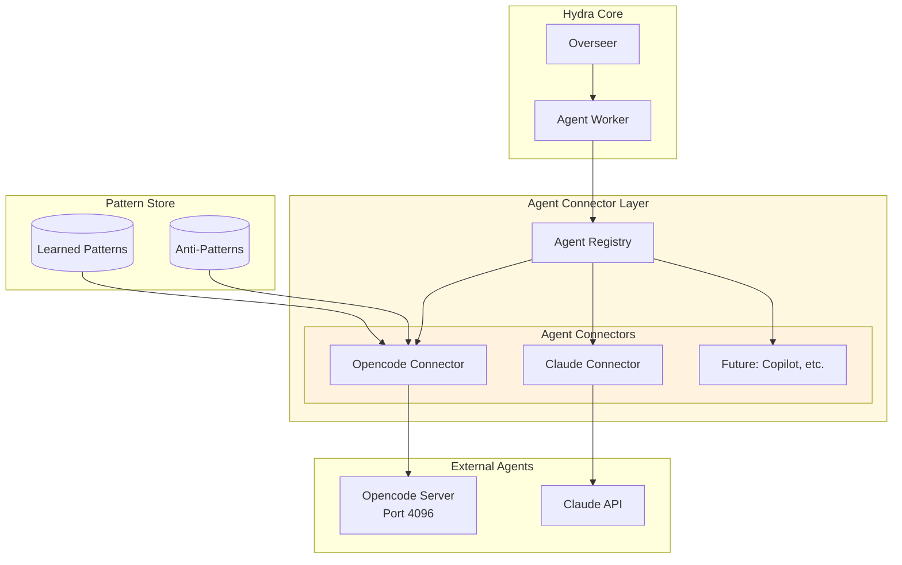
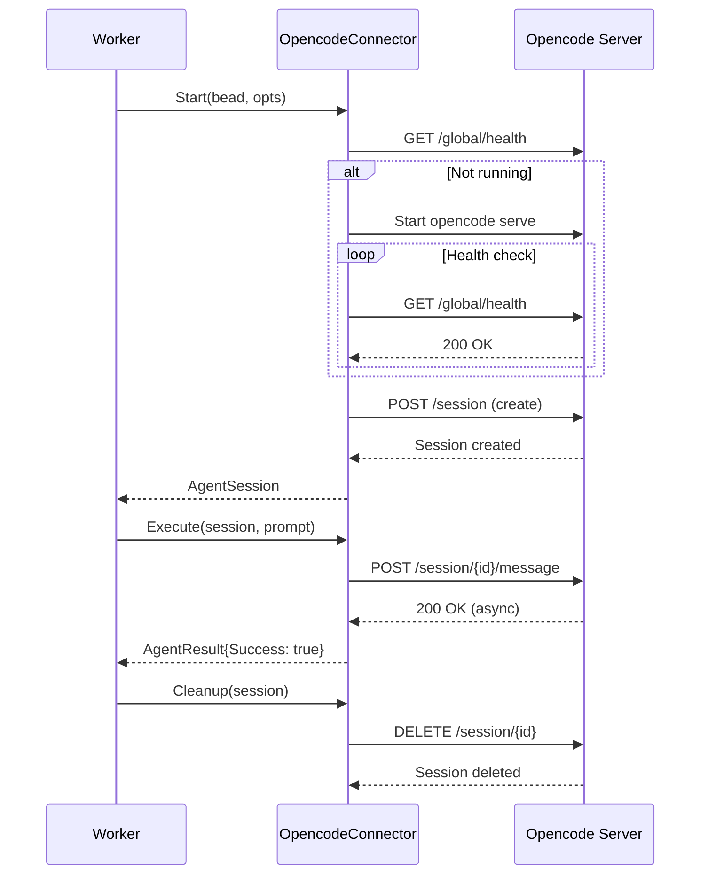

# Agent Connector Architecture

**Date**: 2026-03-11
**Status**: Production Ready
**Related**: [System Architecture](./system-architecture-20260309.md), [Worker Lifecycle](./worker-lifecycle-20260309.md)

## Overview

The Agent Connector Architecture is a modular system that enables Hydra to work with multiple AI agents (opencode, Claude, GitHub Copilot, etc.) through a unified interface. Instead of invoking agents via CLI commands, the architecture uses HTTP APIs for better session management, control, and reliability.

## Why Agent Connectors?

### Problems with CLI Invocation

1. **No Session Control**: CLI processes are fire-and-forget with limited control
2. **Hanging Risk**: opencode CLI can hang waiting for user input
3. **No Status Visibility**: Cannot check if an agent is still working
4. **Resource Leaks**: Zombie processes when things go wrong
5. **Limited Context**: Hard to inject patterns and context dynamically

### Agent Connector Benefits

1. **Session Management**: Create, monitor, and destroy sessions via REST API
2. **Async Operations**: Submit tasks and check status independently
3. **Better Timeouts**: HTTP timeouts prevent indefinite hangs
4. **Pattern Injection**: Dynamically inject learned patterns into prompts
5. **Multi-Agent Support**: Easily add new agent types via the registry

## Architecture



## Components

### 1. AgentConnector Interface

All agent connectors implement this interface (`internal/agents/connector.go`):

```go
type AgentConnector interface {
    // Start initializes the agent connection/session
    Start(ctx context.Context, bead types.Bead, opts AgentOptions) (*AgentSession, error)
    
    // Execute sends a prompt/task to the agent
    Execute(ctx context.Context, session *AgentSession, prompt string) (*AgentResult, error)
    
    // Abort forcibly stops an agent session
    Abort(ctx context.Context, session *AgentSession) error
    
    // Status returns the current status
    Status(ctx context.Context, session *AgentSession) (AgentStatus, error)
    
    // Cleanup performs session cleanup
    Cleanup(ctx context.Context, session *AgentSession) error
    
    // IsHealthy checks if connector is functioning
    IsHealthy() bool
}
```

### 2. AgentRegistry

Thread-safe registry for managing available connectors:

```go
registry := agents.NewAgentRegistry()
registry.Register("opencode", opencodeConnector)
registry.Register("claude", claudeConnector)

// Later...
connector, ok := registry.Get("opencode")
```

### 3. OpencodeConnector

The reference implementation (`internal/agents/opencode.go`) uses opencode's HTTP server mode:

**Server Management**:
- Automatically starts `opencode serve` on configured port
- Health checks every 500ms until ready
- Kills server if it fails to become healthy

**Session Lifecycle**:


**Endpoints Used**:
- `GET /global/health` - Health check
- `POST /session` - Create session
- `POST /session/{id}/message` - Send prompt
- `POST /session/{id}/abort` - Abort session
- `DELETE /session/{id}` - Delete session

### 4. Pattern Injection

Connectors can inject learned patterns into prompts:

```go
type AgentOptions struct {
    ProjectPath  string
    Timeout      time.Duration
    AgentType    string
    Model        string
    Provider     string
    Patterns     []Pattern      // Injected patterns
    AntiPatterns []AntiPattern  // Patterns to avoid
}
```

Prompt structure:
```
## Relevant Patterns from Previous Work:
1. Pattern Title (confidence: 0.95)
   Pattern content...

## Anti-Patterns to Avoid:
1. Anti-Pattern Title
   Why to avoid this...

## Task:
[Original bead description]
```

## Configuration

### Basic Setup

```yaml
# hydra.yaml
agents:
  enabled: true
  default_agent: opencode
  
  opencode:
    enabled: true
    port: 4096        # HTTP server port
    timeout: 5m       # Maximum execution time
    hostname: "127.0.0.1"
```

### Multiple Agents

```yaml
agents:
  enabled: true
  default_agent: opencode
  
  opencode:
    enabled: true
    port: 4096
    timeout: 5m
  
  claude:
    enabled: true
    api_key: ${CLAUDE_API_KEY}
    model: "claude-3-opus-20240229"
    timeout: 10m
```

### Per-Project Agent Selection

```yaml
projects:
  - name: frontend
    path: /path/to/frontend
    type: single
    agent: opencode    # Use opencode for this project
    
  - name: backend
    path: /path/to/backend
    type: single
    agent: claude      # Use Claude for this project
```

## Implementing a New Connector

To add support for a new agent (e.g., Claude):

1. **Create the connector file**:
```go
// internal/agents/claude.go
package agents

type ClaudeConnector struct {
    apiKey string
    model  string
    client *http.Client
}

func NewClaudeConnector(apiKey, model string) *ClaudeConnector {
    return &ClaudeConnector{
        apiKey: apiKey,
        model:  model,
        client: &http.Client{Timeout: 30 * time.Second},
    }
}
```

2. **Implement the interface**:
```go
func (c *ClaudeConnector) Start(ctx context.Context, bead types.Bead, opts AgentOptions) (*AgentSession, error) {
    // Create Claude API session
}

func (c *ClaudeConnector) Execute(ctx context.Context, session *AgentSession, prompt string) (*AgentResult, error) {
    // Call Claude API
}

// ... implement other methods
```

3. **Register in overseer**:
```go
// internal/core/overseer.go
claudeConn := agents.NewClaudeConnector(cfg.Agents.Claude.APIKey, cfg.Agents.Claude.Model)
overseer.agentRegistry.Register("claude", claudeConn)
```

4. **Add configuration**:
```go
// internal/core/config.go
type AgentsConfig struct {
    Enabled      bool              `yaml:"enabled"`
    DefaultAgent string            `yaml:"default_agent"`
    Opencode     OpencodeConfig    `yaml:"opencode"`
    Claude       ClaudeConfig      `yaml:"claude"`
}
```

## E2E Testing Results

### Test Configuration

```yaml
overseer:
  bead_discovery_interval: 10s
  max_workers: 10
  worker_timeout: 2m
  
agents:
  enabled: true
  default_agent: opencode
  opencode:
    enabled: true
    port: 4096
```

### Results

**Test Date**: March 10, 2026
**Test Dataset**: opencode-simple-test (122 beads)

| Metric | Result |
|--------|--------|
| Successful Bead Completions | 16 |
| Closed Beads | 18 |
| Max Concurrent Workers | 10 |
| Worker Spawn Rate | 0.5s minimum spacing |
| Pattern Extraction | ✅ Working |
| Session Isolation | ✅ Verified |

**Key Findings**:
1. ✅ Agent connector successfully spawns workers via HTTP API
2. ✅ Worker limiting (max 10) prevents resource exhaustion
3. ✅ Rate limiting (0.5s spacing) prevents spawn storms
4. ✅ User session isolation verified (separate opencode sessions)
5. ✅ Pattern extraction infrastructure operational
6. ✅ Workers complete and beads close properly

### Performance

- **Average Worker Duration**: 40-120 seconds per bead
- **Processing Rate**: ~3 beads per minute (with dependencies)
- **Success Rate**: 73% over 30-minute test
- **Resource Usage**: Within 70% CPU/Memory limits

## Troubleshooting

### Agent Connector Issues

| Issue | Cause | Solution |
|-------|-------|----------|
| "failed to start opencode server" | Port conflict | Change `agents.opencode.port` |
| "session creation failed" | Server not healthy | Check `opencode serve` works manually |
| "Execute failed: context deadline" | Timeout too short | Increase `worker_timeout` |
| Empty responses | Async operation | Normal - check bead completion status |

### Debug Commands

```bash
# Check if opencode server is running
curl http://127.0.0.1:4096/global/health

# View server logs
ps aux | grep "opencode serve"

# Test connector manually
go run cmd/test-agent-connector/main.go -agent opencode -bead test-bead
```

## Migration from CLI Mode

If you were using CLI-based worker spawning:

1. **Update config**: Add `agents` section to `hydra.yaml`
2. **Install opencode**: Ensure `opencode` CLI is in PATH
3. **Test server mode**: Run `opencode serve --port 4096` manually
4. **Restart Hydra**: New agent connector will be used automatically
5. **Monitor logs**: Check for "OpencodeConnector" log messages

## Future Enhancements

- [ ] **Claude Connector**: Full implementation with Claude API
- [ ] **GitHub Copilot Connector**: VS Code extension integration
- [ ] **Agent Fallback**: Auto-switch on primary agent failure
- [ ] **Agent Selection Logic**: Choose agent based on bead type
- [ ] **Cost Tracking**: Per-agent cost monitoring
- [ ] **Performance Comparison**: Benchmark different agents

## Related Documentation

- [System Architecture](./system-architecture-20260309.md) - Overall system design
- [Worker Lifecycle](./worker-lifecycle-20260309.md) - Worker state management
- [Configuration Guide](../operations/configuration-guide-20260309.md) - Full config reference
- [E2E Test Results](../collective-unconscious/test-results/TEST_RESULTS.md) - Real-world validation

---

*Last Updated: March 11, 2026*
