# Bead Processing Flow

**Date**: 2026-03-09  
**Status**: Current  
**Related**: [System Architecture](./system-architecture-20260309.md), [Worker Lifecycle](./worker-lifecycle-20260309.md)

## Overview

This document describes the complete flow of processing a bead (task) from discovery to completion in the Hydra system.

## High-Level Flow

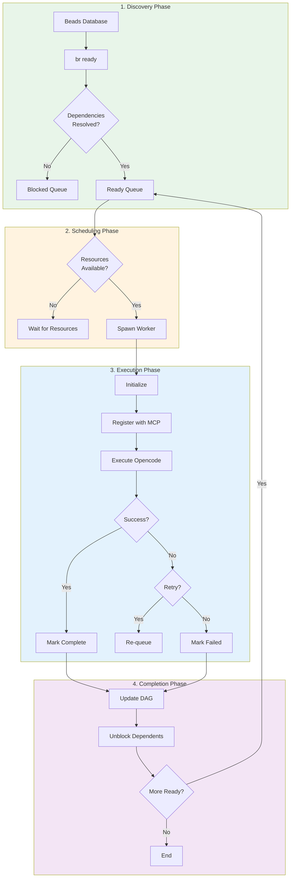

## Phase 1: Discovery

### Bead Database Structure

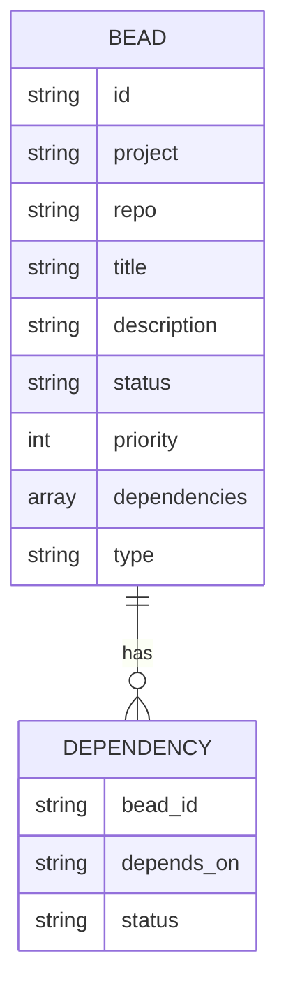

### Finding Ready Beads

**Command**: `br ready --json`

**Process**:
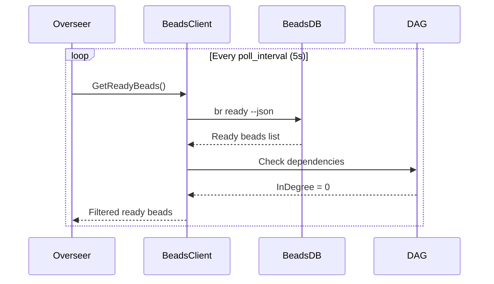

**Example Output**:
```json
[
  {
    "id": "opencode-simple-test-3a5",
    "project": "opencode-simple-test",
    "title": "Implement Basic Arithmetic",
    "status": "open",
    "priority": 5,
    "dependencies": [],
    "type": "feature"
  },
  {
    "id": "opencode-simple-test-1l3",
    "project": "opencode-simple-test",
    "title": "Add TypeScript Support",
    "status": "open",
    "priority": 5,
    "dependencies": ["opencode-simple-test-3v6"],
    "type": "developer"
  }
]
```

### Dependency Resolution

**DAG (Directed Acyclic Graph)**:
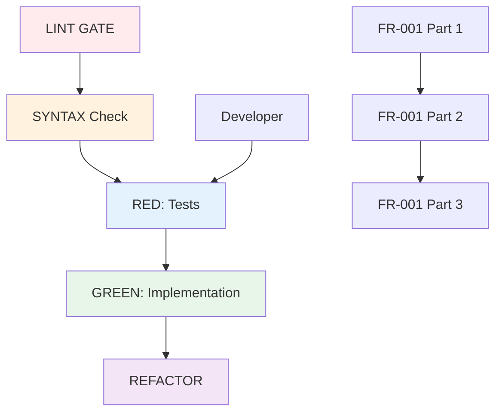

**Ready Bead Criteria**:
1. Status = "open"
2. InDegree = 0 (no unresolved dependencies)
3. Not currently running
4. Not already completed
5. Not an approval-gate (manual approval required)
6. Not an epic (organizational only, not actionable)
7. Only implementation tasks and TDD sub-tasks are actionable

### Ready Queue Management

```go
func (o *Overseer) getReadyBeads() ([]types.Bead, error) {
    // 1. Query all ready beads
    allReady, err := o.beadsClient.GetReadyBeads(project.Path, "")
    
    // 2. Filter out running beads
    for _, bead := range allReady {
        if _, isRunning := o.activeWorkers[string(bead.ID)]; isRunning {
            continue  // Skip already running
        }
        
        // 3. Skip approval gates (require manual intervention)
        if bead.Type == "approval-gate" {
            continue
        }
        
        // 4. Skip epics (organizational containers, not actionable)
        if bead.Type == "epic" {
            continue
        }
        
        readyBeads = append(readyBeads, bead)
    }
    
    // 5. Sort by priority (high to low)
    sort.Slice(readyBeads, func(i, j int) bool {
        return readyBeads[i].Priority > readyBeads[j].Priority
    })
    
    return readyBeads, nil
}
```

## TDD Workflow Integration

The Hydra system enforces strict Test-Driven Development (TDD) workflows through bead dependencies. Each implementation task follows a standardized RED→GREEN→REFACTOR→SYNTAX flow where each phase blocks the next.

### TDD Phase Chain

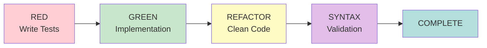

### Phase Descriptions

| Phase | Purpose | Output | Success Criteria |
|-------|---------|--------|------------------|
| **RED** | Write failing tests | Test files | Tests exist and fail |
| **GREEN** | Implement to pass tests | Implementation | All tests pass |
| **REFACTOR** | Clean up code | Clean implementation | Tests still pass, code improved |
| **SYNTAX** | Validate syntax/lint | Validated code | No syntax/lint errors |

### Blocking Mechanism

Each TDD phase creates a hard dependency:

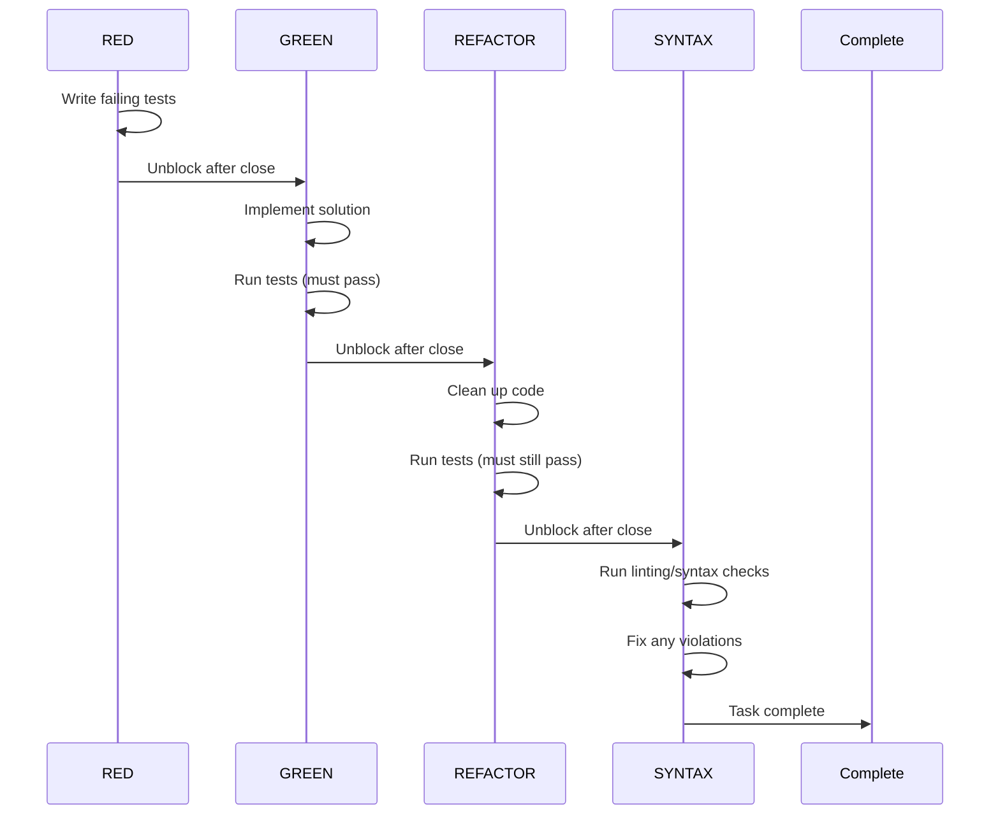

### Example: Feature Implementation

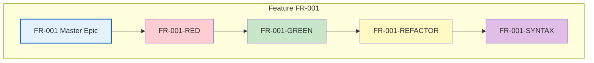

### Phase Transition Rules

1. **RED→GREEN**: Green bead is ready only when Red bead status = "closed"
2. **GREEN→REFACTOR**: Refactor bead is ready only when Green bead status = "closed"
3. **REFACTOR→SYNTAX**: Syntax bead is ready only when Refactor bead status = "closed"
4. **No skipping**: Cannot jump from RED to REFACTOR or GREEN to SYNTAX

This ensures:
- Tests are written before implementation
- Implementation passes tests before refactoring
- Code is validated before marking complete
- Full TDD discipline is maintained automatically

## Epic Handling

Epics are organizational containers that group related tasks together. They are **not actionable** and will never be processed by workers.

### Epic Types

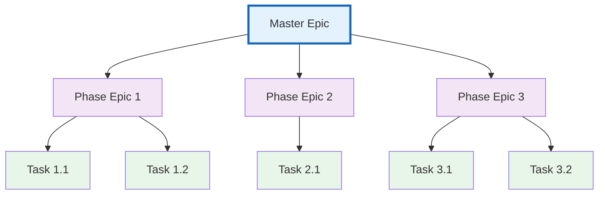

| Epic Type | Purpose | Auto-Close Rule |
|-----------|---------|-----------------|
| **Master Epic** | Top-level feature/PRD | Closes when all phase epics complete |
| **Phase Epic** | Groups tasks by phase | Closes when all child tasks complete |

### Epic Behavior

**Non-Actionable**:
```go
// Epics are skipped during ready bead discovery
if bead.Type == "epic" {
    continue  // Never spawn workers for epics
}
```

**Auto-Close Rules**:
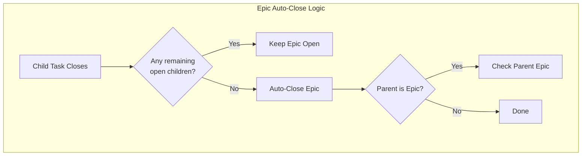

**Example Lifecycle**:
```
1. FR-001 Master Epic created (status: open)
   ├── FR-001-Phase1 Epic (status: open)
   │   ├── FR-001-1.1 Task (status: open)
   │   └── FR-001-1.2 Task (status: open)
   └── FR-001-Phase2 Epic (status: open)
       └── FR-001-2.1 Task (status: open)

2. FR-001-1.1 completes → Phase1 still has open children
3. FR-001-1.2 completes → Phase1 auto-closes → Master still has open children
4. FR-001-2.1 completes → Phase2 auto-closes → Master auto-closes
```

### Epic Best Practices

1. **Master Epics**: Create one per PRD/major feature
2. **Phase Epics**: Group by logical phases (design, implementation, testing)
3. **Task Granularity**: Keep tasks atomic (2-4 hours of work)
4. **Dependencies**: Set dependencies between phase epics for sequential work

## JSON Context

Each bead contains structured JSON Context that provides agents with task-specific metadata, acceptance criteria, and execution instructions.

### Context Structure

```json
{
  "bead_id": "proj-feature-001",
  "title": "Implement User Authentication",
  "description": "Add login/logout functionality",
  "context": {
    "acceptance_criteria": [
      "Users can login with email/password",
      "Passwords are hashed using bcrypt",
      "Session tokens expire after 24h"
    ],
    "files_to_modify": ["src/auth.js", "src/middleware/auth.js"],
    "test_requirements": {
      "coverage_minimum": 80,
      "test_files": ["tests/auth.test.js"]
    },
    "tdd_phase": "GREEN",
    "parent_epic": "proj-auth-epic",
    "estimated_effort": "2-4h"
  }
}
```

### Agent Parsing

Agents receive the context through environment variables and parse it to understand task requirements:

```go
// Worker retrieves context from bead
contextJSON := bead.Context
var taskContext TaskContext
if err := json.Unmarshal([]byte(contextJSON), &taskContext); err != nil {
    log.Printf("[Worker] Failed to parse context: %v", err)
    return err
}

// Agent uses context to guide execution
prompt := fmt.Sprintf(`
Task: %s
Acceptance Criteria:
%s
Test Requirements: %v
TDD Phase: %s
`, bead.Title, 
   strings.Join(taskContext.AcceptanceCriteria, "\n"),
   taskContext.TestRequirements,
   taskContext.TDDPhase)
```

### Context Usage

The JSON Context enables:
- **Acceptance Criteria Validation**: Agents verify completion against defined criteria
- **File Targeting**: Context specifies which files to create/modify
- **TDD Phase Awareness**: Agents know which TDD phase to execute
- **Test Requirements**: Coverage minimums and test file locations
- **Effort Estimation**: Helps with scheduling and resource allocation

For complete details on context schema, validation, and best practices, see:
**[Bead Structure Guide](./bead-structure-guide.md)**

## Phase 2: Scheduling

### Resource Check

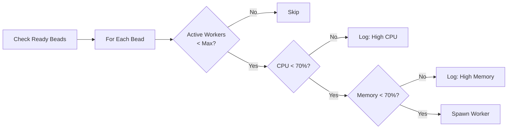

**Resource Monitoring**:
```go
func (o *Overseer) tick() error {
    // ...
    for _, bead := range readyBeads {
        // Check resource limits
        if o.resourceMonitor != nil && !o.resourceMonitor.CanSpawnWorker() {
            log.Printf("[ResourceMonitor] Blocking worker spawn for bead %s", bead.ID)
            continue
        }
        
        if err := o.spawnWorker(bead); err != nil {
            // Handle error
        }
    }
}
```

### Worker Pool Management

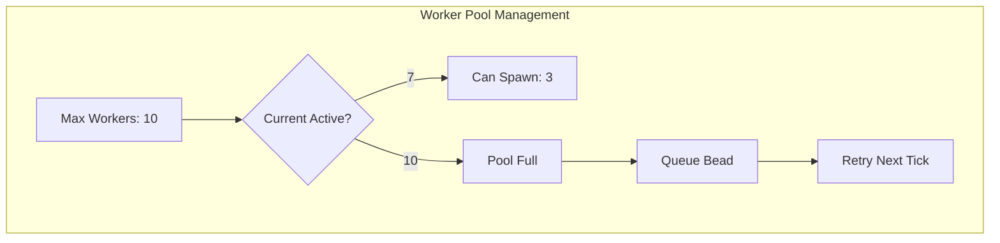

### Priority Scheduling

Beads are processed by priority (highest first):

| Priority | Type | Examples |
|----------|------|----------|
| 10 | LINT GATE | Syntax checks, validation |
| 8 | SYNTAX | Performance checks |
| 5 | Developer | TypeScript support, tests |
| 3 | Feature | FR-001, FR-002, etc. |
| 1 | Approval | Manual gates |

## Phase 3: Execution

### Worker Initialization

**Environment Setup**:
```bash
# Environment variables passed to worker
export HYDRA_BEAD_ID="opencode-simple-test-3a5"
export HYDRA_PROJECT="opencode-simple-test"
export HYDRA_PROJECT_PATH="/tmp/hydra-test-..."
export HYDRA_REPO="main"
export HYDRA_AGENT_TYPE="orchestrator"
export HYDRA_BEAD_TITLE="Implement Basic Arithmetic"
export HYDRA_BEAD_DESCRIPTION="Add add, subtract functions..."
export HYDRA_RETRY_COUNT="0"
export HYDRA_MCP_ENABLED="true"
```

### Opencode Execution

**Command Construction**:
```go
func buildOpencodeCommand(bead types.Bead, projectPath string) *exec.Cmd {
    prompt := fmt.Sprintf("%s: %s", bead.Title, bead.Description)
    
    cmd := exec.Command("bash", "-c",
        fmt.Sprintf(`echo "%s" | opencode run --format json --dir "%s"`,
            prompt, projectPath))
    
    return cmd
}
```

**Activity Monitoring**:
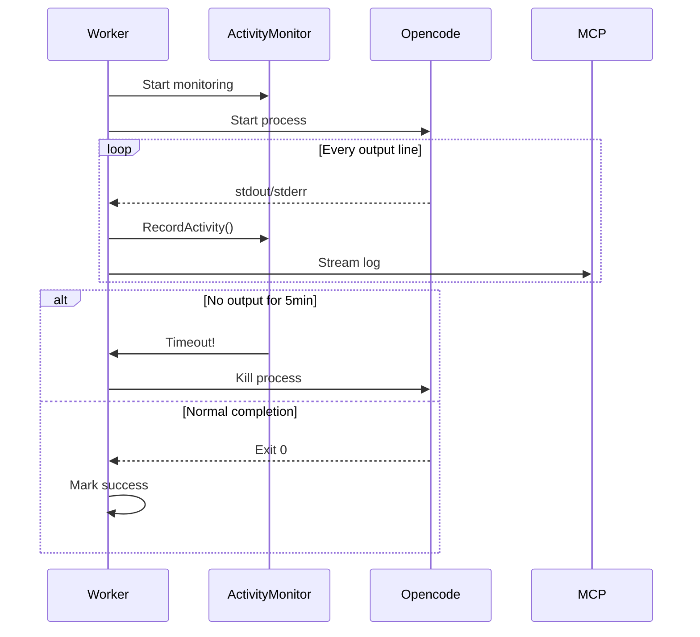

### Execution Results

**Success**:
```json
{
  "success": true,
  "exit_code": 0,
  "output": "Generated calculator.js with add/subtract...",
  "files_created": ["calculator.js", "calculator.test.js"],
  "tests_passed": 5
}
```

**Failure**:
```json
{
  "success": false,
  "exit_code": 1,
  "error": "SyntaxError: Unexpected token...",
  "retry_eligible": true
}
```

## Phase 4: Completion

### Bead Closure

**Process**:
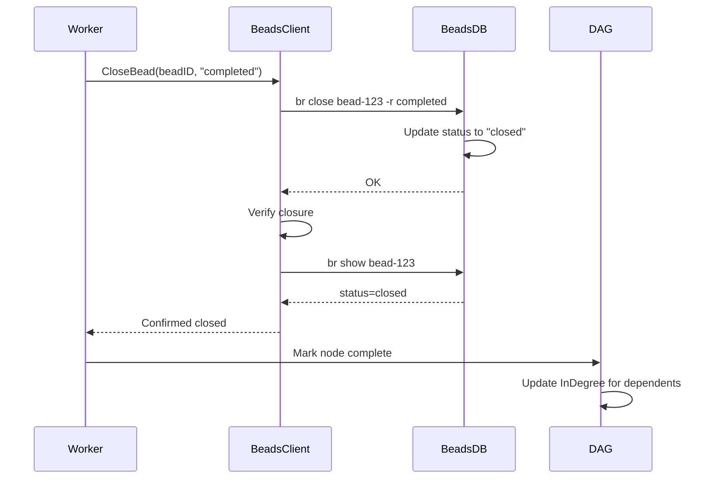

### Dependency Unblocking

**Example**:
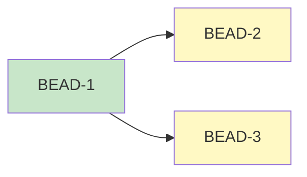

When BEAD-1 closes:
1. BEAD-2 InDegree: 1 → 0 (now ready)
2. BEAD-3 InDegree: 1 → 0 (now ready)
3. Both added to ready queue next poll

### Retry Logic

**Flow**:
```mermaid
stateDiagram-v2
    [*] --> Execute: Start
    Execute --> CheckResult: Complete
    
    CheckResult --> Success: Exit 0
    CheckResult --> Failure: Exit != 0
    
    Failure --> RetryCheck{Retry < 2?}
    RetryCheck --> Requeue: Yes
    RetryCheck --> PermanentFail: No
    
    Requeue --> Delay: Wait 5s
    Delay --> Execute: Retry
    
    Success --> [*]
    PermanentFail --> [*]
```

## Performance Metrics

### Processing Rates

| Phase | Duration | Notes |
|-------|----------|-------|
| Discovery | ~100ms | `br ready` query |
| Scheduling | ~50ms | Resource check + spawn decision |
| Spawn | ~200ms | Process creation |
| Execution | 30s-3min | Opencode execution (variable) |
| Closure | ~100ms | `br close` + verification |
| **Total** | **31s-3.5min** | Per bead |

### Throughput

**With max_workers=10**:
- Theoretical: 10 beads × (60s/avg 90s) = ~6.7 beads/minute
- Actual: ~3 beads/minute (due to dependencies, retries)

**Scaling Factors**:
1. **Ready bead count**: Limited by dependencies
2. **System resources**: CPU/Memory constraints
3. **Opencode speed**: AI generation time
4. **Network**: MCP communication latency

## Error Handling

### Common Errors

| Error | Cause | Solution |
|-------|-------|----------|
| Activity Timeout | No output > 5min | Worker killed, retry |
| Resource Limit | CPU/Memory > 70% | Wait, retry next poll |
| Dependency Block | Unresolved deps | Wait for dependencies |
| Project Not Found | Config mismatch | Check hydra.yaml |
| MCP Error | Server down | Check `pm2 status` |

### Recovery Strategies

1. **Retry with backoff**: Wait 5s, try again
2. **Skip and continue**: Process other beads
3. **Log and alert**: Notify of persistent failures
4. **Resource cleanup**: Force GC, release memory

## Monitoring

### Key Metrics

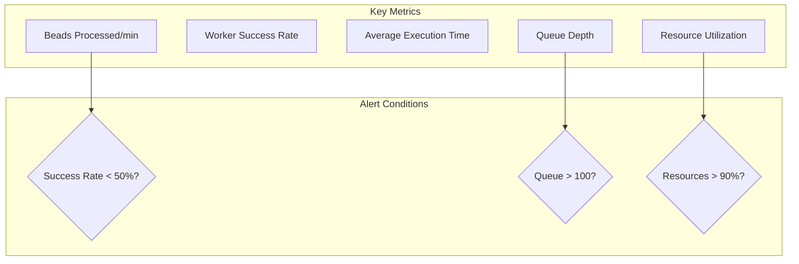

### Log Analysis

**Success Pattern**:
```
[Worker] Spawning worker for bead-123
[Worker] Completed: bead-123 (duration: 45.23s)
[CloseBead] Successfully closed bead-123
```

**Failure Pattern**:
```
[Worker] Spawning worker for bead-456
[Worker] Worker failed: bead-456 (exit: 1)
[CloseBead] Bead bead-456 not closed (status: open)
[Retry] Re-queueing bead-456 (attempt 1/2)
```

## Best Practices

1. **Dependency Management**: Keep dependency chains shallow
2. **Resource Planning**: Monitor CPU/Memory during peak loads
3. **Timeout Tuning**: 5min activity timeout works for most beads
4. **Retry Strategy**: 2 retries with 5s delay is usually sufficient
5. **Priority Assignment**: Use higher priority for blocking beads

## Related Documentation

- [System Architecture](./system-architecture-20260309.md) - High-level design
- [Worker Lifecycle](./worker-lifecycle-20260309.md) - Detailed worker states
- [Configuration Guide](../operations/configuration-guide-20260309.md) - Tuning performance
- [Troubleshooting](../operations/troubleshooting-20260309.md) - Debugging flow issues
- [Bead Structure Guide](./bead-structure-guide.md) - Complete JSON Context reference