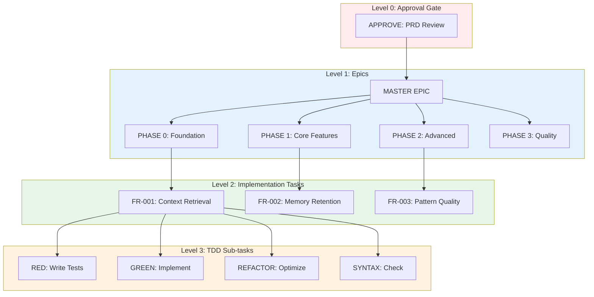
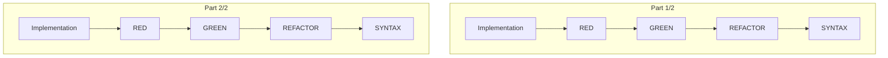

# Bead Structure Guide

**Date**: 2026-03-19  
**Status**: Current  
**Audience**: Hydra developers and agent developers  
**Related**: [Bead Processing Flow](./bead-processing-flow-20260309.md), [System Architecture](./system-architecture-20260309.md)

## Overview

This document explains Hydra's bead structure, designed to enable AI agents to work effectively with structured, deterministic task definitions. The key innovation is **JSON Context embedded in task descriptions**, which provides agents with precise implementation targets extracted from PRDs.

## Why JSON Context?

Traditional bead descriptions were free-form text, requiring agents to:
1. Parse unstructured requirements
2. Guess which files to modify
3. Infer integration points
4. Discover data models through trial and error

**JSON Context solves this** by providing structured, machine-readable metadata:

```json
{
  "implementation": {
    "files": [
      "worker/internal/memory/store.go",
      "worker/internal/memory/patterns.go"
    ],
    "functions": [
      "RecordExecution",
      "ExtractPatterns"
    ],
    "integration_points": [
      "MemoryStore Interface",
      "PatternRecognition Service"
    ],
    "data_models": [
      {
        "name": "ExecutionMemory",
        "fields": ["context_id", "execution_result", "timestamp"]
      }
    ]
  },
  "acceptance_criteria": [
    "AC1: Record execution context with unique ID",
    "AC2: Extract patterns from execution results",
    "AC3: Store in memory with 30-day retention"
  ]
}
```

**Benefits:**
- **Precision**: Agents know exactly which files and functions to work with
- **Consistency**: Same structure across all tasks
- **Validation**: Can verify implementation targets exist before starting
- **Traceability**: Maps back to specific PRD requirements

## Bead Hierarchy

Hydra organizes work in a 4-level hierarchy:



### Level 0: Approval Gate

**Purpose**: Manual review checkpoint before work begins
- **Type**: `approval`
- **Actionable**: Yes (requires human approval)
- **Blocks**: All Phase epics and implementation tasks
- **Lifecycle**: Human marks as complete → unblocks all work

**Example:**
```yaml
id: hydra-22d
title: "APPROVE: Hindsight Integration Implementation Review"
type: approval
status: in_progress
labels: ["approval-gate", "review"]
```

### Level 1: Epics

**Purpose**: Organizational grouping, not actionable work
- **Types**: 
  - `epic` (master)
  - `epic:phase-0`, `epic:phase-1`, etc.
- **Actionable**: No - do not work on epics directly
- **Lifecycle**: Auto-closes when all child tasks complete

**Master Epic:**
```yaml
id: hydra-mt9
title: "EPIC: Hindsight Memory System Integration"
type: epic
labels: ["prd:epic", "type:epic"]
# Contains all requirements
```

**Phase Epics:**
```yaml
id: hydra-31h
title: "PHASE 0: Foundation & Architecture"
type: epic
labels: ["prd:epic", "prd:phase", "prd:phase-0"]
# Contains requirements 1-20
```

**Why Epics?**
1. **Progress Tracking**: See which phases are complete
2. **Dependency Management**: Phase 1 blocked until Phase 0 complete
3. **Reporting**: Aggregate status across related work
4. **Organization**: Group 79 requirements into manageable chunks

### Level 2: Implementation Tasks

**Purpose**: The actual work to be done
- **Type**: `implementation` or inferred from labels
- **Actionable**: Yes - these are what agents work on
- **Contains**: JSON Context with precise targets
- **Blocks**: TDD sub-tasks

**Example:**
```yaml
id: hydra-28z
title: "Pre-Execution Context Retrieval"
labels: ["implementation", "req-001", "type:implementation"]
description: |
  ## Implementation Context
  ```json
  {
    "implementation": {
      "files": [
        "worker/internal/hindsight/client.go",
        "worker/internal/context/retriever.go"
      ],
      "functions": [
        "RetrievePreExecutionContext",
        "ValidateContextCompleteness"
      ],
      "integration_points": [
        "Hindsight Go Client",
        "Context-Processor Agent"
      ],
      "data_models": [
        {
          "name": "PreExecutionContext",
          "struct": "type PreExecutionContext struct {...}"
        }
      ]
    },
    "acceptance_criteria": [
      "AC1: Retrieve context before agent execution",
      "AC2: Validate all required fields present",
      "AC3: Handle missing context gracefully"
    ]
  }
  ```
  
  ## Instructions
  Implement the Pre-Execution Context Retrieval system...
```

### Level 3: TDD Sub-tasks

**Purpose**: Test-Driven Development workflow enforcement
- **Types**: `tdd-red`, `tdd-green`, `tdd-refactor`, `tdd-syntax`
- **Actionable**: Yes - strict workflow order
- **Order**: RED → GREEN → REFACTOR → SYNTAX

**RED (Write Tests First):**
```yaml
id: hydra-1wq
title: "RED: Write tests for Pre-Execution Context Retrieval"
labels: ["tdd-red", "req-001"]
blocked_by: ["hydra-28z"]
```

**GREEN (Make Tests Pass):**
```yaml
id: hydra-2kb
title: "GREEN: Implement Pre-Execution Context Retrieval"
labels: ["tdd-green", "req-001"]
blocked_by: ["hydra-1wq"]
```

**REFACTOR (Optimize):**
```yaml
id: hydra-dta
title: "REFACTOR: Optimize Pre-Execution Context Retrieval"
labels: ["tdd-refactor", "req-001"]
blocked_by: ["hydra-2kb"]
```

**SYNTAX (Final Checks):**
```yaml
id: hydra-3bs
title: "SYNTAX: Check Pre-Execution Context Retrieval"
labels: ["tdd-syntax", "req-001"]
blocked_by: ["hydra-dta"]
```

**Why TDD?**
1. **Quality**: Tests verify implementation meets requirements
2. **Documentation**: Tests show expected behavior
3. **Refactoring**: Tests enable safe code changes
4. **Consistency**: Same workflow for all requirements

## Multi-Part Requirements

Some PRD requirements are too large for single implementation. They're split into parts:



**Example: FR-013 - Embedded Hindsight Server Lifecycle Management**

- **Part 1/2**: Server initialization and configuration
- **Part 2/2**: Graceful shutdown and resource cleanup

Each part has its own complete TDD chain. Parts can be worked on in parallel (no dependency between parts), but each part's TDD tasks must complete in order.

## JSON Context Schema

The JSON embedded in task descriptions follows this schema:

```typescript
interface TaskContext {
  implementation: {
    // Files that need modification
    files: string[];
    
    // Functions to implement or modify
    functions: string[];
    
    // External services/interfaces to integrate with
    integration_points: string[];
    
    // Data structures needed
    data_models: Array<{
      name: string;
      struct?: string;  // Full struct definition
      fields?: string[];  // Field names only
    }>;
    
    // Configuration values
    config?: {
      keys: string[];
      defaults?: Record<string, any>;
    };
  };
  
  // What must be true for task completion
  acceptance_criteria: string[];
  
  // Which PRD requirement this maps to
  requirement_mapping?: {
    prd_section: string;
    requirement_id: string;
  };
}
```

**Extracted from PRD Sections:**
- **Section 5.2** (Integration Points) → `implementation.integration_points`
- **Section 5.4** (Configuration) → `implementation.config`
- **Section 5.6** (Data Models) → `implementation.data_models`
- **Section 5.8** (Implementation Mapping) → `implementation.files`, `implementation.functions`

## Working with the Structure

### For Agent Developers

**1. Start with Ready Tasks:**
```bash
br ready
# Returns: Implementation tasks with no unresolved dependencies
```

**2. Parse JSON Context:**
```go
// Extract JSON from description
jsonStart := strings.Index(description, "```json")
jsonEnd := strings.Index(description, "```", jsonStart+7)
contextJSON := description[jsonStart+7 : jsonEnd]

var context TaskContext
json.Unmarshal([]byte(contextJSON), &context)
```

**3. Validate Targets:**
```go
// Check files exist before starting
for _, file := range context.Implementation.Files {
    if _, err := os.Stat(file); os.IsNotExist(err) {
        // File doesn't exist - may need to create
    }
}
```

**4. Follow TDD Workflow:**
1. Complete RED task (write failing tests)
2. Complete GREEN task (implement to pass tests)
3. Complete REFACTOR task (optimize)
4. Complete SYNTAX task (final validation)

### For Hydra Developers

**1. Epic Handling:**
```go
// Epics are organizational - skip them in scheduling
if bead.Type == "epic" || strings.HasPrefix(bead.Type, "epic:") {
    continue // Don't spawn workers for epics
}
```

**2. Dependency Chain:**
```go
// TDD tasks block each other
redTask.BlockedBy = []string{implementationTask.ID}
greenTask.BlockedBy = []string{redTask.ID}
refactorTask.BlockedBy = []string{greenTask.ID}
syntaxTask.BlockedBy = []string{refactorTask.ID}
```

**3. Epic Auto-Close:**
```go
// When all children complete, close the epic
if allChildrenClosed(epic) {
    beadsClient.Close(epic.ID, "completed")
}
```

## Example: Complete Requirement Flow

**PRD Requirement:** FR-001 - Pre-Execution Context Retrieval

**Generated Beads:**
```yaml
# Approval Gate (blocks all)
approval:
  id: hydra-22d
  title: "APPROVE: Hindsight Integration"
  status: in_progress

# Epic (organizational)
epic:
  id: hydra-31h
  title: "PHASE 0: Foundation & Architecture"
  type: epic:phase-0
  
# Implementation Task (actionable)
implementation:
  id: hydra-28z
  title: "Pre-Execution Context Retrieval"
  labels: [implementation, req-001]
  blocked_by: [hydra-22d]  # Waits for approval
  
# TDD Chain (actionable, in order)
tdd_red:
  id: hydra-1wq
  title: "RED: Write tests for Pre-Execution Context Retrieval"
  blocked_by: [hydra-28z]
  
tdd_green:
  id: hydra-2kb
  title: "GREEN: Implement Pre-Execution Context Retrieval"
  blocked_by: [hydra-1wq]
  
tdd_refactor:
  id: hydra-dta
  title: "REFACTOR: Optimize Pre-Execution Context Retrieval"
  blocked_by: [hydra-2kb]
  
tdd_syntax:
  id: hydra-3bs
  title: "SYNTAX: Check Pre-Execution Context Retrieval"
  blocked_by: [hydra-dta]
```

**Execution Order:**
1. Human approves `hydra-22d`
2. `hydra-28z` becomes ready
3. Agent completes `hydra-28z`
4. `hydra-1wq` becomes ready
5. Agent completes `hydra-1wq` (writes tests)
6. `hydra-2kb` becomes ready
7. Agent completes `hydra-2kb` (implements)
8. ... continues through REFACTOR and SYNTAX
9. Phase epic auto-closes when all children complete

## Best Practices

**For PRD Authors:**
- Use Section 5.2, 5.4, 5.6, 5.8 for automatic context extraction
- Keep acceptance criteria atomic (max 3 per requirement)
- Split large requirements into Parts (1/2, 2/2, etc.)

**For Agent Developers:**
- Always parse JSON Context before starting
- Validate implementation targets exist
- Follow TDD workflow strictly (RED→GREEN→REFACTOR→SYNTAX)
- Don't work on epics directly

**For Hydra Developers:**
- Filter out epics from scheduling
- Respect dependency chains
- Auto-close epics when children complete
- Provide clear error messages for invalid JSON Context

## Migration from Old Structure

**Old Structure:**
- Flat task list
- No TDD enforcement
- Free-form descriptions
- No JSON Context

**New Structure:**
- Hierarchical (Approval → Epics → Implementation → TDD)
- Strict TDD workflow
- Structured JSON Context
- PRD-exact titles and requirements

**Migration is automatic** - the task-breakdown skill generates the new structure from PRDs. No manual migration needed.

## Related Documentation

- [Bead Processing Flow](./bead-processing-flow-20260309.md) - Execution lifecycle
- [System Architecture](./system-architecture-20260309.md) - High-level design
- [Worker Lifecycle](./worker-lifecycle-20260309.md) - Worker states
- [Configuration Guide](../operations/configuration-guide-20260309.md) - Setup and tuning
