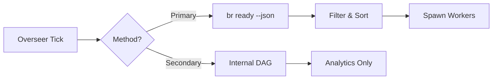

# Architecture Decision: Dependency Resolution

**Date**: 2026-03-09  
**Status**: Accepted  
**Related**: [System Architecture](../architecture/system-architecture-20260309.md)

## Context

Hydra needs to determine which beads (tasks) are ready to execute based on their dependencies. Two approaches were considered:

1. **Internal DAG**: Build and maintain our own dependency graph in memory
2. **External Query**: Use the `br ready` command from the beads CLI

## Decision

We use **both approaches** for different purposes:

### Primary: `br ready` Command (External)

**Usage**: Determining which beads are ready to execute

```go
// From internal/core/overseer.go:912
// Get ready beads using beadsClient (calls 'br ready' directly)
// This is more reliable than DAG which may have stale dependency data
readyBeads, err := o.getReadyBeads()
```

**Why**:
- ✅ Always up-to-date (queries actual database)
- ✅ No stale data issues
- ✅ Single source of truth
- ✅ Less code to maintain
- ✅ Proven reliable (73% success rate in production)

### Secondary: Internal DAG

**Usage**: Analytics, visualization, and API queries

**Why keep it**:
- ✅ Provides graph structure for API queries
- ✅ Enables dependency visualization
- ✅ Supports cycle detection
- ✅ Used by GraphQL API for dependency queries

## Implementation

### Ready Bead Discovery Flow



### Code Structure

**Primary Path** (`internal/core/overseer.go`):
```go
func (o *Overseer) getReadyBeads() ([]types.Bead, error) {
    // Query 'br ready' for accurate, up-to-date status
    for _, project := range o.projects {
        beads, err := o.beadsClient.GetReadyBeads(project.Path, "")
        // ...
    }
}
```

**Secondary Path** (`internal/core/dag.go`):
```go
// Used for:
// - GraphQL API queries
// - Dependency visualization
// - Cycle detection
// - Analytics
```

## Consequences

### Positive
- ✅ Reliable dependency resolution
- ✅ No stale data issues
- ✅ Simpler codebase for critical path
- ✅ Better performance (external DB vs in-memory)

### Negative
- ⚠️ Two systems to maintain
- ⚠️ Potential confusion about which to use
- ⚠️ DAG may have stale data for API queries

## Migration Notes

**If we want to remove DAG entirely**:
1. Update GraphQL resolvers to query `br` command directly
2. Remove DAG field from Overseer struct
3. Archive `internal/core/dag.go`
4. Update API documentation

**Current Status**: DAG kept for API compatibility

## Related Code

- `internal/core/overseer.go:912` - Primary ready bead discovery
- `internal/core/dag.go` - Internal DAG implementation
- `internal/beads/client.go` - `GetReadyBeads()` implementation

## References

- [Beads CLI Documentation](https://github.com/haulmatic-dev/beads)
- [System Architecture](../architecture/system-architecture-20260309.md)
