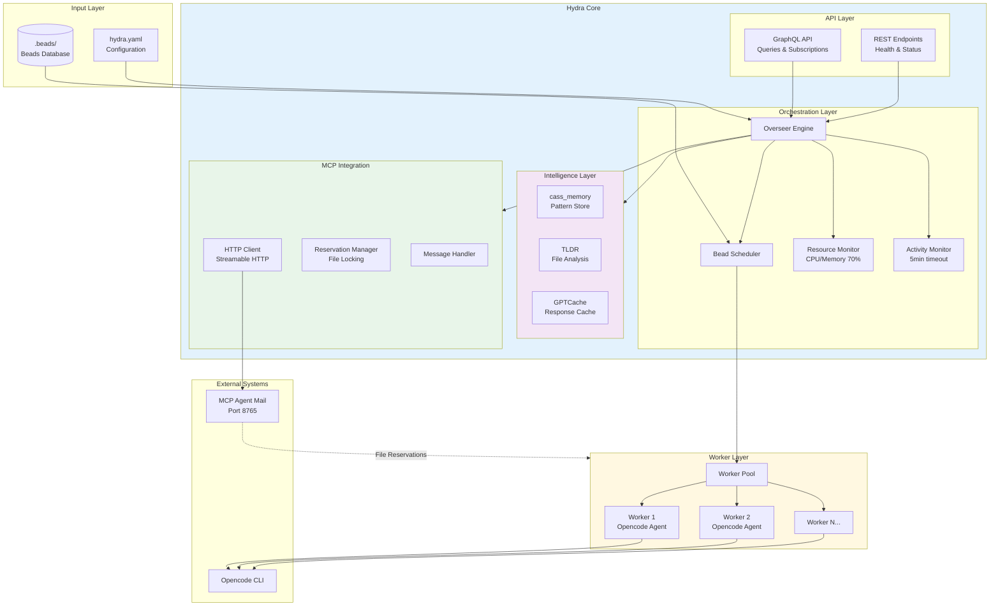
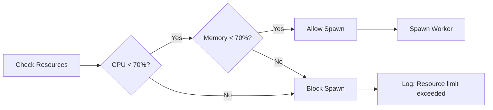
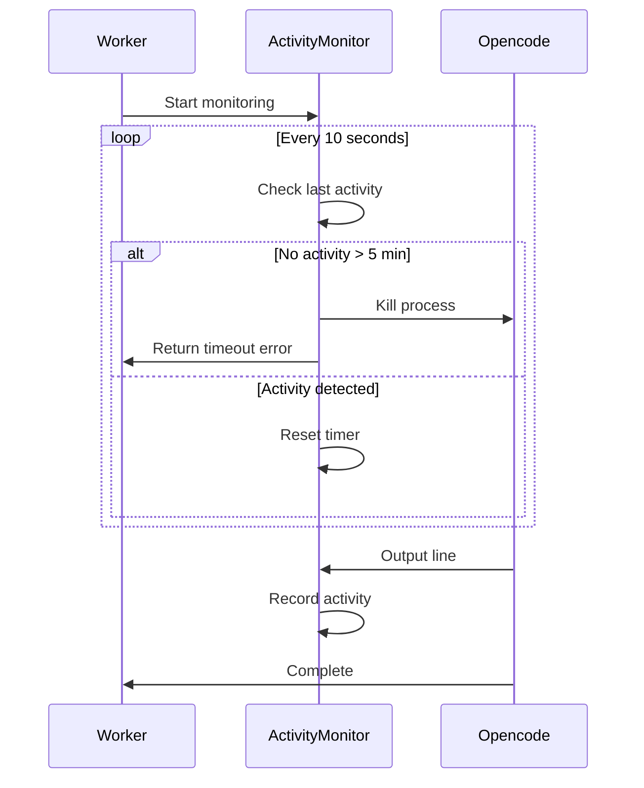
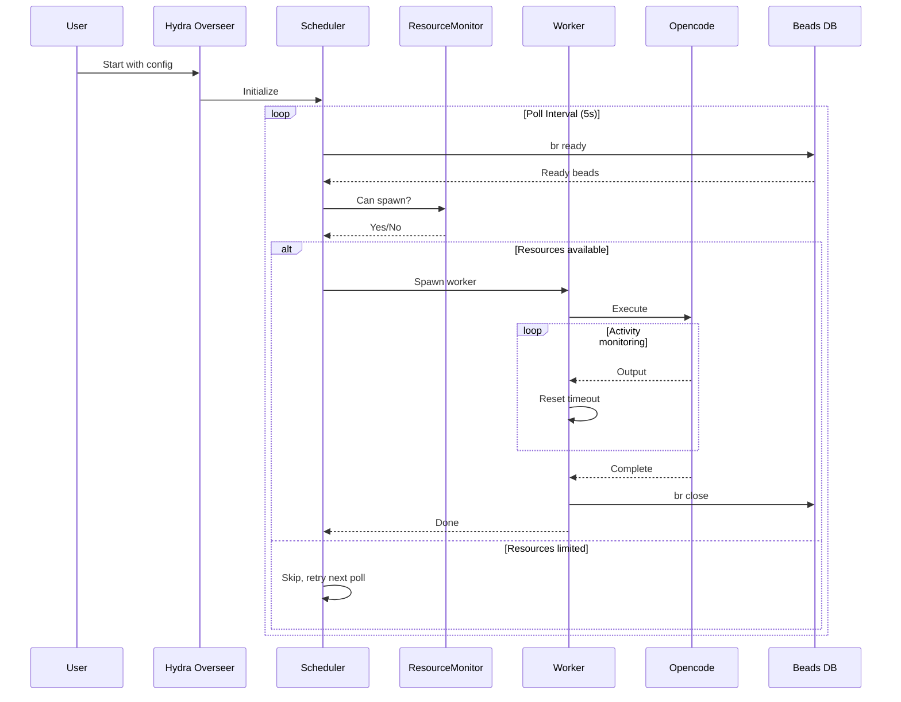

# System Architecture

**Date**: 2026-03-09  
**Status**: Current  
**Related**: [Worker Lifecycle](./worker-lifecycle-20260309.md), [Bead Processing Flow](./bead-processing-flow-20260309.md)

## Overview

Hydra follows a modular, event-driven architecture with clear separation of concerns between the orchestration layer, intelligence services, and ephemeral workers.

## High-Level Architecture

## Component Details

### 1. API Layer

**GraphQL API** (`internal/api/`)
- Queries: beads, workers, status
- Subscriptions: real-time updates (TODO)
- Mutations: control operations

**REST Endpoints** (`internal/api/handlers.go`)
- `/health/liveness` - Health check
- `/health/readiness` - Ready state
- `/metrics` - Prometheus metrics (TODO)

### 2. Orchestration Layer

**Overseer** (`internal/core/overseer.go`)
- Central coordination hub
- Manages worker lifecycle
- Handles configuration
- Coordinates intelligence services

**Scheduler** (`internal/core/overseer.go`)
- Polls for ready beads (`br ready`)
- Maintains worker pool
- Enforces max_workers limit
- Respects dependency chains

**Resource Monitor** (`internal/core/resource_monitor.go`)

- Monitors CPU using `top` (cross-platform)
- Monitors Memory using `free` (Linux) or `vm_stat` (macOS)
- Blocks worker spawn when limits exceeded
- Platform-agnostic (standard Unix commands)

**Activity Monitor** (`internal/core/activity_monitor.go`)

- Tracks stdout/stderr output
- Resets timeout on every line
- Kills process after 5 minutes of inactivity
- Prevents killing slow-but-active workers

### 3. Intelligence Layer

**cass_memory** (`internal/intelligence/cass_memory.go`)
- Pattern storage and retrieval
- Historical execution context
- Anti-pattern detection

**TLDR** (`internal/intelligence/tldr.go`)
- File impact analysis
- Dependency mapping
- Token optimization

**GPTCache** (`internal/intelligence/gptcache.go`)
- Response caching
- Cost optimization
- Rate limiting

### 4. MCP Integration

**HTTP Client** (`internal/mcp/http_client.go`)
- Streamable HTTP protocol (not WebSocket)
- Connection to port 8765
- JSON-RPC message format
- Auto-reconnection

**Reservation Manager** (`internal/mcp/reservation.go`)
- File locking mechanism
- Prevents concurrent edits
- TTL-based reservations

### 5. Worker Layer

**Worker Pool** (`cmd/worker/main.go`)
- Ephemeral workers
- One worker per bead
- Isolated environments
- Automatic cleanup

**Opencode Integration**
- Executes AI prompts
- Streams output to MCP
- Reports completion status
- Handles timeouts

## Data Flow

## Design Principles

1. **Resilience**: Workers are ephemeral and disposable
2. **Observability**: All components log extensively
3. **Resource Awareness**: Respects system limits
4. **Protocol Compliance**: Standard HTTP for MCP
5. **Cross-Platform**: Unix commands only, no external deps

## Related Documentation

- [Worker Lifecycle](./worker-lifecycle-20260309.md) - Detailed worker state machine
- [Bead Processing Flow](./bead-processing-flow-20260309.md) - End-to-end execution flow
- [Configuration Guide](../operations/configuration-guide-20260309.md) - Setup and tuning
