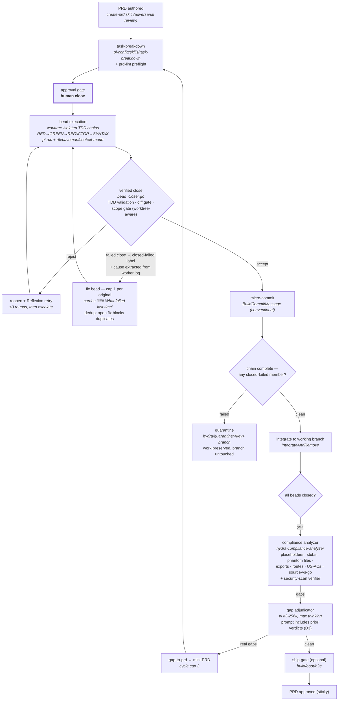
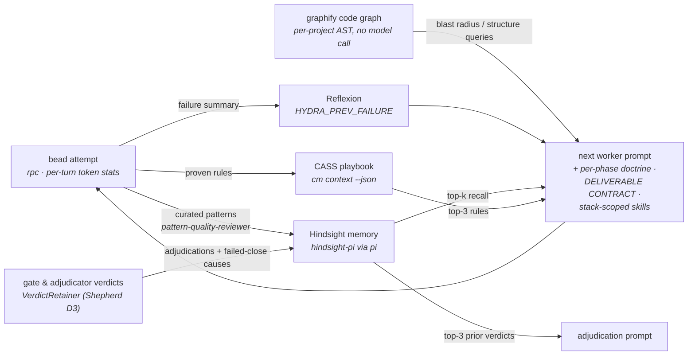
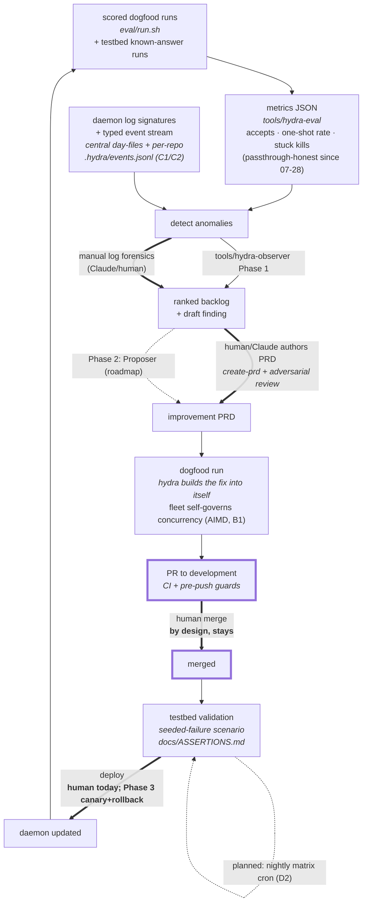

# Hydra System Loop — Process Flow & Loop-Closure Map

**Status:** living document · **Updated:** 2026-07-30

Hydra is three nested loops. Each subsection shows the flow, which component
implements each edge, and whether the edge is **automated**, **planned**, or
**deliberately human**. The compounding claim is only honest if every loop's
exit feeds a later iteration's input — the closure table at the end audits
exactly that.

Legend (all diagrams): solid = automated today · dashed = planned (PRD exists)
· thick = human-by-design.

Companion operational reference: [`shepherd.md`](shepherd.md) — the event
stream, quarantine, fix-bead lifecycle, concurrency governor, and verdict
memory that this page references.

---

## 1. Inner loop — Build (per PRD, bounded by `max_cycles`)

Bounded: the analyzer→gap-to-prd→task-breakdown cycle stops at `max_cycles`
(default 2) or when the gap set stops shrinking (progress-delta). Fix-bead
recursion caps at one level (`fix-recursion-capped` label marks the refusal).

**Known gap (2026-07-30, run D3 evidence):** the compliance gate closed clean
on a run whose working branch contained zero integrated code — the analyzer's
verdict is not yet derived from repo state. State-based gate truth is the next
A-track item.

---

## 2. Middle loop — Learning (per worker prompt, compounds across runs)

Every edge automated. This is the per-run compounding: each attempt makes the
next attempt's prompt smarter, and — since D3 — each *judgment* (gate
rejection cause, adjudicator verdict with reasoning) is retained instead of
evaporating. `ambiguous` verdicts and cause-less failures are deliberately not
retained: an unsure judgment is noise, not memory.

**This loop fails silently, and that is its most dangerous property.** On
2026-07-27 a one-line change to Hindsight recall switched the entire read path
off for every worker, and nothing in the system noticed. The recall API returned
HTTP 200 with an empty result set, so workers logged the routine `No relevant
memories found` and carried on with no prior experience. Beads still closed,
gates still passed, metrics still looked healthy — the run simply stopped
compounding. It was caught only by comparing worker logs either side of the
deploy: every worker before it logged `Retrieved 5 relevant memories`, every
worker after logged none.

Two structural lessons for anyone touching this loop:

1. **An empty recall is indistinguishable from a working recall** unless someone
   compares across runs. There is no gate on "did the worker actually receive
   memories," the way `RequireDiffOnClose` gates real code changes. Until there
   is, a recall regression can survive indefinitely.
2. **Correcting a wrong parameter name is not a safe rename.** The old code sent
   the bead type as `type`, which the API ignored; renaming it to the real
   `types` turned an inert parameter into an enforced filter, and bead types
   match none of Hindsight's memory kinds (`experience`, `observation`, `world`).
   The behaviour depended on being ignored.

Recall latency is 3.4–4.0s measured against the live service, so any client
built without an explicit timeout above that fails 100% of the time — also
silently. The default is now 10s for that reason.

---

## 3. Outer loop — Meta (self-improvement; the loop that builds Hydra)

Since 2026-07-29 the working practice is a **single long-lived branch**
(`feat/shepherd` era): work is committed and deployed from the branch, and PRs
are raised from it when a unit completes — review does not block the loop,
because prod is ahead of the PR, not behind it.

---

## Loop-closure audit (is it a closed, compounding system?)

| Loop | Closed? | Compounds via | Manual links | Mechanization plan |
|---|---|---|---|---|
| Inner (build) | ✅ closed, bounded (cycles 2, fix-cap 1) | gap beads fix the same PRD's deficits within the run | approval gate (by design) | ✅ A1 quarantine + A2 cause-aware fix beads shipped 07-29 · next: state-based gate truth, pathology brake (B2) |
| Middle (learning) | ✅ closed, verified live | CASS rules + Hindsight memories + Reflexion + code graph persist across runs; ✅ verdicts retained since 07-30 (D3) | none | recall-liveness gate (the silent-failure class) |
| Outer (meta) | ✅ topology closed; cadence human | every merged improvement changes the daemon that runs the next loop | PRD authoring · merge (by design) | Observer shipped · Proposer (roadmap) · shepherd cron (D1) · nightly matrix (D2) |

**Resilience note (2026-07-27):** a daemon restart used to orphan in-flight
beads permanently — Charon's recovery was unreachable whenever no workers were
tracked, which is precisely when orphans exist. That is fixed: recovery now
runs every cleanup cycle and **reopens** orphaned beads. A mid-run restart is
survivable and has been survived four times in production since.

**Verdict:** the system is a closed compounding loop at the topology level —
each loop's output verifiably feeds a later iteration's input, including (since
D3) its own judgments. Cadence of the outer loop is human-limited at two links;
merge is *kept* human as the safety invariant (roadmap:
`self-improvement-loop.md`).

## Evidence that compounding is real (measured, not asserted)
- Gate fix (#65): empty-diff rejections 21 → 0, one-shot accepts 0 → 14 —
  detected by outer loop, fixed via inner loop, verified by `hydra-eval`.
- Anti-consultant doctrine (#56): 0 accepts → 13 accepts between consecutive
  scored runs of the same PRD.
- 9 → 3 divergent implementations across dogfood runs 4→6 after
  Reflexion + CASS injection (middle loop).
- Fix-bead churn against a seeded guaranteed failure: 158 → 25, zero nested
  (was 3-deep), refusals labelled (07-28, testbed).
- Fleet freeze on transient 429s: 15m → 0 across a 219-hang provider storm
  (exit-7 classification, 07-28).
- Hydra built its own AIMD concurrency governor in one dogfood run (B1: 36
  beads, 3 gates closed, harvested and deployed same day, 07-29).
- 26/26 fix beads in run B1 carried their predecessor's failure cause (A2).
