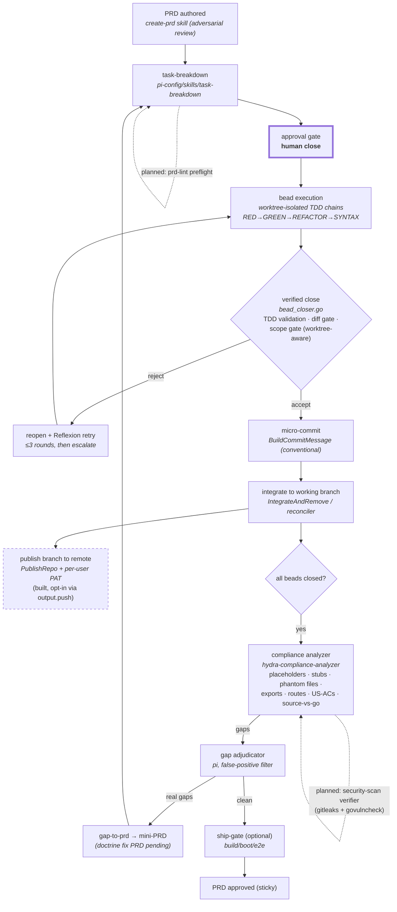
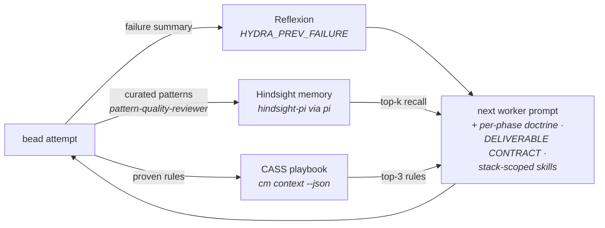
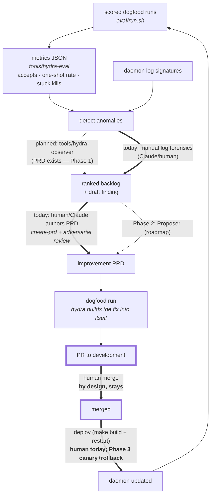

# Hydra System Loop — Process Flow & Loop-Closure Map

**Status:** living document · **Updated:** 2026-07-24

Hydra is three nested loops. Each subsection shows the flow, which component
implements each edge, and whether the edge is **automated**, **planned**, or
**deliberately human**. The compounding claim is only honest if every loop's
exit feeds a later iteration's input — the closure table at the end audits
exactly that.

Legend (all diagrams): solid = automated today · dashed = planned (PRD exists)
· thick = human-by-design.

---

## 1. Inner loop — Build (per PRD, bounded by `max_cycles`)

Bounded: the analyzer→gap-to-prd→task-breakdown cycle stops at `max_cycles`
or when the gap set stops shrinking (progress-delta).

---

## 2. Middle loop — Learning (per worker prompt, compounds across runs)

Every edge automated. This is the per-run compounding: each attempt makes the
next attempt's prompt smarter.

**Known leak:** gate and adjudicator *decisions* (why closes were rejected,
which gaps were false positives) are not fed back into CASS/Hindsight — only
worker-level patterns are. The richest judgment data in the system currently
evaporates.

---

## 3. Outer loop — Meta (self-improvement; the loop that builds Hydra)

---

## Loop-closure audit (is it a closed, compounding system?)

| Loop | Closed? | Compounds via | Manual links | Mechanization plan |
|---|---|---|---|---|
| Inner (build) | ✅ closed, bounded | gap beads fix the same PRD's deficits within the run | approval gate (by design) | prd-lint preflight + security-scan verifier + gap-to-prd doctrine (PRDs exist) harden edges |
| Middle (learning) | ✅ closed | CASS rules + Hindsight memories + Reflexion persist across runs | none | leak to fix: feed gate/adjudicator verdicts into CASS/Hindsight |
| Outer (meta) | ✅ topology closed; cadence human | every merged improvement changes the daemon that runs the next loop | detect/diagnose · PRD authoring · merge+deploy | Observer (PRD exists) → Proposer (roadmap) → merge stays human; deploy gains canary+rollback (roadmap Phase 3) |

**Resilience note (2026-07-27):** a daemon restart used to orphan in-flight
beads permanently — Charon's recovery was unreachable whenever no workers were
tracked, which is precisely when orphans exist. That is fixed: recovery now
runs every cleanup cycle and **reopens** orphaned beads (it previously
force-closed them, silently unblocking dependents on unfinished work). A
mid-run restart is therefore survivable, and worth testing deliberately.

**Verdict:** the system is a closed compounding loop at the topology level —
each loop's output verifiably feeds a later iteration's input. Cadence of the
outer loop is currently human-limited at three links; the Observer and
Proposer phases exist precisely to mechanize the first two. The merge link is
*kept* human as the safety invariant (roadmap: `self-improvement-loop.md`).

## Evidence that compounding is real (measured, not asserted)
- Gate fix (#65): empty-diff rejections 21 → 0, one-shot accepts 0 → 14 —
  detected by outer loop, fixed via inner loop, verified by `hydra-eval`.
- Anti-consultant doctrine (#56): 0 accepts → 13 accepts between consecutive
  scored runs of the same PRD.
- 9 → 3 divergent implementations across dogfood runs 4→6 after
  Reflexion + CASS injection (middle loop).
