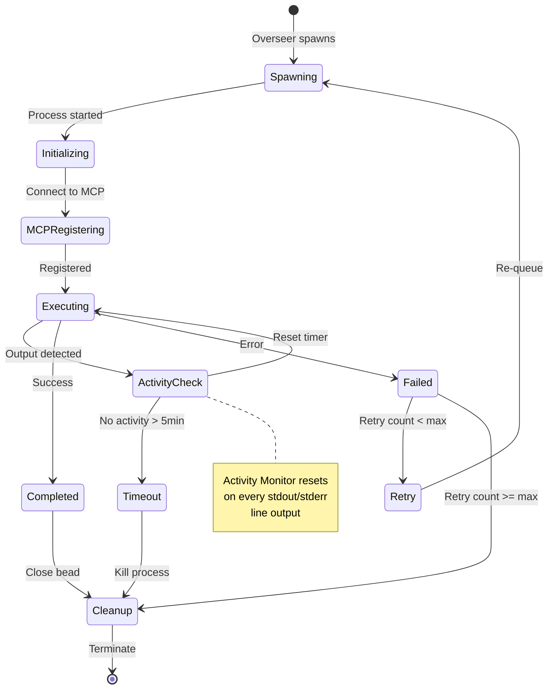
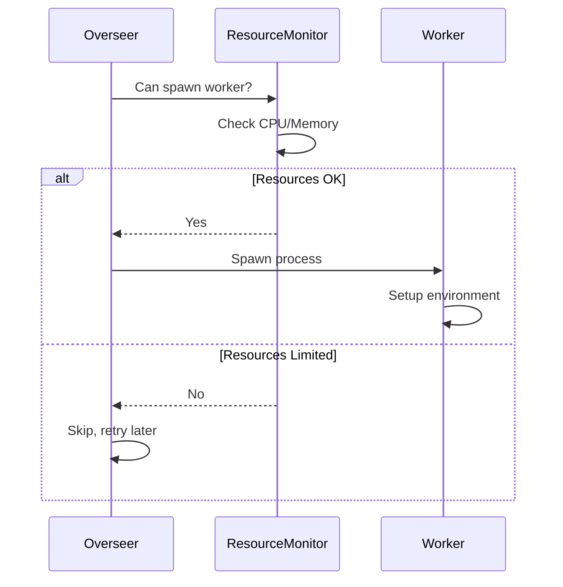
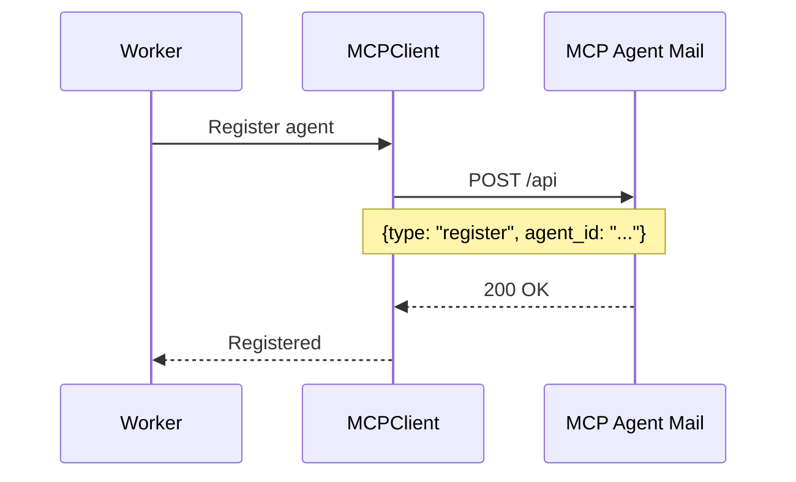
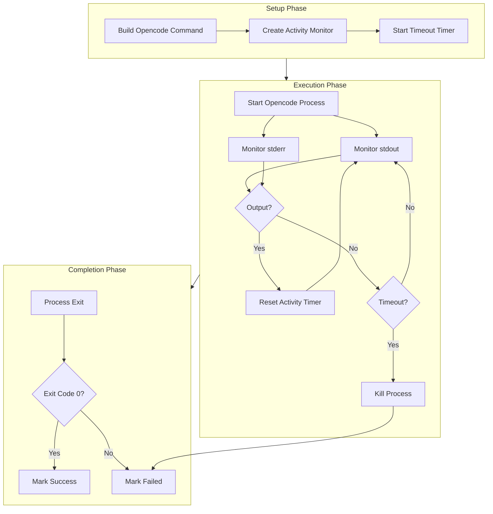
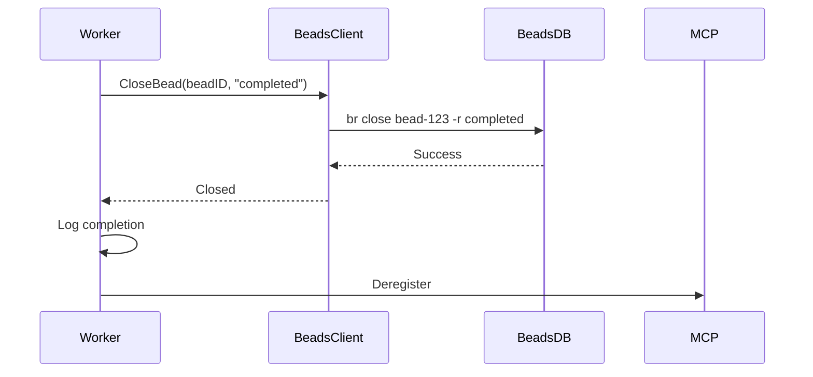
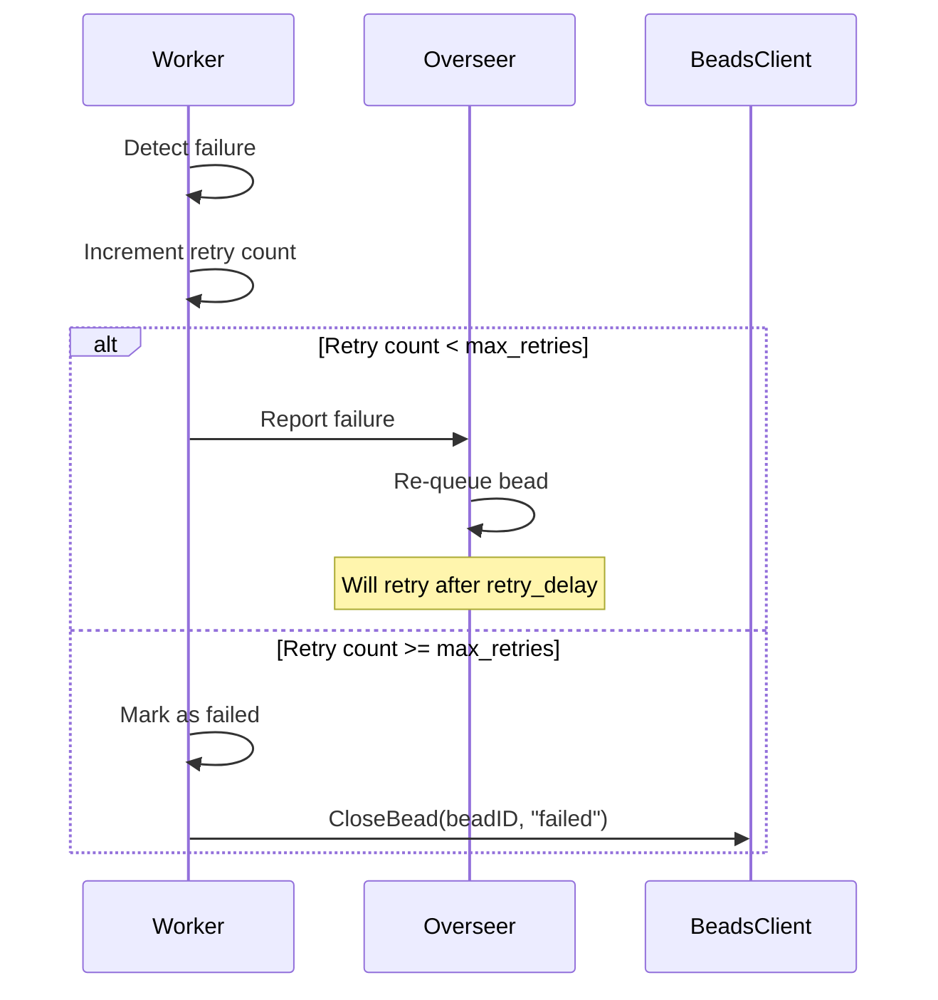
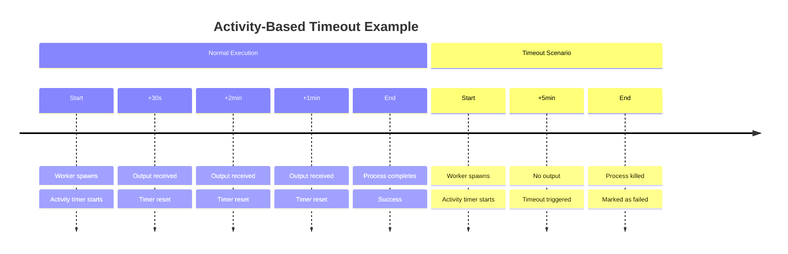

# Worker Lifecycle

**Date**: 2026-03-09  
**Status**: Current  
**Related**: [System Architecture](./system-architecture-20260309.md), [Bead Processing Flow](./bead-processing-flow-20260309.md)

## Overview

Workers in Hydra are ephemeral processes that execute a single bead (task) and then terminate. This document describes the complete lifecycle of a worker from spawn to completion.

## Worker State Machine



## Lifecycle Phases

### 1. Spawning

**Triggered By**: `Overseer.tick()` when ready beads available and resources permit



**Environment Variables**:
```bash
HYDRA_BEAD_ID=bead-123
HYDRA_PROJECT=my-project
HYDRA_PROJECT_PATH=/path/to/project
HYDRA_REPO=main
HYDRA_AGENT_TYPE=orchestrator
HYDRA_BEAD_TITLE="Implement feature"
HYDRA_BEAD_DESCRIPTION="Detailed description"
```

### 2. Initialization

**Duration**: ~100ms

The worker performs the following setup:

1. **Parse Configuration** (`cmd/worker/main.go`):
   ```go
   config := parseConfig() // From env vars
   bead := createBead(config)
   ```

2. **Initialize Intelligence Context**:
   ```go
   intelligenceCtx := &IntelligenceContext{
       CassMemoryEnabled: config.MCP.CassMemoryEnabled,
       GPTCacheEnabled:   config.MCP.GPTCacheEnabled,
       // ...
   }
   ```

3. **Connect to MCP** (if enabled):
   ```go
   mcpClient := initializeMCP(config)
   ```

### 3. MCP Registration

**Protocol**: HTTP POST to MCP Agent Mail



**Registration Payload**:
```json
{
  "type": "register",
  "agent_id": "hydra-worker-abc123",
  "bead_id": "bead-123",
  "project": "my-project",
  "timestamp": "2026-03-09T10:00:00Z"
}
```

### 4. Execution with Activity Monitoring

**Core Logic** (`cmd/worker/main.go`):



**Activity Monitor Implementation**:
```go
type ActivityMonitor struct {
    lastActivity time.Time
    timeout      time.Duration  // 5 minutes
}

func (am *ActivityMonitor) RecordActivity() {
    am.mu.Lock()
    defer am.mu.Unlock()
    am.lastActivity = time.Now()
}

func (am *ActivityMonitor) IsTimedOut() bool {
    return time.Since(am.lastActivity) > am.timeout
}
```

**Monitoring Goroutines**:
```go
// Monitor stdout
go func() {
    scanner := bufio.NewScanner(stdoutPipe)
    for scanner.Scan() {
        activityMonitor.RecordActivity()
        streamToMCP(scanner.Text())
    }
}()

// Monitor stderr
go func() {
    scanner := bufio.NewScanner(stderrPipe)
    for scanner.Scan() {
        activityMonitor.RecordActivity()
        streamToMCP(scanner.Text())
    }
}()
```

### 5. Resource Monitoring During Execution

While executing, the worker doesn't actively monitor resources - that's the overseer's job. The overseer ensures new workers aren't spawned if resources are constrained.

However, the worker does:
- Stream logs to MCP
- Report progress
- Handle signals

### 6. Completion

**Success Path**:


**Failure Path** (Retry eligible):


### 7. Cleanup

**Always Executed** (defer statements):

```go
defer func() {
    // 1. Deregister from MCP
    if mcpClient != nil {
        mcpClient.Deregister(metadata)
    }
    
    // 2. Release file reservations
    if reservationMgr != nil {
        reservationMgr.ReleaseAll()
    }
    
    // 3. Close log streams
    if logStream != nil {
        logStream.Close()
    }
    
    // 4. Exit with appropriate code
    os.Exit(exitCode)
}()
```

## Timeout Handling

### Activity-Based Timeout (Primary)



**Why Activity-Based?**
- Some beads take 2-3 minutes to complete
- Fixed timeout (e.g., 2 min) would kill valid work
- Activity-based allows long-running but active workers
- Prevents stuck/deadlocked workers

### Configuration

```yaml
overseer:
  # Activity-based timeout: 5 minutes of inactivity
  # This is hardcoded in worker, not configurable
  # (can be made configurable if needed)
```

## Retry Logic

### Retry Eligibility

A worker can be retried if:
1. Exit code ≠ 0 (failed)
2. Retry count < max_retries
3. Not explicitly cancelled

### Retry Flow

```mermaid
stateDiagram-v2
    [*] --> FirstAttempt: Initial spawn
    FirstAttempt --> Success: Exit 0
    FirstAttempt --> Failure: Exit != 0
    
    Failure --> RetryCheck{Retry < max?}
    RetryCheck --> SecondAttempt: Yes
    RetryCheck --> PermanentFailure: No
    
    SecondAttempt --> Success: Exit 0
    SecondAttempt --> Failure2: Exit != 0
    
    Failure2 --> RetryCheck2{Retry < max?}
    RetryCheck2 --> ThirdAttempt: Yes (if max > 2)
    RetryCheck2 --> PermanentFailure: No
    
    PermanentFailure --> [*]
    Success --> [*]
```

### Backoff Strategy

Current implementation uses fixed delay:
```yaml
overseer:
  retry_delay: 5s  # Fixed delay between retries
```

**Future Enhancement**: Exponential backoff
```
Retry 1: 5s delay
Retry 2: 10s delay
Retry 3: 20s delay
...
```

## Worker State Tracking

The overseer maintains worker state in memory:

```go
type Worker struct {
    ID          string
    BeadID      BeadID
    PID         int
    AgentType   AgentType
    StartTime   time.Time
    Status      string  // running, completed, failed
    ProjectPath string
}
```

**Active Workers Map**:
```go
activeWorkers map[string]*Worker  // beadID -> Worker
```

## Common Issues

### 1. Workers Timeout Despite Being Active

**Symptom**: Workers killed after 5 minutes even though opencode is still running.

**Cause**: Output buffering - opencode not flushing stdout/stderr.

**Solution**: Already handled by line-by-line scanning with bufio.Scanner.

### 2. Resource Starvation

**Symptom**: No new workers spawning despite ready beads available.

**Cause**: CPU or Memory > 70%.

**Solution**: Check resource usage:
```bash
# Check current usage
top -l 1 | grep "CPU usage"
vm_stat | awk '/Pages free/ {free=$3} /Pages active/ {active=$3} END {print "Memory active: " (active/(active+free))*100 "%"}'
```

### 3. MCP Connection Failures

**Symptom**: Workers fail to register with MCP.

**Cause**: 
- MCP Agent Mail not running
- Wrong URL/port
- Network issues

**Solution**: Check MCP status:
```bash
pm2 status
curl http://127.0.0.1:8765/health/liveness
```

## Performance Characteristics

| Metric | Typical Value |
|--------|---------------|
| Spawn Time | ~100-200ms |
| Initialization | ~50-100ms |
| MCP Registration | ~50-200ms |
| Execution | 30s - 3min |
| Cleanup | ~20-50ms |
| **Total Lifecycle** | **31s - 3.5min** |

## Related Documentation

- [System Architecture](./system-architecture-20260309.md) - High-level design
- [Bead Processing Flow](./bead-processing-flow-20260309.md) - End-to-end execution
- [Configuration Guide](../operations/configuration-guide-20260309.md) - Tuning worker settings
- [Troubleshooting](../operations/troubleshooting-20260309.md) - Debugging worker issues
