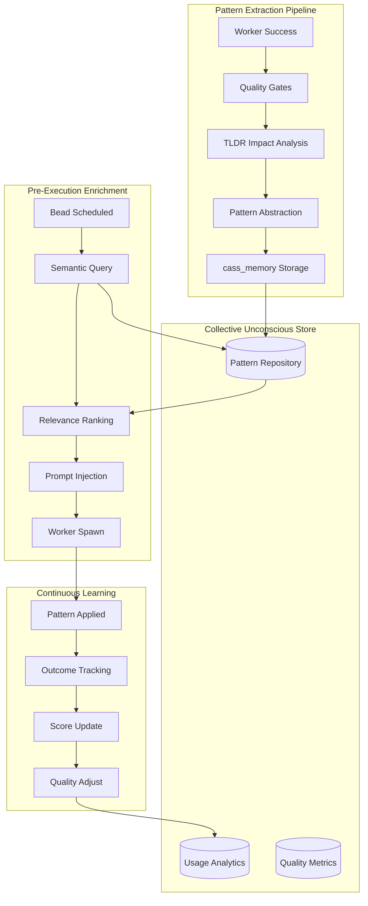

# Product Requirements Document: Collective Unconscious

**Project**: Hydra Orchestrator  
**Feature**: Cross-Project Pattern Learning & Enrichment  
**Version**: 1.0  
**Status**: Draft  
**Date**: 2026-03-10  
**Author**: AI Agent (Claude Code)  

---

## 1. Executive Summary

The Collective Unconscious is a cross-project pattern learning and enrichment system that transforms Hydra from a task orchestrator into a continuously learning organism. When beads complete successfully (post-quality gates), the system extracts semantic patterns from the solution and stores them in a shared knowledge base. New beads receive relevant patterns from similar tasks across all projects, dramatically improving agent effectiveness.

**Key Innovation**: Unlike existing project-isolated learning (cass_memory), patterns transcend project boundaries. A database migration pattern learned in Project A automatically becomes available to Project B's agents.

---

## 2. Problem Statement

### Current State
Hydra's existing intelligence layer (cass_memory) stores patterns locally within each project. Agents working on Project A cannot benefit from solutions found in Project B, even when solving identical problems.

**Impact**:
- Agents repeatedly solve the same problems across projects
- No compounding intelligence - each project learns in isolation
- Knowledge silos prevent organization-wide improvement
- Anti-patterns discovered in one project spread to others

### Success Criteria
- **≥40% reduction** in time-to-completion for similar tasks across projects
- **≥90% adoption rate** of suggested patterns when confidence >0.85
- **<2% false positive rate** for pattern suggestions
- **Zero security incidents** from extracted patterns

---

## 3. Proposed Solution

### 3.1 System Architecture



### 3.2 Key Components

#### 3.2.1 Pattern Extractor Service
**Location**: `internal/intelligence/pattern_extractor.go`

**Responsibilities**:
- Trigger on configurable events (on_merge, on_close, on_approval)
- Analyze code changes using TLDR
- Extract multi-level pattern abstractions (code, approach, concept)
- Validate against quality gates before storage
- Store in cass_memory with cross-project tags

**Interface**:
```go
type PatternExtractor interface {
    Extract(ctx context.Context, bead types.Bead, result ExecutionResult) (*Pattern, error)
    ValidateQuality(pattern *Pattern) error
    Store(ctx context.Context, pattern *Pattern) error
}
```

#### 3.2.2 Pattern Matcher Service
**Location**: `internal/intelligence/pattern_matcher.go`

**Responsibilities**:
- Query collective unconscious before bead execution
- Calculate multi-factor relevance scores
- Rank patterns by applicability
- Block execution on query failure (configurable)
- Cache frequently accessed patterns

**Matching Algorithm**:
```
Relevance Score = 
  0.35 × SemanticSimilarity +
  0.25 × SuccessRate +
  0.15 × Recency +
  0.15 × UsageFrequency +
  0.10 × ContextMatch
```

#### 3.2.3 Worker Prompt Enhancement
**Location**: `cmd/worker/main.go`

**Modification**: Extend `buildOpencodeCommand()` to include pattern context:

```go
func buildOpencodeCommand(bead types.Bead, patterns []Pattern) *exec.Cmd {
    promptParts := []string{
        fmt.Sprintf("%s: %s", bead.Type, bead.Title),
        bead.Description,
    }
    
    if len(patterns) > 0 {
        promptParts = append(promptParts, "\n## Relevant Patterns from Previous Work:\n")
        for i, p := range patterns {
            if i >= 3 { break }
            promptParts = append(promptParts, formatPattern(p))
        }
    }
    
    // ... existing prompt building
}
```

---

## 4. Functional Requirements

### 4.1 Pattern Extraction

**FR-001: Extraction Trigger Points**
- Must support configurable triggers: `on_completion`, `on_merge`, `on_approval`, `on_settled`
- Default: `on_settled` (multi-signal settling detection)
- Must verify all quality gates pass before extraction

**FR-001a: Settled-State Detection (NEW)**
- Must detect when a bead is truly immutable and safe to extract from
- Must support multiple settling signals (deterministic OR logic):
  - **Signal 1 - Git Merge**: Git webhook detects merge to main branch (immutable)
  - **Signal 2 - DAG Stability**: Bead terminal + all dependents terminal + settling window elapsed
  - **Signal 3 - Explicit Finalization**: User marks bead as finalized via CLI/UI
  - **Signal 4 - Time-Based**: Bead closed for minimum settling period (default: 7 days)
- Must track: last status change timestamp, reopen history, dependent status
- Must NOT extract from beads that: were reopened recently, have non-terminal dependents, or haven't met settling window

**FR-001b: Settling Monitor**
- Must periodically scan closed beads for settling (every settling_check_interval)
- Must maintain: settled_beads index to avoid re-checking
- Must be deterministic: same bead state always produces same settling decision

**FR-002: Multi-Level Abstraction**
- Level 1 (Concrete): Specific file paths, exact code changes
- Level 2 (Approach): Strategy used, libraries involved, testing approach
- Level 3 (Conceptual): Problem category, design patterns, architectural decisions
- Must store all three levels for flexible matching

**FR-003: Quality Gate Validation**
- Must pass static analysis (cyclomatic complexity < 10)
- Must have ≥80% test coverage
- Must pass security scan (no secrets, vulnerabilities)
- Must receive human review approval for cross-project sharing
- Quality threshold: ≥0.75 aggregate score

**FR-004: Provenance Tracking**
- Must record: source repository, commit hash, extraction timestamp
- Must track: author attribution, license information, modification history
- Must support: pattern lineage (parent/child relationships)

### 4.2 Pattern Storage

**FR-005: Cross-Project Tagging**
- Must tag patterns with: technology stack, domain, architectural layer
- Must support: language-agnostic concepts with framework mappings
- Must enable: filtering by project type, complexity, success rate

**FR-006: Usage Analytics**
- Must track: application count, success rate, time-to-completion
- Must record: failure reasons, adaptations made, user feedback
- Must support: A/B testing framework for pattern effectiveness

**FR-007: Pattern Lifecycle Management**
- States: Candidate → Pending Review → Experimental → Stable → Deprecated
- **Pending Review state**: All extracted patterns start here for human validation
- Auto-promote to Experimental after human approval OR auto-approve if quality_score > 0.90
- Auto-promote to Stable after >100 successful applications with >95% success rate
- Auto-deprecate if success rate drops below 85% or negative feedback >20%
- **Discarded state**: Rejected patterns marked as discarded, kept for audit but never suggested

**FR-007a: Review & Discard Workflow (NEW)**
- All extracted patterns enter "Pending Review" state before being available for matching
- Review criteria (any can trigger discard):
  - Quality score below threshold (default: 0.75)
  - Security scan failures (secrets, vulnerabilities)
  - License incompatibility
  - Human reviewer marks as "not reusable" or "too specific"
  - Pattern similarity to existing patterns (duplicate detection)
- **Discard reasons must be categorized**: low_quality, security_risk, not_reusable, duplicate, license_issue, other
- **Discarded patterns**: Not deleted, moved to "discarded" collection with full audit trail
- **Appeal process**: Authors can appeal discard decisions with justification
- **Bulk operations**: Admins can bulk approve/review patterns based on filters

**FR-007b: Automatic Discard Triggers (NEW)**
- Auto-discard if: quality_score < 0.50 (too low to be useful)
- Auto-discard if: 3+ security scan failures
- Auto-discard if: duplicate of existing pattern with >95% similarity
- Auto-discard if: no tests, no documentation, no clear problem statement

### 4.3 Pattern Matching

**FR-008: Semantic Query**
- Must support: natural language search across pattern descriptions
- Must use: multi-factor relevance scoring (semantic + behavioral + contextual)
- Must return: top 3 patterns with confidence scores

**FR-009: Blocking on Failure**
- Must block execution if pattern lookup fails and `block_on_failure: true`
- Must log detailed error for debugging
- Must support: graceful degradation with empty patterns if configured

**FR-010: Caching Strategy**
- Must cache: frequently accessed patterns in-memory
- TTL: 5 minutes for pattern cache, 1 hour for semantic index
- Must invalidate: cache on pattern updates

### 4.4 Prompt Enrichment

**FR-011: Pattern Presentation**
- Must format patterns with: problem statement, solution approach, key insights
- Must include: confidence score, success rate, source project
- Must limit: to top 3 patterns to avoid prompt bloat

**FR-012: Anti-Pattern Awareness**
- Must include: relevant anti-patterns to avoid
- Must track: patterns that failed and why
- Must prevent: suggestion of known-bad patterns

### 4.5 Feedback Loop

**FR-013: Outcome Tracking**
- Must record: whether suggested pattern was used, modified, or ignored
- Must track: task completion success/failure with pattern
- Must measure: time delta with vs without pattern

**FR-014: Continuous Score Updates**
- Must adjust: pattern relevance scores based on outcomes
- Formula: Success adds +0.02, failure subtracts -0.05
- Must decay: old patterns exponentially (λ = 0.01/day)

**FR-015: Developer Feedback**
- Must support: post-task thumbs up/down on pattern usefulness
- Must collect: free-form feedback on pattern quality
- Must weight: explicit feedback 2× implicit usage metrics

---

## 5. Non-Functional Requirements

### 5.1 Performance

**NFR-001: Extraction Latency**
- Pattern extraction must complete within 5 seconds of trigger
- TLDR impact analysis must timeout after 10 seconds
- Must not block worker termination on extraction

**NFR-002: Query Latency**
- Pattern lookup must complete within 500ms
- Must support: 50 concurrent queries without degradation
- Cache hit rate target: ≥80%

**NFR-003: Storage Efficiency**
- Maximum pattern size: 10KB (compressed)
- Must support: 100,000 patterns without performance degradation
- Must compress: embeddings using quantization (768-dim → 96-dim)

### 5.2 Reliability

**NFR-004: Graceful Degradation**
- If cass_memory unavailable: continue with empty patterns, log warning
- If TLDR unavailable: skip impact analysis, proceed with basic extraction
- If pattern matcher fails: block execution (configurable)

**NFR-005: Data Consistency**
- Pattern storage must be atomic (all-or-nothing)
- Must support: retry with exponential backoff on storage failures
- Must maintain: eventual consistency across distributed cache

**NFR-006: Circuit Breaker**
- Must implement: circuit breaker for cass_memory calls
- Threshold: 50% error rate in 60-second window
- Recovery: 30-second cooldown, then limited test requests

### 5.3 Security

**NFR-007: Pattern Sanitization**
- Must scan: extracted patterns for secrets/credentials (gitleaks, truffleHog)
- Must remove: PII, hardcoded IPs/URLs, environment-specific paths
- Must validate: no SQL injection, XSS, or other vulnerability patterns

**NFR-008: Access Control**
- Must respect: project-level privacy settings
- Must support: opt-in/opt-out for cross-project sharing
- Must audit: all pattern access with user attribution

**NFR-009: License Compliance**
- Must check: source code licenses before extraction
- Must propagate: attribution and license requirements
- Must exclude: GPL/AGPL patterns from proprietary projects

### 5.4 Scalability

**NFR-010: Horizontal Scaling**
- Must support: multiple Hydra instances sharing pattern store
- Pattern store must use: distributed database (PostgreSQL with pgvector)
- Must shard: by pattern category for parallel processing

**NFR-011: Incremental Indexing**
- Must update: semantic search index incrementally
- Must support: background reindexing without downtime
- Must optimize: embedding storage with vector compression

---

## 6. User Interface

### 6.1 Developer Experience

**UI-001: Pattern Visibility**
- Developers see: which patterns were suggested and why
- CLI: `hydra patterns show <bead-id>` displays matched patterns
- Web UI: Pattern match explanation with confidence breakdown

**UI-002: Pattern Contribution**
- Developers can: flag patterns as helpful/unhelpful
- CLI: `hydra patterns feedback <pattern-id> --rating 5`
- Must acknowledge: contributor attribution for extracted patterns

**UI-003: Pattern Discovery**
- Web UI dashboard: Browse patterns by category, technology, success rate
- Search: Natural language search across all accessible patterns
- Filter: By project, language, date range, quality score

### 6.2 Admin Interface

**UI-004: Pattern Governance**
- Admin panel: Review pending patterns in "Review" state
- Bulk actions: Approve, reject, or request changes
- Quality metrics: View pattern health dashboard

**UI-005: System Monitoring**
- Metrics: Extraction success rate, query latency, cache hit rate
- Alerts: Pattern pollution detection, security scan failures
- Audit log: All pattern operations with full provenance

---

## 7. Configuration

### 7.1 hydra.yaml Extension

```yaml
collective_unconscious:
  enabled: true
  
  extraction:
    trigger_on: ["on_settled"]  # Options: on_completion, on_merge, on_approval, on_settled
    settling:
      check_interval: "1h"           # How often to check for settled beads
      settling_window: "24h"         # Time bead must be unchanged before considering settled
      min_closed_duration: "7d"      # Minimum time bead must be closed (time-based signal)
      require_all_dependents_terminal: true  # DAG stability check
      auto_extract_on_merge: true    # Git merge signal
    quality_threshold: 0.75
    auto_approve_threshold: 0.90     # Auto-approve patterns above this score
    max_patterns_per_project: 1000
    require_human_review: true  # For cross-project sharing
    discard_policy:
      auto_discard_below_score: 0.50
      auto_discard_security_failures: 3
      auto_discard_duplicates: true
      duplicate_similarity_threshold: 0.95
    
  storage:
    backend: "cass_memory"  # Options: cass_memory, postgres, hybrid
    connection_string: ""
    cache_ttl: "5m"
    
  matching:
    enabled: true
    block_on_failure: true
    max_patterns_in_prompt: 3
    min_confidence_threshold: 0.70
    similarity_metric: "cosine"  # Options: cosine, dot_product, euclidean
    
  feedback:
    track_outcomes: true
    collect_explicit_feedback: true
    decay_rate: 0.01  # Per day
    
  security:
    scan_for_secrets: true
    allowed_licenses: ["MIT", "Apache-2.0", "BSD-3-Clause"]
    sanitize_patterns: true
```

### 7.2 Environment Variables

```bash
# Pattern extraction
HYDRA_CU_EXTRACTION_ENABLED=true
HYDRA_CU_QUALITY_THRESHOLD=0.75

# Pattern matching
HYDRA_CU_MATCHING_ENABLED=true
HYDRA_CU_BLOCK_ON_FAILURE=true

# Security
HYDRA_CU_SCAN_SECRETS=true
HYDRA_CU_ALLOWED_LICENSES=MIT,Apache-2.0
```

---

## 8. Implementation Phases

### Phase 1: Foundation (Weeks 1-2)
**Goal**: Basic pattern extraction with settled-state detection and review workflow

**Tasks**:
1. Create `internal/intelligence/pattern_extractor.go`
2. **Implement settled-state detection service** (`internal/intelligence/settling_monitor.go`)
   - Detect git merge events via webhooks
   - Monitor DAG stability (terminal dependents check)
   - Time-based settling window tracking
   - Explicit finalization support
3. Implement quality gate validation
4. **Create review/discard workflow** (`internal/intelligence/pattern_review.go`)
   - Pending Review state for all extracted patterns
   - Discard logic for low-quality patterns
   - Duplicate detection
5. Integrate with existing cass_memory client
6. Add configuration to `hydra.yaml`
7. Hook extraction into settled-state monitor

**Deliverables**:
- Pattern extraction pipeline with settled-state detection
- Quality gate framework
- Review/discard workflow with audit trail
- Basic storage in cass_memory

**Success Criteria**:
- Successfully extract patterns from 90% of qualifying beads
- Settled-state detection correctly identifies immutable beads
- Zero false positives in quality gates
- Discarded patterns have clear audit trail with reasons

### Phase 2: Matching (Weeks 3-4)
**Goal**: Pattern lookup and prompt enrichment

**Tasks**:
1. Create `internal/intelligence/pattern_matcher.go`
2. Implement semantic search using TLDR
3. Build relevance scoring algorithm
4. Modify worker to receive patterns via environment
5. Update `buildOpencodeCommand()` with pattern injection

**Deliverables**:
- Pattern matcher service
- Worker prompt enhancement
- Blocking/non-blocking execution modes

**Success Criteria**:
- <500ms query latency
- ≥70% precision in pattern matching

### Phase 3: Feedback (Weeks 5-6)
**Goal**: Continuous learning loop

**Tasks**:
1. Implement outcome tracking in worker
2. Build score adjustment algorithms
3. Add explicit feedback collection
4. Create pattern lifecycle state machine
5. Implement decay and promotion logic

**Deliverables**:
- Outcome tracking system
- Continuous score updates
- Pattern lifecycle management

**Success Criteria**:
- Accurate score adjustments within 0.05 of target
- <2% false positive rate after 30 days

### Phase 4: Governance (Weeks 7-8)
**Goal**: Quality assurance and security

**Tasks**:
1. Implement secret scanning (gitleaks integration)
2. Add license compliance checks
3. Build admin review interface
4. Create monitoring dashboard
5. Add circuit breaker for resilience

**Deliverables**:
- Security scanning pipeline
- Admin governance interface
- Production monitoring

**Success Criteria**:
- Zero security incidents
- 100% license compliance
- <1% pattern rejection rate

### Phase 5: Optimization (Weeks 9-10)
**Goal**: Performance and scale

**Tasks**:
1. Implement caching layer (Redis/in-memory)
2. Add vector database for embeddings (pgvector)
3. Optimize query performance with indexing
4. Implement sharding for horizontal scale
5. A/B testing framework

**Deliverables**:
- High-performance query engine
- Scalable storage backend
- A/B testing infrastructure

**Success Criteria**:
- Support 100,000 patterns
- <100ms cache hit latency
- 99.9% uptime

---

## 9. Testing Strategy

### 9.1 Unit Tests

**Pattern Extractor**:
- Test quality gate validation with various inputs
- Mock TLDR client for impact analysis
- Test error handling and graceful degradation

**Pattern Matcher**:
- Test relevance scoring algorithm
- Mock cass_memory for pattern queries
- Test caching behavior and TTL

**Worker Integration**:
- Test prompt building with patterns
- Test environment variable passing
- Test blocking/non-blocking modes

### 9.2 Integration Tests

**End-to-End Flow**:
1. Create test bead
2. Complete with success
3. Verify pattern extraction
4. Create similar bead
5. Verify pattern suggestion
6. Submit feedback
7. Verify score update

**Failure Scenarios**:
- cass_memory unavailable
- TLDR timeout
- Quality gate failures
- Secret detection triggers

### 9.3 Performance Tests

**Load Testing**:
- 50 concurrent pattern queries
- 1000 pattern storage operations/minute
- Measure latency percentiles (p50, p95, p99)

**Cache Testing**:
- Cache hit rate under various TTLs
- Memory usage with 10,000 cached patterns
- Cache invalidation correctness

### 9.4 Security Tests

**Pattern Sanitization**:
- Inject secrets into test patterns
- Verify detection and removal
- Test license compliance checking

**Access Control**:
- Cross-project access attempts
- Unauthorized pattern extraction
- Privilege escalation attempts

---

## 10. Risks and Mitigations

### 10.1 Technical Risks

| Risk | Likelihood | Impact | Mitigation |
|------|-----------|--------|------------|
| Pattern pollution (bad patterns spreading) | Medium | High | Multi-layer quality gates + human review |
| cass_memory performance bottleneck | Medium | Medium | Implement caching + circuit breaker |
| Secret leakage in patterns | Low | Critical | Mandatory secret scanning + automated removal |
| License violations | Low | High | License checking + attribution tracking |
| Overfitting to specific projects | Medium | Medium | Cross-validation + A/B testing |

### 10.2 Operational Risks

| Risk | Likelihood | Impact | Mitigation |
|------|-----------|--------|------------|
| Storage cost explosion | Low | Medium | Pattern compression + retention policies |
| False positive fatigue | Medium | Medium | Confidence thresholds + feedback loop |
| Developer resistance | Medium | Medium | Transparent UI + opt-out options |
| Privacy concerns | Low | High | Strict access controls + audit logging |

### 10.3 Mitigation Strategies

**Pattern Pollution Defense**:
1. Automated quality gates (static analysis, tests, security)
2. Human review for cross-project patterns
3. Usage monitoring with automatic deprecation
4. Regular pattern audits (quarterly)

**Performance Protection**:
1. Circuit breaker for external services
2. Aggressive caching with TTL
3. Database indexing and query optimization
4. Horizontal scaling support

**Security Safeguards**:
1. Pre-extraction secret scanning
2. PII detection and removal
3. License compliance automation
4. Comprehensive audit logging

---

## 11. Success Metrics

### 11.1 Adoption Metrics

| Metric | Target | Measurement |
|--------|--------|-------------|
| Pattern extraction rate | ≥90% | % of qualifying beads with extracted patterns |
| Settled-state detection accuracy | ≥95% | % of truly settled beads correctly detected |
| Pattern suggestion acceptance | ≥75% | % of suggested patterns used by agents |
| Cross-project pattern reuse | ≥30% | % of patterns used outside source project |
| Pattern discard rate | 10-20% | % of extracted patterns discarded (indicates quality filtering) |
| Time to settle | <7 days | Median time from close to settled state |
| Developer satisfaction | ≥4.2/5 | Post-task survey ratings |

### 11.2 Performance Metrics

| Metric | Target | Measurement |
|--------|--------|-------------|
| Extraction latency | <5s | Time from trigger to storage |
| Query latency | <500ms | Time to retrieve relevant patterns |
| Cache hit rate | ≥80% | % of queries served from cache |
| System uptime | 99.9% | Availability of pattern services |

### 11.3 Quality Metrics

| Metric | Target | Measurement |
|--------|--------|-------------|
| Pattern success rate | ≥95% | % of pattern applications leading to success |
| False positive rate | <2% | % of irrelevant pattern suggestions |
| Security scan pass rate | 100% | % of patterns passing security checks |
| Quality score average | ≥0.80 | Average pattern quality score |

### 11.4 Business Metrics

| Metric | Target | Measurement |
|--------|--------|-------------|
| Time-to-completion reduction | ≥40% | Comparison with/without patterns |
| Developer productivity gain | ≥25% | Tasks completed per day per developer |
| Knowledge sharing coverage | ≥80% | % of projects sharing patterns |
| ROI | 300% | Time saved vs. implementation cost |

---

## 12. Open Questions

1. **Privacy Model**: Should patterns from private repositories be visible to other private repositories within the same organization?

2. **License Propagation**: How should we handle patterns derived from copyleft-licensed source code?

3. **Attribution**: What level of attribution is required when a pattern is used across projects?

4. **Human Review**: Should all cross-project patterns require human approval, or only those below a quality threshold?

5. **Pattern Ownership**: Who "owns" a pattern - the original author, the project, or the organization?

6. **Versioning**: How should pattern versions be handled when the source code evolves?

7. **Deletion**: Under what circumstances can patterns be permanently deleted vs. deprecated?

---

## 13. Appendix

### 13.1 Pattern Metadata Schema

```json
{
  "pattern_id": "uuid-v4",
  "version": "1.0.0",
  "abstraction_level": 2,
  
  "provenance": {
    "source_repository": "github.com/org/project",
    "source_commit": "abc123",
    "source_file": "src/utils/http.ts",
    "extracted_at": "2026-03-10T10:00:00Z",
    "extracted_by": "hydra-worker-7",
    "author": "developer@company.com",
    "license": "MIT"
  },
  
  "content": {
    "title": "HTTP Retry with Exponential Backoff",
    "description": "Implements resilient HTTP requests with automatic retry logic",
    "problem_statement": "Network requests fail intermittently and need retry",
    "solution_approach": "Use exponential backoff with jitter to prevent thundering herd",
    "code_template": "async function retryRequest(url, maxRetries=3) {...}",
    "language": "typescript",
    "frameworks": ["axios", "fetch"],
    "technologies": ["http", "async", "retry"]
  },
  
  "context": {
    "domain": "infrastructure",
    "architectural_layer": "data_access",
    "complexity_score": 3.5,
    "preconditions": ["async_operation", "network_call"],
    "applicability_rules": {
      "triggers": ["fetch", "axios"],
      "exclusions": ["test_files"]
    }
  },
  
  "quality": {
    "test_coverage": 94.5,
    "cyclomatic_complexity": 4,
    "review_score": 4.7,
    "security_scan": "passed",
    "overall_score": 0.87
  },
  
  "analytics": {
    "application_count": 127,
    "success_rate": 0.962,
    "avg_time_to_apply": "45s",
    "last_used": "2026-03-10T15:30:00Z",
    "satisfaction_rating": 4.5
  },
  
  "lifecycle": {
    "state": "stable",
    "created_at": "2026-01-15T10:00:00Z",
    "promoted_to_stable": "2026-02-01T00:00:00Z",
    "deprecated_at": null,
    "superseded_by": null
  },
  
  "embedding": {
    "semantic_vector": [0.23, -0.45, ...],
    "ast_hash": "sha256:abc123",
    "behavioral_signature": "uuid"
  }
}
```

### 13.2 Quality Gate Checklist

**Automated Gates**:
- [ ] Cyclomatic complexity < 10
- [ ] Cognitive complexity < 15
- [ ] Test coverage ≥ 80%
- [ ] All tests passing
- [ ] No high-severity lint errors
- [ ] Documentation coverage ≥ 80%
- [ ] No TODO/FIXME comments
- [ ] Security scan passed
- [ ] No secrets detected
- [ ] License compatible

**Human Gates** (for cross-project sharing):
- [ ] Architecture review approved
- [ ] Security review approved (if sensitive domain)
- [ ] Code quality review (2+ approvers)
- [ ] Pattern usefulness validated

### 13.3 Glossary

**Pattern**: A reusable solution to a recurring problem, extracted from successful bead completion

**Abstraction Level**: The generality of a pattern (1=concrete code, 2=approach, 3=conceptual)

**Collective Unconscious**: The shared pattern repository accessible across all projects

**Quality Gate**: A validation checkpoint that patterns must pass before storage

**Relevance Score**: A 0-1 score indicating how applicable a pattern is to a given task

**Provenance**: The complete history and origin of a pattern

---

## 14. Document History

| Version | Date | Author | Changes |
|---------|------|--------|---------|
| 1.0 | 2026-03-10 | AI Agent | Initial PRD creation |

---

**End of Document**
