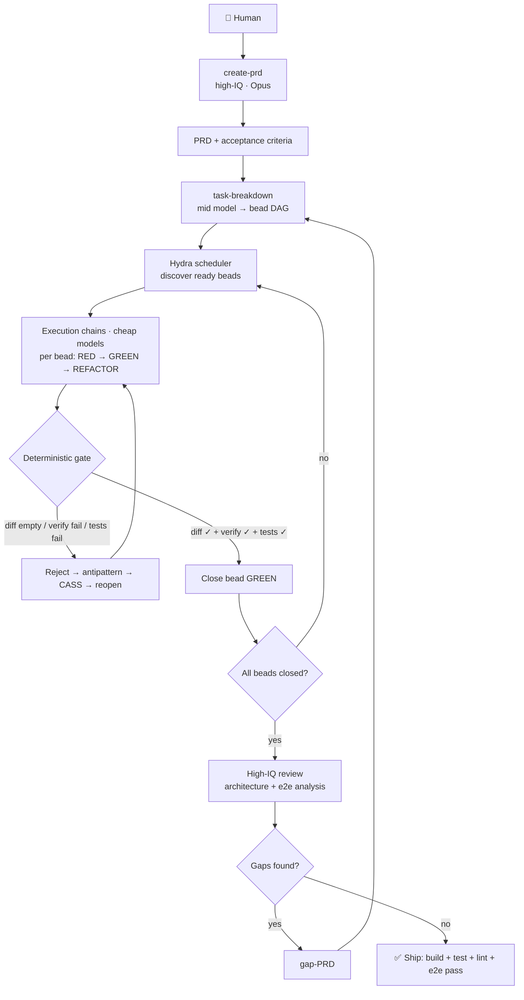
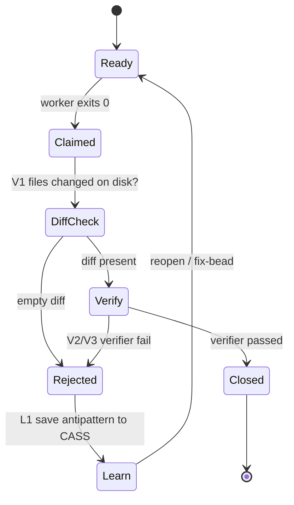
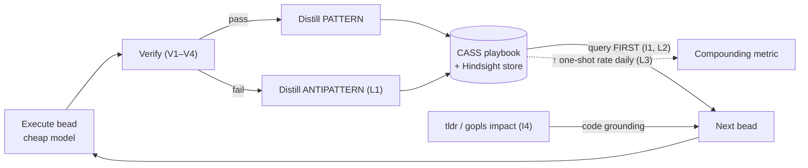
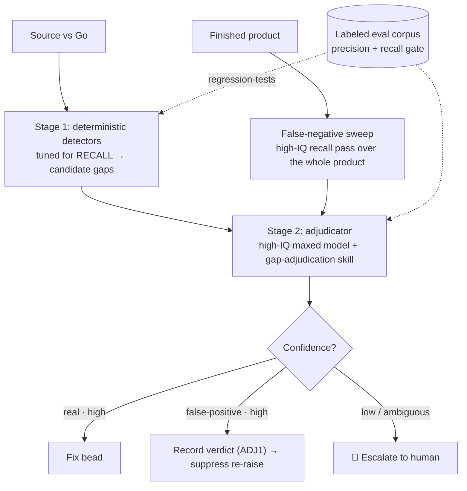

# Hydra Analysis II — Actionable Roadmap — 2026-07-01

> **⚠️ Superseded for execution:** a 2026-07-02 verification pass corrected several findings here (ACL1 retracted; INF1 impact reduced; "dark loop" refined — Hindsight wiring runs but **retrieval returns nothing** despite 4,209 stored memory units). The distilled, agent-executable plan is **`hydra-analysis-20260702iii.md`** — start there; this doc remains the evidence/analysis record.

> Supersedes the diagnosis in `hydra-analysis-20260701i.md` (kimi-k2.7). That doc's core call — *close-on-self-report is the dominant flaw* — is correct. This doc adds the pi/intelligence layer it missed, corrects several claims, and turns everything into a tagged, actionable list toward the end goal.

## End goal (the contract)

Hydra builds **complete, shippable, end-to-end-tested products** from a PRD with **minimal human intervention**, by wrapping **cheap-model execution** in **deterministic gates** and **high-intelligence review**, and getting measurably better every day via a **compounding memory loop**.

Intelligence tiers:

| Stage | Who / Model | Why |
|---|---|---|
| `create-prd` | 👤 Human + **high-IQ** (Opus / high-effort) | Intent & acceptance criteria must be right; cheap to spend here, expensive to get wrong. |
| `task-breakdown` → beads | 🤖 **mid** model | Structured decomposition, deterministic DAG. |
| execution chains (bulk) | 🤖 **cheap** (kimi-k2.x-code / MiniMax) | High volume, bite-sized, gated by tests. |
| review / arch analysis | 🤖 **high-IQ** | Judge the *product*, emit next-cycle gaps. |

**Legend for action tags:** Scope `[HYDRA]` (Go daemon) · `[PI]` (pi-config) · `[DOC]`. Type ⚙️=deterministic (code/gate/script) · 🧠=intelligence (model/LLM). Priority `P0`–`P3`.

---

## 1. Candid analysis — concept & current state

**The concept is sound and more-built than it looks.** Hydra is a Go daemon (`cmd/hydra/main.go`) that discovers "beads" (tasks) across projects, spawns workers, and drives a PRD→beads→verify→gap-PRD compliance loop (`compliance_cycle.go`, MaxCycles=5). Workers run through the **`pi` agent**, which injects a *mandatory Intelligence Protocol* (CASS memory → tldr search → tldr impact → save pattern) and can reach Hindsight. TDD phase validation, a DAG, retry/infra classification, and worktree/rollback machinery all already exist. The overseer God-object refactor is ~90% merged.

**But the loop spins without provable progress.** Three structural cracks:

1. **The close valve leaks.** A bead closes on worker `exitCode==0` (`worker_lifecycle.go:88` → `bead_closer.go:114`, unconditional). The only verifier (TDD) is label-gated, **non-blocking** (`bead_closer.go:85-87` logs and falls through), content- not diff-based, and self-terminates after 3 rounds. Nothing checks that target files actually changed. → Agents "verify X is intentional" without editing, close GREEN, verifier re-detects the same gap next cycle (confirmed in commit `502a059`). Recent fixes patched *symptoms* (prompt wording; `autoApproveGapGate` — which **removed the last human checkpoint** while verification is still absent).

2. **The intelligence supply line may be disconnected.** The "mandatory" protocol likely no-ops in places: **CASS is invoked under 3 different command names** (`cm`, `hydra-cass-memory`, `hydra-cass-memory playbook add`) — only `cass` resolves on PATH here; `tldr` may collide with the unrelated tldr-pages client; **all 16 installed pi skills report `failed`** (`skills-installed.json`, incl. `golang-testing`, `test-driven-development`, `code-review`); and `tldr` semantic index **returns 0 units on Go** — the exact target language. If workers can't query memory or search the Go target, they fly blind → the empty "fixes" from crack #1 are *caused* here.

3. **No tiering, no failover, no compounding.** One cheap model does everything; no high-IQ review pass; no auto-failover though a 2nd provider (kimi) is configured; `defaultModel: MiniMax-M3` isn't even in `models.json`. Verification rejections don't feed back into memory, so the same mistake recurs — the system doesn't learn.

**Verdict:** the pieces for a closed, verified, learning factory exist but aren't wired into a circuit. Close the valve, reconnect the supply line, add tiering + a feedback loop — then it compounds.

---

## 1a. Live production verification — VPS `<prod-vps>`, 2026-07-01

Read-only SSH inspection of the running daemon (user **`hydra`**, `ExecStart=/opt/hydra/bin/hydra`, config `/etc/hydra/hydra.yaml`). Both `hydra.service` and `hindsight.service` active. This section corrects several §1–§2 items that were based on the local mac config.

**Confirmed against the live box:**
- **CASS is unreachable by workers.** As user `hydra`: `cm`, `cass`, `hydra-cass-memory` **all MISSING** on PATH. The real code-intel CLI is `llm-tldr` / `tldr` (an AST tool: `search/impact/calls/change-impact/arch/semantic`) — but prompts call the non-existent `hydra-llm-tldr`. → the "mandatory" Intelligence Protocol can't run as written. `br` and `pi` resolve fine.
- **`.beads` ACL wall is live.** `hydra` was denied `cat /home/buddhi/projects/.../srv-file-handler/.beads/issues.jsonl` (not in sudoers) — doc-i's "ACL fixed" claim is false.
- **Hindsight is a real RAG service:** `hindsight-api` on `:8888` + Postgres + local embeddings (`BAAI/bge-small-en-v1.5`) + reranker + MiniMax LLM.

**New infra bugs (all P0):**

| ID | Finding → Fix | Tags |
|----|----|----|
| INF1 | **`HINDSIGHT_*` env silently dropped.** `/etc/profile.d/hydra-api-keys.sh` uses `export VAR=val`; systemd `EnvironmentFile` rejects the `export` prefix → ~25 "Ignoring invalid environment assignment" lines; hydra never receives Hindsight DB/port/bank/LLM config. **Fix:** write `VAR=val` (no `export`) or source via `ExecStartPre`. Then verify hydra actually reaches `hindsight-api:8888`. | `[infra]` ⚙️ P0 |
| SEC1 | **API key leaked in logs.** `HINDSIGHT_API_LLM_API_KEY=<redacted>` is printed plaintext in `journalctl -u hydra` (side-effect of INF1). **Fix:** rotate the key; stop echoing env values; restrict journal access. | `[infra]` 🔒 P0 |
| INF2 | **Make the CASS CLI resolvable for user `hydra`.** Install it to a daemon-PATH dir readable by `hydra` (`/usr/local/bin` or `/opt/hydra/.local/bin`), standardize ONE name, and fix prompt refs `hydra-llm-tldr` → `llm-tldr`. Supersedes I1/I2 on the box. | `[infra/pi]` ⚙️ P0 |
| ACL1 | **Fix `.beads` cross-user read.** Group/ACL so `hydra` can read project `.beads/` across user homes (or run discovery as the owning user). Supersedes S3 with live proof. | `[infra]` ⚙️ P0 |

**Corrections to §2 (local config ≠ production):**
- **Models — "single-model" is dead.** Prod `models.json` lists 5 models / 2 providers (`kimi-k2.7-code`, `kimi-k2.6`, `MiniMax-M3`, `MiniMax-M2.7`, `-Highspeed`); default = **`kimi-k2.7-code`** (matches the intended tiering). M1 is a **dev/prod config-drift** item, not a prod bug.
- **429s = 0** in the last 3 days (default moved to the kimi coding plan). The storm was historical; M2 failover is resilience, not urgent.
- **Skills:** prod box shows `failed: 0` (local showed 16). I3 is local-only.
**Worker-log forensics — open thread RESOLVED:**

Daemon stdout → `/var/log/hydra/hydra.log` (9 KB, idle since Jun 25); stderr → `hydra-error.log` (**235 MB, still growing Jul 1** though idle); worker records in `/tmp/hydra-executions` (4197 files).

- **Intelligence Protocol is SILENTLY SKIPPED** (not invoked-and-failing). Across 235 MB of logs + 4197 execution records: `cm`/`hydra-cass-memory`/`hydra-llm-tldr`/`llm-tldr` invocations = **0**; `command not found` = 0; no `finalScore` / "Intelligence Protocol" / "query CASS" markers anywhere. The commands don't resolve for `hydra` **and** nothing tries to run them → the learning loop is **dark in production**.
- **Hindsight connection is failing** (corroborates INF1): error log has `hindsight`×11528, `:8888`×2655, `connection refused`×19 — hydra can't reach `hindsight-api`. Also historical `429`×6017 (the storm) and `exit status`×21231.
- **The loop spins on "false-positive" re-litigation.** Worker outputs are *high-quality* discovery docs (file:line, Java↔Go maps, `go build`/`test` exit codes) that mostly conclude **"gap is a false positive — close without code changes"** (FR-001, FR-003, task-queue-default…). Because the learning loop is dark, these verdicts aren't remembered → the detector re-raises the same gaps → workers re-adjudicate them next cycle. **The spinning loop and the disconnected memory are the same root cause** — a sharper diagnosis than doc-i's "agent self-report": agents re-litigate settled questions because nothing records the settlement.

| ID | Action | Tags |
|----|----|----|
| RETRY1 | **Fix the runaway retry loop.** Retry manager re-enqueues beads absent from the DAG (`[Retry] … not found in DAG` ×651/bead, still emitting Jul 1). Drop beads not in the DAG, honor the hourly cadence, de-dupe log lines. Root of the 235 MB flood. | `[HYDRA]` ⚙️ P0 |
| ADJ1 | **Remember adjudications.** Persist gap verdicts — especially "false positive" — to CASS/Hindsight so the compliance detector suppresses already-settled gaps instead of re-raising them each cycle. Pairs with L1; needs the learning loop reconnected (INF1/INF2). | `[HYDRA]` ⚙️ P1 |
| LOG1 | **logrotate `/var/log/hydra/*.log`** — error log reached 235 MB unrotated. | `[infra]` ⚙️ P1 |

**Refines V1:** a diff-gate alone can't pass a *legitimate* no-change close (true false-positive). Those must require the verifier to actually pass (V3) or a recorded adjudication (ADJ1) that suppresses re-detection — not blind trust, and not a forced diff.

---

## 2. Current gaps → how to fill

### A. Verification & close integrity — *the #1 problem*
| ID | Action | Tags |
|----|--------|------|
| V1 | **Diff-based close gate.** Block close if target file(s) unchanged on disk (`git diff` empty ⇒ reject). Add to `bead_closer.go` close path. Cheapest, highest ROI — kills the `502a059` class instantly. | `[HYDRA]` ⚙️ P0 |
| V2 | **Make validation blocking.** Stop swallowing at `bead_closer.go:85-87`; on fail → reopen or fix-bead, do **not** fall through and close. | `[HYDRA]` ⚙️ P0 |
| V3 | **Extend verify to gap beads.** Compliance gap-fix beads must re-run `verify-source-vs-go` and confirm `passed` before close — not only TDD-labeled beads. | `[HYDRA]` ⚙️ P0 |
| V4 | **Two-phase close: claim → verify → close.** Wire the existing `agent_verifier.go` (today gated behind `AgentVerificationEnabled`, unwired) as an independent verify stage. | `[HYDRA]` ⚙️ P1 |
| V5 | **Progress-delta compliance loop.** Diff `gap-report-cycle-N` vs `N-1`; unchanged gap set ⇒ halt + escalate. Gate `autoApproveGapGate` on "progress made this cycle." | `[HYDRA]` ⚙️ P1 |

### B. Intelligence supply line — *upstream root cause*
| ID | Action | Tags |
|----|--------|------|
| I1 | **Standardize the CASS command to ONE name** across `APPEND_SYSTEM.md` + `code-search-and-intelligence` + `code-discovery` skills. Confirm it resolves on the **daemon's** PATH. | `[PI]` ⚙️ P0 |
| I2 | **Fix tldr command name** (not a collision — verified on prod: `tldr`/`llm-tldr` is the real AST code-intel tool). Prompts call the non-existent `hydra-llm-tldr` → change to `llm-tldr`/`tldr`. See INF2. | `[PI]` ⚙️ P0 |
| I3 | **Reinstall failed skills** — LOCAL mac `skills-installed.json` shows all 16 `failed`; **prod box shows `failed: 0`**, so this is a local-dev issue. Verify prod, fix local. | `[PI]` ⚙️ P2 |
| I4 | **LSP/AST-backed impact for Go.** Replace tldr's broken Go call-graph path with `gopls`/tree-sitter impact analysis (tldr semantic index = 0 on Go). | `[HYDRA/PI]` 🧠 P1 |
| I5 | **Structured worker output** via installed `pi-structured-return`: emit `{files_changed, tests_added, verifier_result}` → machine-parseable, feeds V1/V4. | `[PI]` ⚙️ P1 |

### C. Compounding learning flywheel — *the daily-improvement lever*
| ID | Action | Tags |
|----|--------|------|
| L1 | **Rejections → antipatterns.** When a verify gate (V1–V4) rejects a close, auto-save the antipattern to CASS ("claimed done, diff empty"; "edited wrong file"). Failures become guardrails future agents query. **This is what makes one-shot rate compound.** | `[HYDRA]` ⚙️ P0 |
| L2 | **Enforce (don't just request) the protocol.** Verify CASS-query-before + `cm learn`-after actually ran per worker; log misses. | `[PI]` ⚙️ P1 |
| L3 | **One-shot-rate metric.** Track % beads closed first attempt without a fix-bead, over time; surface via GraphQL API. Proves (or disproves) compounding. | `[HYDRA]` ⚙️ P2 |
| L4 | **Feed review findings back** into CASS/Hindsight as architectural patterns (see M4). | `[HYDRA]` 🧠 P2 |

### D. Tiered intelligence & model routing
| ID | Action | Tags |
|----|--------|------|
| M1 | **Reconcile dev/prod config drift.** Prod is correct (default `kimi-k2.7-code`; `models.json` = 5 models / 2 providers). LOCAL mac config still says `MiniMax-M3` (absent from local `models.json`) + `kimi-k2.6`. Sync local→prod so dev matches runtime. | `[PI/DOC]` ⚙️ P1 |
| M2 | **Auto-failover on 429.** Circuit-breaker in scheduler: minimax→kimi (both already configured), pause-and-switch instead of spawning doomed workers. | `[HYDRA]` ⚙️ P1 |
| M3 | **Task-type model routing.** Cheap model for mechanical beads; high-IQ for design/arch/review beads — route by bead label/type. | `[HYDRA]` 🧠 P1 |
| M4 | **High-IQ review stage.** After product reaches GREEN, run an architectural-review agent (high model) → emits next-cycle gap-PRD. The "review with higher intelligence" from the end goal. | `[HYDRA]` 🧠 P1 |
| M5 | **Document the tier contract** (`create-prd`=Opus/human; execution=cheap; review=high) so operators and agents share the model. | `[DOC]` P2 |

### E. Execution safety
| ID | Action | Tags |
|----|--------|------|
| S1 | **File isolation.** Confirm the daemon worker path uses `task-breakdown/worktree-orchestrator.mjs` isolation; else add per-worker git worktrees or advisory locks (`gofrs/flock`, already the chosen dep). `max_workers=5` is unsafe on shared files without this. | `[HYDRA]` ⚙️ P1 |
| S2 | **Daemon-lock retry everywhere.** Extend the exit-8 retry (today `CloseBead`-only, linear) to `ready/show/update/create`; use exponential backoff. | `[HYDRA]` ⚙️ P1 |
| S3 | **ACL for `.beads/`.** Claimed done in doc i, **actually absent** in prod code — implement it or drop the claim. | `[HYDRA]` ⚙️ P1 |
| S4 | **Artifact cleanup.** Workers write to temp workspace; only named deliverables committed; `.gitignore` test binaries/coverage. | `[HYDRA]` ⚙️ P2 |

### F. Documentation & cleanup
| ID | Action | Tags |
|----|--------|------|
| D1 | **Hindsight is ACTIVE via pi** (`@walodayeet/hindsight-pi` extension + `pattern-quality-reviewer` skill), confirmed 2026-07-01. Fix the drift: `AGENTS.md:239` example still says `enabled:false`, and Hydra ships an older `internal/hindsight/` Go module that may duplicate the pi one — pick one path, align docs. | `[DOC]` P1 |
| D2 | **Clarify CASS vs Hindsight.** Overlapping memory systems (`cm learn`/playbook vs `hindsight_retain`; plus the `pattern-quality-reviewer` skill already gates saves). Define roles — proposal: Hindsight = raw execution/embedding store; CASS = distilled playbook curated by `pattern-quality-reviewer` — or merge. | `[DOC]` P1 |
| D3 | **Finish + archive `REFACTOR-TRACKING.md`.** Remaining: `ChainOrchestrator`, `ResourceGovernor`, **`ValidationEngine`** (the natural home for V1–V4). | `[DOC]` P1 |
| D4 | **De-drift `AGENTS.md`** examples vs runtime config (model names, hindsight flag). | `[DOC]` P2 |
| D5 | **Purge ~50 untracked artifacts** (test binaries, coverage, `drift_test/`, dup packages) noted in doc i. | `[DOC]` P2 |

---

## 3. Target workflow & boosts

### 3.1 The tiered pipeline

**Boost — deterministic scaffolding wraps intelligent steps.** Everything in `{ }` gates above is *code, not judgment*: the DAG, the diff/verify/test gate, retries, failover, cleanup. LLMs only do what needs judgment: design, code, review. This is how you get "least human intervention" without losing reliability — the machine enforces the contract, the model fills it.

**Boost — multi-level loops.** Bead-level (TDD red/green/refactor), chain-level (DAG dependencies), product-level (review → gap-PRD). Progress-delta (V5) prevents any loop from spinning without change.

### 3.2 Verified close (two-phase)

Today only the `Claimed → Closed` edge exists. V1/V2/V3/L1 add the rest.

### 3.3 The compounding flywheel

**Boost — make it actually compound.** The loop only improves if three things hold:
1. **Failures become guardrails (L1).** Every rejected close writes an antipattern the next agent queries — the same mistake can't recur. Without this, agents repeat errors forever.
2. **Memory is queried before acting, verified (L2).** A "mandatory" protocol that silently no-ops (crack #2) compounds *nothing*. Fix I1–I3 first or the flywheel never turns.
3. **It's measured (L3).** One-shot rate (first-attempt closes / total) is the single number that proves the ecosystem is learning. If it's flat, the loop is broken.

### 3.4 Recommended additional tools
- **`gopls`/tree-sitter impact service (I4)** — replaces tldr's dead Go path; gives real call-graph grounding for the target language.
- **Eval/golden corpus** — snapshot each gap→fix→verify outcome as a labeled example; regression-test the pipeline and chart one-shot rate.
- **Reviewer agent (M4)** on a high-IQ model — the only place besides `create-prd` where spending on intelligence pays back across the whole product.
- **Model router (M2/M3)** — one component owns "which model for which bead + failover," instead of a static default.

---

## 4. Detector trustworthiness

The false-positive storm (§1a) exposed the weakest link: the gap detectors (`verify-source-vs-go`, `verify-*`, `hydra-compliance-analyzer`) are **deterministic token/regex matchers** that misfire across layers — and, worse, can miss real gaps (false negatives). Your levers — skill? prompt? maxed model? — **all three, but layered; and the real trust lever is none of them (it's an eval corpus).** Note: the current detectors aren't prompts, so "better prompt / bigger model" only applies once you add an **LLM adjudication stage** on top.

Design — two-stage detection with tiered escalation:

| ID | Action | Tags |
|----|----|----|
| DET1 | **Detectors emit *candidates*, not verdicts.** Keep the Go binaries but tune for recall; fix cross-layer misfires (require same-layer + same-symbol before flagging). Stage 1 is fast/free/noisy-on-purpose. | `[HYDRA]` ⚙️ P1 |
| DET2 | **`gap-adjudication` skill** (model it on the existing `pattern-quality-reviewer`). Fixed protocol: gather source + Go + PRD clause + `build`/`test` evidence → classify `{real｜false-positive｜ambiguous}` → require file:line on BOTH sides + same-layer proof → structured verdict + confidence. This is the **skill** lever. | `[PI]` 🧠 P1 |
| DET3 | **Run the adjudicator on a high-end maxed model** (Opus / kimi-k2.7, max effort). Low volume — 1 call per *candidate gap*, not per bead-action — so a top model is affordable. **Two-sided prompt:** independently try to prove the gap REAL *and* prove it FALSE; rubber-stamping fails when the two disagree. This is the **prompt + model** lever. | `[PI/HYDRA]` 🧠 P1 |
| DET4 | **Eval corpus = the actual trust metric.** Label past gaps `{true｜false-positive}` (ADJ1 history seeds it); measure each detector's **precision + recall** against it; regression-test every detector/prompt/model change. Makes "trustworthy" a number, not a vibe. **The lever prompt and model alone can't give you.** | `[HYDRA]` ⚙️ P1 |
| DET5 | **False-negative sweep.** Separate high-IQ recall pass over the *finished product* (does every Java behavior / endpoint / error / config / edge case have a Go counterpart?). Pattern detectors only catch known shapes; this catches the silent holes — the dangerous failure. | `[HYDRA]` 🧠 P2 |
| DET6 | **Confidence-gated escalation.** high-conf real → fix; high-conf false-positive → record (ADJ1) + suppress; **low-conf → human.** Bounds both failure modes with the minimal human touch. | `[HYDRA]` ⚙️ P1 |
| DET7 | **Panel adjudication for high-stakes / ambiguous gaps** — N independent verdicts across diverse lenses (correctness / PRD-intent / security), consensus or escalate. | `[HYDRA]` 🧠 P2 |

**Why layered beats "just use a big model":** a maxed model pointed at a noisy deterministic detector still inherits its **false negatives** (it can't adjudicate a gap the detector never surfaced) and burns cost if run per-action. Recall-first Stage 1 + precision-first maxed adjudicator + a corpus that measures both = trust you can *prove and improve*. Prompt/skill/model are *how* the adjudicator judges; the corpus + escalation are what make it *trustworthy*.

---

## 5. Necessary vs sufficient — the last mile

Completing §2–§4 turns Hydra from "spins without progress" into a reliable, self-improving factory for **specified** work. Necessary — but not sufficient for the full "autonomously ships complete products" goal. Honest split:

**✅ Delivered by the recs:** honest closes (V1–V4); a learning loop that actually turns (INF1/INF2, L1, ADJ1); tiered execution + review (M3/M4); stable ops (RETRY1, SEC1, LOG1).

**⚠️ Enabled, not guaranteed:**
- **"Complete product" > green beads.** Per-bead pass ≠ coherent assembled product.
- **"e2e tested"** — TDD writes *unit* tests; a real e2e/acceptance ship-gate isn't a hard gate yet. → **LM1.**
- **Compounding is a hypothesis** — reconnecting memory makes it *possible*; the one-shot-rate metric (L3) is how you know the curve actually bends. Could plateau.

**❌ Still frontier:**
- **PRD quality is the ceiling** — ambiguous PRD → bad product regardless of loop quality. The human `create-prd`-on-Opus step stays the highest-leverage, least-automatable part.
- **Detector trustworthiness** (§4) — false negatives ship holes; needs the corpus + sweep to earn trust.
- **Greenfield ≠ migration** — spec-anchored work (migrations, well-specified features) is tractable now; open-ended product-building from a bare PRD has no oracle and is further out.

| ID | Action | Tags |
|----|----|----|
| LM1 | **Product-level acceptance / e2e ship-gate.** Beyond per-bead tests: the assembled product must build, boot, and pass an e2e/acceptance suite derived from the PRD before "shippable." No green e2e → no ship. | `[HYDRA]` ⚙️ P1 |
| LM2 | **Prove the compounding curve.** Track one-shot rate (L3) over time; if flat, the memory loop isn't changing behavior — diagnose retrieval + antipattern quality. | `[HYDRA]` ⚙️ P2 |

**Bottom line:** finish §2–§4 → a trustworthy, compounding factory for specified work, humans at the PRD + final review. The last mile to hands-off "ships any product" = product-level e2e gate (LM1) + trustworthy detectors (§4) + proof the compounding curve bends (LM2). The recs get you to the door; those three walk you through it.

---

## 6. Sequencing

- **P0 — unblock & stop lying to yourself:** V1, V2, V3, L1 (close integrity + failures-as-guardrails) · I1, I2, INF2 (reconnect intelligence for user `hydra`) · **INF1, SEC1, ACL1, RETRY1 (live infra: dropped env, leaked key, `.beads` ACL, 235 MB retry loop)**.
- **P1 — tier & verify:** V4, V5 · I4, I5 · M2, M3, M4 · S1, S2, S3 · D2, D3 · **DET1–DET4, DET6 (trustworthy detection)** · **LM1 (product e2e gate)**.
- **P2 — compound & polish:** L3, L4 · M5 · S4 · D4, D5 · **DET5, DET7 (false-negative sweep, panel)** · **LM2 (prove compounding)**.

**Fastest path to the end goal:** P0 makes closes *honest* and failures *stick*; P1 adds *tiering* (cheap execution, high-IQ review), *isolation*, and *trustworthy detection*; P2 makes the learning *measurable* and detection trustworthy *at scale*. Do P0 before adding capability — capability on a leaky, blind loop just spins faster.
