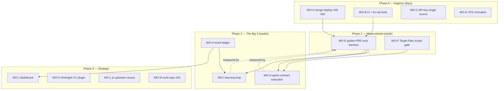

# Hydra Improvement Plan — 2026-07-12 (iv)

Successor to `hydra-analysis-20260702iii.md`. That plan's Phase-1 work orders (WO-1..8, 13) are DONE and merged. This plan is grounded in the first full **hydra-on-hydra dogfood run** (2026-07-08..12): a real PRD (`compliance-sticky-approval-20260705.md`) was autonomously decomposed (21 beads), implemented (26/28 closed, 11 verified-close accepts, FR code correct on target files), surfacing the failure modes this plan addresses.

**Theme:** Hydra trusts LLM narration where it should use mechanics. Workers free-roam checkouts; validation is LLM-reads-LLM; state smears across logs/DB/tmp files; memory recall is prompt-hope. Every major dogfood failure traces to one of these.

---

## Sequencing logic

Measurement (WO-E) comes **before** the Big 3 so every improvement is a number, not a vibe. WO-F ships early because it's a one-day slice of WO-G with immediate payoff.

---

## Phase 0 — Hygiene (target: this week, ~1 day of work total)

### WO-A: Merge + deploy #49 and #50
**Why:** Validated fixes sitting unmerged = zero value. #49 = worker/scheduler robustness (skill-scoping, worktree root under `$HYDRA_HOME`, Pi `--offline` hardening, activity timeout 30m→10m + `HYDRA_WORKER_ACTIVITY_TIMEOUT`). #50 = leveled logging (`internal/logx`, `HYDRA_LOG_LEVEL`) + per-bead worker logs (`$HYDRA_HOME/logs/workers/`).
**How:** Merge both PRs → on VPS: `git pull` development, `make build`, add `HYDRA_LOG_LEVEL=info` to daemon env (systemd drop-in or api-keys.env), `systemctl restart hydra`. Verify: `[Overseer] Worktree isolation ENABLED`, worker log files appear, daemon error log stays lean.
**Accept:** development contains both; VPS runs development (not integration branch); error-log growth <1MB/hour idle.
**Effort:** 1h. **Deps:** none (human merge + one `!` for env edit).

### WO-B: CI pipeline + fix the red base
**Why:** 5 pre-existing test failures on clean development (`internal/beads TestListBeads_{Success,CLIError,EmptyResult}`, `internal/core TestComplianceCycleManager_runGapToPRD`, `TestSettledStateService_HasActiveDependencies`) + `internal/pi` us004 LSP assertion rot. No CI → every PR reviewed against noise; regressions invisible.
**How:** (1) Fix or quarantine (skip with tracking issue) the 6 failures — most are stale assertions, same class as the 13→16 skill-count rot already fixed. (2) `.github/workflows/ci.yml`: `go build ./...`, `go vet ./...`, `go test ./... -short` on PR + push to development. Mark slow/network tests (`us004`, integration) with `testing.Short()` guards.
**Accept:** `go test ./... -short` green on development; CI badge red/green on PRs.
**Effort:** 0.5–1 day. **Deps:** none. **Dogfood candidate:** partially (stale-assertion fixes are well-scoped FRs).

### WO-C: API-key single source + rotation
**Why:** The bashrc↔`/etc/hydra/api-keys.env` drift cost a full day (401 saga: user updated bashrc, daemon reads EnvironmentFile). Also unfinished WO-6: old leaked `sk-cp-…` key still unrotated.
**How:** (1) Make `/etc/hydra/api-keys.env` the single source; `~/.bashrc` sources it (`set -a; . /etc/hydra/api-keys.env; set +a`) so shells and daemon can't diverge. (2) Rotate the leaked key. (3) One-line README-ops note: "keys live in api-keys.env ONLY; restart hydra after edits."
**Accept:** `sha256(daemon KIMI_API_KEY) == sha256(shell KIMI_API_KEY)` by construction; old key revoked at provider.
**Effort:** 1h (needs user for provider-side rotation + `/etc` edits). **Deps:** none.

### WO-D: VPS normalize
**Why:** Session left deliberate drift: provider switched to `kimi-coding` (keep — the only reliably resolvable provider), `max_workers=1` (was 3), dogfood clone + `.beads` present, `vps-local` git stash parked, ACL on buddhi's PAT (keep — matches per-user design).
**How:** After WO-A deploys the activity-timeout: `max_workers` back to 3 (hangs now cost ≤10m). Keep dogfood clone as the golden-PRD target for WO-E (wipe its `.beads`). Drop the `vps-local` stash after eyeballing (superseded by merged WO-13). Document final config state in `docs/ops-runbook.md` (new, 1 page: services, logs, keys, restart, rotate).
**Accept:** config matches runbook; runbook exists.
**Effort:** 1–2h. **Deps:** WO-A.

---

## Phase 1 — Measurement (target: next week)

### WO-E: Golden-PRD eval harness ⭐ keystone
**Why:** Every improvement claim today is vibes. The dogfood was run by hand with a human babysitter. Make it a button: hydra's own regression suite.
**How:**
1. `eval/` dir in repo: 2–3 golden PRDs of graded size — G1 = `compliance-sticky-approval` (2 FRs, known-good outcome), G2 = a 4–5 FR PRD, G3 = one deliberately containing a false-positive-prone spec (exercises adjudicator).
2. `eval/run.sh <prd>`: clones a pinned hydra tag into a scratch target, seeds beads via task-breakdown, approves gate, watches to terminal state (APPROVED / max_cycles / stall-timeout), then emits `eval/results/<ts>.json`: beads total/closed/failed, one-shot rate (closed on attempt 1 / closed), verified-close accepts, wall-clock, worker attempts, hang count (Charon kills), off-scope file count (diff vs declared Target Files), token/cost if obtainable.
3. Baseline run recorded before Phase 2; every Phase-2 WO reruns G1+G2 and diffs metrics.
**Accept:** one command produces a metrics JSON; baseline committed to `eval/baselines/`.
**Effort:** 2–3 days. **Deps:** WO-A (stable deploy). **Metrics get richer after WO-H (ledger) but must NOT wait for it — grep-based extraction is fine for v1.**

### WO-F: Target-Files scope gate (fast slice of WO-G)
**Why:** Dogfood workers gutted 40+ JS-skill docs and created a bogus tree in a Go repo (-1753 lines) for a 2-file PRD. Nothing enforces the bead's declared Target Files.
**How:** In the verified-close path (`bead_closer.go`, where diff-gate already runs): parse bead's Target Files (already in bead JSON/description from task-breakdown); `git diff --name-only` in the worker's tree; changed-files ⊄ (targets ∪ allowlist: `*_test.go` siblings, `go.mod/sum`) → **reject close** with reason listing off-scope files → worker retries with the violation in context. Config `validation.enforce_target_scope` (default true; `warn` mode for gates/us-integration beads which have loose targets).
**Accept:** unit tests: on-scope closes pass, off-scope rejected with file list; golden-PRD G1 off-scope count → 0.
**Effort:** 1 day. **Deps:** none (composes with WO-G later). **Dogfood candidate: yes** — well-scoped, single file cluster.

---

## Phase 2 — The Big 3 (target: 2–4 weeks, sequenced, each measured by WO-E)

### WO-G: Patch-contract execution
**Why:** Trust mechanics, not narration. Kill sprawl + claimed-done-did-nothing at the root.
**What changes:**
1. Worker completion → hydra extracts `git diff` from the worktree (worktree isolation from #45/#49 is the enabler).
2. Mechanical close gate: patch applies clean ∧ **hydra itself** runs the bead's Test/Build Commands (never trusting worker-reported results) ∧ scope-clean (WO-F) ∧ diff≠∅ for implement-type beads.
3. LLM validation (agent_verifier, tdd_validator) demoted to advisory: logged, non-blocking (config-gated during transition).
4. Patch stored per bead (ledger-ready artifact; also = reviewable unit for humans).
**Files:** `bead_closer.go`, `worktree_manager.go` (diff extraction), `validation/` (advisory mode), worker prompt (declare "your diff is your deliverable").
**Accept:** golden-PRD runs where every close has an attached patch; test-execution results come from hydra's own runs; G1 one-shot rate ≥ baseline; sprawl = 0.
**Effort:** 4–6 days. **Deps:** WO-F, WO-E baseline. **Risk:** Test Command trust (PRD supplies it) — sandbox via timeout + worktree cwd; don't run as root (already user hydra).

### WO-H: Event-sourced run ledger
**Why:** State smears across ≥6 places; restarts lose in-flight context; diagnosis = grep archaeology over rotated blobs; cost invisible until 429s.
**What changes:**
1. `internal/ledger`: append-only SQLite (one `events` table: ts, run_id, bead_id, type, payload JSON). Emit from: spawn, worker exit (code, duration, kill reason), close verdict + patch hash, adjudication verdict, cycle transitions, provider/model used, token counts (parse pi output if available).
2. Overseer **resume**: on startup, reconstruct in-flight state (chains, prevSurviving, retry counts) from ledger instead of starting blind.
3. `hydra ledger` CLI: `--bead X` (full lifecycle), `--run` (summary), `--metrics` (feeds WO-E).
**Accept:** kill -9 the daemon mid-run → restart → run continues without re-executing closed beads; `hydra ledger --bead <failed>` answers "why" in one command.
**Effort:** 5–8 days (resume is the hard part; ship emit+query first, resume second). **Deps:** none hard; do after WO-G to capture patch hashes.

### WO-I: Learning loop (inject, retry-with-context, route by outcome)
**Why:** Hindsight recalls log `score: 0.00` despite `min_score: 0.7` → scoring/filtering broken, workers get unranked memory dumps. Retries re-run the **identical prompt** blind. "MANDATORY run cm context" is skippable prompt-hope.
**What changes:**
1. **Fix recall scoring** — trace why recall API scores parse as 0.00 (`internal/hindsight/client.go` field mapping vs new API, same class as the WO-1 `results`/`text` fix); enforce min_score; verify reranker actually runs server-side.
2. **Deterministic injection** — overseer queries CASS + Hindsight, score-gates, injects top-k distilled insights into the bead prompt (enrichment path `queryHindsightForContext` exists — make it the only path; drop reliance on the worker choosing to run `cm context`).
3. **Reflexion retry** — attempt N+1 prompt = task + attempt N's patch (from WO-G) + failure reason (from WO-H ledger): "here is what was tried and why it failed; do differently."
4. **Outcome-driven routing** — per-phase model map in config (`RED: cheap/fast`, `GREEN/REFACTOR: strong`, `adjudicator: judge`), plus escalation: retry-2 bumps to the stronger model. Builds on existing ProviderBreaker plumbing.
**Accept:** recalls show real scores ≥ min_score; retry prompts contain prior-attempt context (assert in tests); G1/G2 one-shot rate and tokens/PRD improve vs baseline.
**Effort:** 5–8 days. **Deps:** WO-G (patches), WO-H (failure reasons) for item 3; items 1–2 independent — start immediately.

---

## Phase 3 — Strategic (after Phase 2, order by appetite)

- **WO-J: Live dashboard** — serve ledger metrics from the existing `internal/api` server: bead states, cost/PRD, hang rate, one-shot trend. Effort 2–3 days. Deps WO-H.
- **WO-K: Hindsight Claude-Code plugin** — official `vectorize-io/hindsight` plugin for operator sessions; `hindsightApiUrl` → VPS :8888 over SSH tunnel, same bank as workers, auto-features OFF. Effort 0.5 day. (CASS `cm` flow already in use.)
- **WO-L: pi upstream issues** — file with repro data: (1) startup provider-registry fetch flakes under concurrent launches ("Unknown provider" for valid provider; `--offline` insufficient at extension layer), (2) stream hangs (no output ≥10m, signal-kill needed). We hold logs + repro commands. Effort 0.5 day; unblocks removing our workarounds later.
- **WO-M: Multi-repo (#2b)** — bv-client repo-awareness, write-path `repoName` threading (`UpdateBeadStatus`/`CreateBead`), iterate beyond `Repos[0]`. Do when a real multi-repo project needs it. Effort 3–4 days. **Status (2026-09-16): discovery read path done** — `findFromBV`/`findFromBVPlan` invoke bv per repo dir and resolve repo from the item's `repo` field (added to `bv.TriageRecommendation`/`BlockerToClear`/`PlanItem`) or the invocation target; current bv v0.16.4 emits no repo field, so per-repo invocation is the mechanism. Write-path threading remains open.

---

## Expected outcomes (vs dogfood baseline)

| Metric (dogfood observed) | Target after Phase 2 |
|---|---|
| One-shot close rate (most beads 2–4 attempts) | 2–3× |
| Off-scope changes (45 files for a 2-file PRD) | 0 |
| Tokens/PRD (blew a quota plan) | −40–60% |
| Wall-clock/PRD (~2 days with babysitter) | hours, unattended |
| Diagnosis ("why did X fail") | 1 ledger query |
| Restart cost (lost in-flight state) | resume, no re-execution |

**Not fixed by this plan:** base model quality (kimi hangs/weak phases — mitigated by routing + upstream issues), PRD spec quality in = out, adjudicator judgment remains LLM-opinion.

## Dogfood policy
WO-F, parts of WO-B, and later well-scoped slices of WO-G/I should be **fed to hydra itself** (golden-PRD style) once WO-E exists — every such run doubles as an eval datapoint. Infra/ops WOs (A, C, D) and the ledger core (H) stay human+Claude.

## Definition of done for this plan
`eval/run.sh G2` on a clean VPS: unattended PRD → APPROVED with patch-per-bead, one-shot ≥60%, zero off-scope files, full ledger trail — repeatable twice consecutively.
