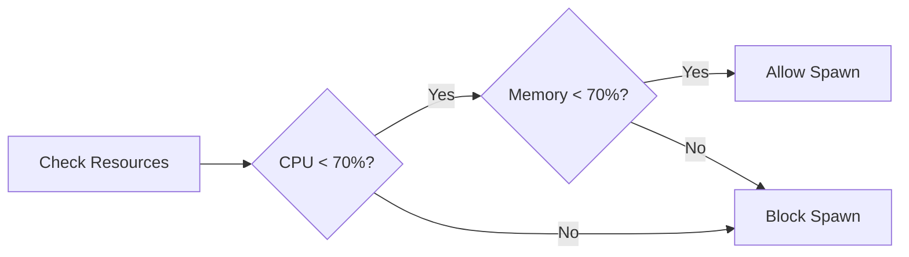
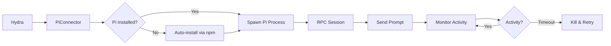

# Configuration Guide

**Date**: 2026-03-09  
**Status**: Current  
**Related**: [Monitoring & Metrics](./monitoring-metrics-20260309.md), [Troubleshooting](./troubleshooting-20260309.md)

## Overview

Hydra is configured via a YAML file (default: `hydra.yaml`). This guide covers all configuration options with examples and best practices.

## Configuration File Structure

```yaml
overseer:
  poll_interval: 5s
  max_workers: 10
  max_retries: 2
  retry_delay: 5s
  worker_timeout: 5m
  resource_limits:
    max_cpu_percent: 70
    max_memory_percent: 70

api:
  enabled: true
  port: 8080

projects:
  auto_discover: false
  list:
    - name: my-project
      path: /path/to/project
      type: single

intelligence:
  cass_memory:
    enabled: true
    query_limit: 10
    history_days: 30
  tldr:
    enabled: true
    max_files: 50
  gptcache:
    enabled: true

mcp:
  enabled: true
  url: http://127.0.0.1:8765
  port: 8765
  reconnect_interval: 5s
  max_reconnect_attempts: 10
  heartbeat_interval: 30s
```

## Configuration Sections

### 1. Overseer Configuration

The overseer is the core orchestration engine.

#### `poll_interval`

**Type**: `duration` (e.g., `5s`, `1m`)  
**Default**: `5s`  
**Description**: How often to check for ready beads.

```yaml
overseer:
  poll_interval: 5s  # Check every 5 seconds
```

**Guidelines**:
- **Fast processing**: `2s` (more frequent checks, higher CPU)
- **Normal**: `5s` (balanced)
- **Slow/background**: `10s` (less frequent, lower CPU)

#### `max_workers`

**Type**: `integer`  
**Default**: `5`  
**Description**: Maximum number of concurrent workers.

```yaml
overseer:
  max_workers: 10  # Up to 10 workers at once
```

**Resource Requirements**:

| max_workers | CPU | Memory | Disk I/O | Network |
|-------------|-----|--------|----------|---------|
| 3 | Low | 3GB | Low | Low |
| 5 | Medium | 5GB | Medium | Medium |
| 10 | High | 10GB | High | High |
| 20 | Very High | 20GB | Very High | High |

**Guidelines**:
- **Development**: `3-5` (conserve resources)
- **Production (8GB RAM)**: `5-8`
- **Production (16GB+ RAM)**: `10-15`
- **High-performance (32GB+ RAM)**: `20+`

#### `max_retries`

**Type**: `integer`  
**Default**: `2`  
**Description**: Number of retry attempts for failed beads.

```yaml
overseer:
  max_retries: 2  # Retry failed beads twice
```

**Guidelines**:
- **0**: No retries (fail fast)
- **1-2**: Recommended (handles transient failures)
- **3+**: Use for flaky environments

#### `retry_delay`

**Type**: `duration`  
**Default**: `5s`  
**Description**: Wait time between retries.

```yaml
overseer:
  retry_delay: 10s  # Wait 10 seconds before retry
```

**Backoff Strategy**:
- Current: Fixed delay
- Future: Exponential backoff (`5s, 10s, 20s...`)

#### `worker_timeout`

**Type**: `duration`  
**Default**: `5m`  
**Description**: Hard timeout for worker processes (backup to activity timeout).

```yaml
overseer:
  worker_timeout: 5m  # Kill workers after 5 minutes
```

**Note**: Activity-based timeout (5min inactivity) is primary. This is a safety backup.

#### `resource_limits`

**Type**: `object`  
**Description**: Resource thresholds for spawning workers.

```yaml
overseer:
  resource_limits:
    max_cpu_percent: 70      # Don't spawn if CPU > 70%
    max_memory_percent: 70   # Don't spawn if Memory > 70%
```

**How It Works**:


**Platform Support**:
- **Linux**: Uses `free` (memory) and `top` (CPU)
- **macOS**: Uses `vm_stat` (memory) and `top` (CPU)
- **No external dependencies**: Standard Unix commands only

### 2. API Configuration

#### `enabled`

**Type**: `boolean`  
**Default**: `true`  
**Description**: Enable GraphQL and REST API.

```yaml
api:
  enabled: true
```

**When to Disable**:
- Background processing only
- Resource-constrained environments
- CLI-only usage

#### `port`

**Type**: `integer`  
**Default**: `8080`  
**Description**: HTTP server port.

```yaml
api:
  port: 8080
```

### 3. Projects Configuration

#### `auto_discover`

**Type**: `boolean`  
**Default**: `true`  
**Description**: Automatically discover projects.

```yaml
projects:
  auto_discover: false  # Disable auto-discovery
```

**Warning**: Auto-discovery can find unexpected projects. Recommended to disable and explicitly list projects.

#### `list`

**Type**: `array` of project objects  
**Description**: Explicitly configured projects.

**Single-Repo Project**:
```yaml
projects:
  list:
    - name: my-project
      path: /path/to/project
      type: single
```

**Multi-Repo Project**:
```yaml
projects:
  list:
    - name: monorepo
      path: /path/to/monorepo
      type: multi
      repos:
        - name: frontend
          path: /path/to/monorepo/frontend
        - name: backend
          path: /path/to/monorepo/backend
```

**Project Fields**:

| Field | Type | Required | Description |
|-------|------|----------|-------------|
| `name` | string | Yes | Project identifier |
| `path` | string | Yes | Absolute path to project |
| `type` | string | Yes | `single` or `multi` |
| `repos` | array | No | For `multi` type only |

### 4. Intelligence Configuration

#### `cass_memory`

**Type**: `object`  
**Description**: Pattern storage and retrieval.

```yaml
intelligence:
  cass_memory:
    enabled: true
    query_limit: 10
    history_days: 30
    timeout: 5s
```

**Purpose**: Store successful patterns and anti-patterns for context-aware execution.

#### `tldr`

**Type**: `object`  
**Description**: File impact analysis.

```yaml
intelligence:
  tldr:
    enabled: true
    max_files: 50
    timeout: 10s
    max_tokens: 100000
```

**Purpose**: Analyze which files are affected by changes.

#### `gptcache`

**Type**: `object`  
**Description**: LLM response caching.

```yaml
intelligence:
  gptcache:
    enabled: true
    server_url: http://127.0.0.1:8788
```

**Purpose**: Cache LLM responses to reduce costs and improve speed.

### 5. MCP Configuration

#### `enabled`

**Type**: `boolean`  
**Default**: `true`  
**Description**: Enable MCP Agent Mail integration.

```yaml
mcp:
  enabled: true
```

**Prerequisites**:
- MCP Agent Mail must be running (`pm2 status`)
- Port 8765 must be accessible

#### `url`

**Type**: `string`  
**Default**: `http://127.0.0.1:8765`  
**Description**: MCP server URL.

```yaml
mcp:
  url: http://127.0.0.1:8765
```

**Note**: Hydra automatically converts `ws://` to `http://` and removes `/ws` suffix.

#### `port`

**Type**: `integer`  
**Default**: `8765`  
**Description**: MCP server port.

```yaml
mcp:
  port: 8765
```

#### Connection Settings

```yaml
mcp:
  reconnect_interval: 5s       # Retry connection every 5s
  max_reconnect_attempts: 10   # Max 10 reconnection attempts
  heartbeat_interval: 30s      # Send heartbeat every 30s
  file_reservation_ttl: 30m    # File locks expire after 30min
```

### 6. Agents Configuration

The agents section configures the **Agent Connector Architecture** for multi-agent support.

#### `enabled`

**Type**: `boolean`  
**Default**: `true`  
**Description**: Enable agent connector system.

```yaml
agents:
  enabled: true
```

#### `default_agent`

**Type**: `string`  
**Default**: `pi`  
**Description**: Default agent to use when spawning workers.

```yaml
agents:
  default_agent: pi
```

**Supported Agents**:
- `pi` - Pi coding agent via RPC mode (default)
- `claude` - Claude API (future)
- `github_copilot` - GitHub Copilot (future)

#### `pi`

**Type**: `object`  
**Description**: Pi coding agent configuration.

```yaml
agents:
  pi:
    enabled: true
    provider: kimi          # AI provider (kimi, anthropic, openai, etc.)
    model: k2.5             # Model to use
    timeout: 10m            # Maximum execution time
    thinking_level: medium  # Reasoning level (off, minimal, low, medium, high, xhigh)
```

**How It Works**:


**Prerequisites**:
- Node.js and npm must be installed
- Pi will be auto-installed: `npm install -g @mariozechner/pi-coding-agent`
- API key for chosen provider (e.g., `KIMI_API_KEY`)

## Configuration Examples

### Development Environment

```yaml
# hydra-dev.yaml
overseer:
  poll_interval: 10s
  max_workers: 3
  max_retries: 1
  worker_timeout: 3m

api:
  enabled: true
  port: 8080

projects:
  auto_discover: false
  list:
    - name: my-dev-project
      path: /Users/me/projects/my-project
      type: single

intelligence:
  cass_memory: { enabled: false }
  tldr: { enabled: false }
  gptcache: { enabled: false }

mcp:
  enabled: false

agents:
  enabled: true
  default_agent: pi
  pi:
    enabled: true
    provider: kimi
    model: k2.5
    timeout: 3m
```

### Production Environment

```yaml
# hydra-prod.yaml
overseer:
  poll_interval: 5s
  max_workers: 10
  max_retries: 2
  worker_timeout: 5m
  resource_limits:
    max_cpu_percent: 70
    max_memory_percent: 70

api:
  enabled: true
  port: 8080

projects:
  auto_discover: false
  list:
    - name: production-api
      path: /opt/projects/api
      type: single
    - name: production-web
      path: /opt/projects/web
      type: single

intelligence:
  cass_memory:
    enabled: true
    query_limit: 10
    history_days: 30
  tldr:
    enabled: true
    max_files: 50
  gptcache:
    enabled: true

mcp:
  enabled: true
  url: http://127.0.0.1:8765
  port: 8765
  reconnect_interval: 5s
  max_reconnect_attempts: 10
  heartbeat_interval: 30s

agents:
  enabled: true
  default_agent: pi
  pi:
    enabled: true
    provider: kimi
    model: k2.5
    timeout: 5m
```

### High-Performance Environment

```yaml
# hydra-highperf.yaml
overseer:
  poll_interval: 2s
  max_workers: 20
  max_retries: 2
  worker_timeout: 10m
  resource_limits:
    max_cpu_percent: 80
    max_memory_percent: 80

api:
  enabled: false  # Disable to save resources

projects:
  auto_discover: false
  list:
    - name: big-project
      path: /data/projects/big-project
      type: single

intelligence:
  cass_memory: { enabled: true }
  tldr: { enabled: true }
  gptcache: { enabled: true }

mcp:
  enabled: true
  url: http://127.0.0.1:8765

agents:
  enabled: true
  default_agent: pi
  pi:
    enabled: true
    provider: kimi
    model: k2.5
    timeout: 10m
```

## Environment-Specific Configuration

### Using Environment Variables

Hydra supports environment variable substitution:

```yaml
overseer:
  max_workers: ${HYDRA_MAX_WORKERS:-5}  # Default to 5 if not set

api:
  port: ${HYDRA_API_PORT:-8080}

projects:
  list:
    - name: my-project
      path: ${PROJECT_PATH:-/default/path}
```

### API Key Configuration

Pi requires an API key for your chosen provider. Set it as an environment variable:

```bash
# For Kimi (default)
export KIMI_API_KEY="sk-kimi-your-key-here"

# For Anthropic
export ANTHROPIC_API_KEY="sk-ant-your-key-here"

# For OpenAI
export OPENAI_API_KEY="sk-your-key-here"
```

Add to your shell profile (`.bashrc`, `.zshrc`, etc.) for persistence:

```bash
echo 'export KIMI_API_KEY="your-key"' >> ~/.zshrc
source ~/.zshrc
```

### Configuration Profiles

Use multiple config files for different environments:

```bash
# Development
./bin/hydra -config hydra-dev.yaml

# Staging
./bin/hydra -config hydra-staging.yaml

# Production
./bin/hydra -config hydra-prod.yaml
```

## Validation

### Check Configuration

```bash
# Validate YAML syntax
cat hydra.yaml | python -c 'import yaml, sys; yaml.safe_load(sys.stdin)'

# Test with dry-run
./bin/hydra -config hydra.yaml -dry-run
```

### Common Configuration Errors

| Error | Cause | Solution |
|-------|-------|----------|
| `invalid YAML` | Syntax error | Check indentation, quotes |
| `project not found` | Wrong path | Verify absolute path |
| `port in use` | Port conflict | Change `api.port` |
| `MCP connection failed` | Wrong URL | Check `mcp.url` |

## Performance Tuning

### For High Throughput

```yaml
overseer:
  poll_interval: 2s        # Check more frequently
  max_workers: 15          # More parallel workers
  worker_timeout: 10m      # Longer timeout for complex beads
  resource_limits:
    max_cpu_percent: 80    # Allow higher CPU usage
    max_memory_percent: 80
```

### For Resource Conservation

```yaml
overseer:
  poll_interval: 10s       # Check less frequently
  max_workers: 3           # Fewer workers
  worker_timeout: 3m       # Shorter timeout
  resource_limits:
    max_cpu_percent: 50    # Lower CPU threshold
    max_memory_percent: 50

api:
  enabled: false           # Disable API

mcp:
  enabled: false           # Disable MCP
```

## Security Considerations

### Project Paths

- Use absolute paths (not relative)
- Ensure paths are readable/writeable
- Don't expose sensitive directories

### API Access

```yaml
api:
  enabled: true
  port: 8080
  # Future: Add authentication
  # auth:
  #   enabled: true
  #   token: ${API_TOKEN}
```

### MCP Security

```yaml
mcp:
  enabled: true
  url: http://127.0.0.1:8765
  # Ensure MCP Agent Mail has authentication enabled
  # Never expose MCP port publicly
```

## Troubleshooting Configuration

### Verbose Logging

```bash
# Enable debug logging
./bin/hydra -config hydra.yaml -v

# Or set environment variable
export HYDRA_LOG_LEVEL=debug
./bin/hydra -config hydra.yaml
```

### Configuration Reload

Currently, Hydra requires restart to reload config:

```bash
# 1. Stop Hydra
pkill -f "hydra.*config"

# 2. Edit config
vim hydra.yaml

# 3. Restart
./bin/hydra -config hydra.yaml
```

**Future Enhancement**: Hot-reload configuration without restart.

## Related Documentation

- [Monitoring & Metrics](./monitoring-metrics-20260309.md) - Observability
- [Troubleshooting](./troubleshooting-20260309.md) - Debugging issues
- [Deployment Guide](../guides/deployment-20260309.md) - Production setup
