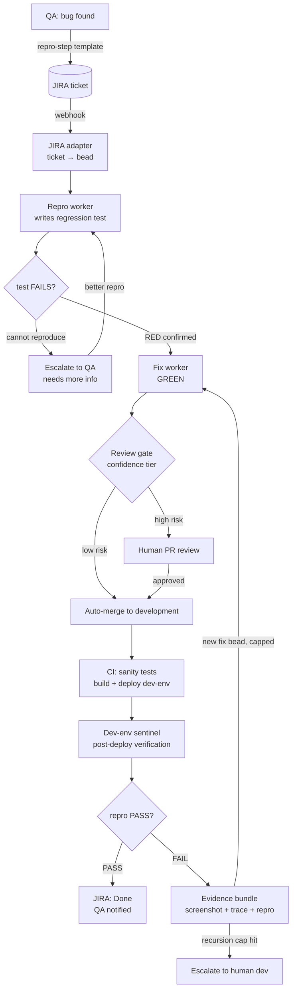
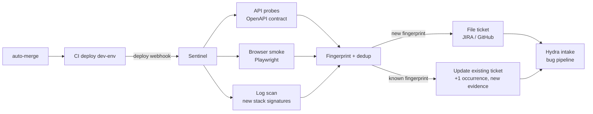
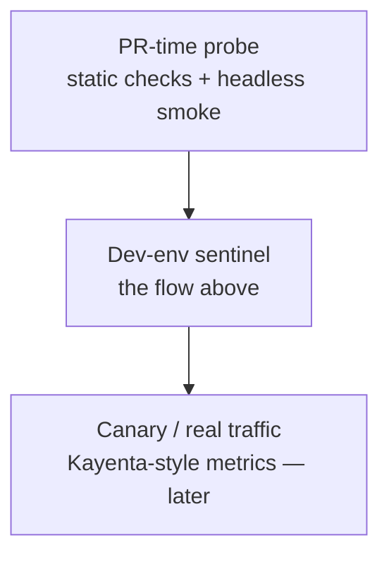
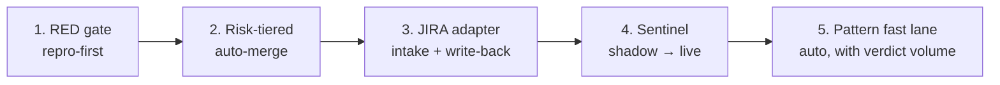

# Roadmap: Closing the Bug-Fix Loop End-to-End

**Status:** Planning — not scheduled for implementation
**Created:** 2026-08-03
**Owner:** TBD

This document is the agreed roadmap for automating the bug lifecycle from QA
report to verified close (~80% automation target), plus the same machinery
reused for verifying untested features. It will be refined over time; nothing
here is committed to a delivery date.

> **Guiding principle (from Meta SapFix/Sapienz and AutoCodeRover):** the loop
> closes only when a **machine-checkable oracle** exists. SapFix never deployed
> a patch without Sapienz-generated tests validating it; AutoCodeRover turns a
> bug report into a reproduction test *first* and uses it as the pass/fail
> oracle for every candidate fix. Every capability below exists to create or
> check that oracle.

---

## 1. The whole flow

Three exits, only one is a human handoff by design:

- **Cannot reproduce** → back to QA with a structured request (this is an
  exit, not a loop).
- **Recursion cap** → human dev with full attempt history.
- **Done** → QA notified.

---

## 2. Stage-by-stage: who does what

| # | Stage | Owner today | Automation target | Tooling |
|---|-------|-------------|-------------------|---------|
| 1 | QA finds bug, writes report | QA (human) | **Stays human** — but enforce repro-step template on intake | JIRA field template |
| 2 | Ticket created + assigned | Human | JIRA webhook → bead, auto-mapped to repo/project | JIRA Automation, webhook → Hydra adapter |
| 3 | Reproduction | Dev (human) | Repro worker: failing regression test (RED) as only deliverable | `br` bead chain, tdd-chain-validation |
| 4 | Fix | Dev (human) | Fix worker (GREEN), fix-specialist agent | Hydra worker, existing `bug`/`fix` routing |
| 5 | Review + merge | Dev (human) | Confidence-tiered auto-merge | Scope gate, verdict, graphify god-nodes |
| 6 | Build + deploy dev-env | CI/CD | Already automated | Existing CI pipeline |
| 7 | Post-deploy verification | QA (human) | Sentinel agent: probes + evidence | Playwright, OpenAPI contract tests, Sentry |
| 8 | Ticket close / reopen | QA (human) | Verdict → JIRA write-back (Done or reopened w/ evidence) | JIRA adapter (reverse path) |

The human share shrinks to: QA report writing, high-risk merge review, and
resistant bugs (recursion cap). That is the ~20%.

---

## 3. What gets built in Hydra

Capabilities that belong in the Hydra codebase (this repo):

### 3.1 Repro-first RED gate *(build first)*

- New bead phase/type `repro`: worker's only deliverable is a failing
  regression test derived from the ticket's repro steps.
- Chained: `repro → fix → refactor`. The fix worker cannot start until the
  repro bead closes with a failing test.
- Enforced via existing **tdd-chain-validation** machinery.
- If no repro steps exist, a repro agent attempts to construct them (browser
  automation / API replay); failure escalates to QA immediately — no guessing.

### 3.2 JIRA adapter

- Webhook receiver + poller; ticket ↔ bead mapping; repo/project routing.
- Reverse write: comments (verdict, AC mapping, changelog) and status
  transitions (In Progress → Done / Reopened).
- Same plumbing later serves GitHub Issues.
- Reference implementations: ai-bug-triage-agent, claude-code-jira-agent.

### 3.3 Confidence-tiered auto-merge

Auto-merge only when **all** hold:

1. Regression test flipped RED → GREEN,
2. Diff inside Target-Files scope gate,
3. All AC met, verdict `done`,
4. Low blast radius (graphify god-node check — touching an architectural hub
   forces human review).

Everything else routes to human PR review. SapFix's deployment rule, adapted.

### 3.4 Pattern fast lane (Getafix idea)

If Hindsight holds a *verified* pattern matching the bug class (same error
signature → same fix shape), auto-merge confidence bumps up. Foundation
already shipped: verdict-first retention (PR #105) + close-time extraction
(PR #120). Needs verdict volume.

### 3.5 Cross-run correlation

Link sentinel ticket ↔ merged PR ↔ original bead/verdict. Stored as Hindsight
patterns ("this fingerprint → this PR → this fix pattern"). The only truly
novel Hydra capability in this roadmap.

---

## 4. What gets built separately (runs in dev env)

The **sentinel** — a post-deploy verification agent living next to dev-env.
It is *not* part of the Hydra daemon; it is a standalone service triggered by
the CI deploy webhook.

### Capabilities

- **API probes** — OpenAPI spec → contract tests; schema drift detection;
  auth/500 sweeps on known endpoints.
- **Browser smoke** — Playwright: login + top user flows; console errors,
  failed network calls; screenshots → evidence bundle.
- **Log scan** — stack traces diffed against a baseline; only *new*
  signatures ticket. Fingerprint = exception type + top frames + message.
  **If Sentry (or similar) already runs, integrate its webhook instead of
  building log scraping** — fingerprinting/dedup is its core job.
- **Trigger on deploy webhook, not continuous polling.** "What broke since
  last deploy" is the useful diff, and blame attribution comes free (the
  merge that just deployed).

### Non-negotiables

- **Dedup is trust.** Same crash firing 10 tickets/day → QA ignores the agent
  within a week. Fingerprint → search open tickets → update existing.
- **Evidence bundle = repro steps.** Screenshot, stack trace, exact
  request/selector. If the ticket carries machine-usable repro, it feeds
  straight into the RED-gate repro worker — intake closes without humans.
- **Tiered severity.** Blocker → auto-revert PR + P1 ticket; degraded → P2
  ticket; noise → log only.
- **Read-only / seeded tenant.** Probing must not mutate real flows.
- **Shadow-mode rollout.** Weeks 1–2: tickets go to a "candidate" queue QA
  reviews. Tune false positives before letting it write to the real queue.

### Tooling

| Need | Options |
|------|---------|
| Browser automation | Playwright (preferred), Selenium |
| API contract testing | OpenAPI-driven (Schemathesis, Dredd), custom probes |
| Error fingerprinting | Sentry webhook (reuse if present), else custom log diff |
| Self-healing E2E | QA Wolf / Mabl-style selector repair |
| Canary analysis (later) | Kayenta-style metric comparison |

---

## 5. Three verification tiers

PR-time and dev-env are needed for the 80% target; canary is not.

---

## 6. Reuse: untested features

Same machinery, inverted expectation (full discussion in planning notes):

| | Bug | Untested feature |
|---|---|---|
| Oracle source | QA repro steps | PRD / acceptance criteria |
| Expected result | test FAILS (RED) → fix makes it PASS | test PASSES if feature works |
| On unexpected result | fix loop | auto-spawn bug bead |
| Loop end | test flips PASS | all AC have passing tests |

Rules that differ:

- **Bias separation** — the test-writer must not read the implementation;
  tests derive from AC text only. Same reason QA is a separate team.
- **Characterization vs specification** — passing tests on shipped untested
  features are characterization tests (they lock in current behavior,
  including bugs). Tag them; a QA repro test always outranks them.

---

## 7. Rollout order

Steps 1–2 close the middle of the loop (fix-and-test) using machinery that
mostly already exists in Hydra. Steps 3–4 close the ends (intake,
verification, write-back). Step 5 turns on by itself.

## 8. Prerequisite state (as of 2026-08-03)

- Live worker binary predates PR #120 — close-time pattern extraction is **not
  live**. Rebuild + redeploy before any dogfood run of this loop.
- Dogfood target projects need fresh `graphify-out` in the project root
  (workers run in worktrees that don't carry it — known visibility gap).
- Fix-recursion cap and fix-bead auto-spawn already exist in the shepherd
  layer; the FAIL→Fix loop in the diagram reuses them.

## 9. Open questions

- Exact JIRA project ↔ repo mapping rules (one adapter config knob per repo).
- Repro-step template: which fields are mandatory before a ticket can webhook
  into Hydra.
- Whether auto-revert on blocker severity is safe for the dev branch
  protection rules we run.
- Sentinel hosting: sidecar on the dev-env box vs. scheduled runner in CI.

## 10. Tool stack (consolidated)

### Already in Hydra (reuse — zero new dependencies)

| Tool | Role |
|------|------|
| `br` (beads-rust) | Ticket ↔ work-item graph; `bug`/`fix`/`repro` types, dep chains |
| `pi` | Worker runtime (LLM execution), session resume |
| Shepherd + Pan | Close/fix loop, fix-bead auto-spawn, recursion cap |
| graphify | Blast-radius (god-nodes) for auto-merge gate; worker code context |
| Hindsight | Pattern memory, fast-lane confidence, cross-run correlation |
| tdd-chain-validation | RED-gate enforcement |
| Registry (SQLite) | Fleet state, congestion pause |

### Intake / close plumbing (new)

| Component | Tool |
|-----------|------|
| JIRA intake | **JIRA REST API + webhooks** — Go service inside Hydra |
| GitHub Issues alternative | `gh` CLI / GitHub REST |
| Status write-back | Same adapter, reverse path (comments, transitions) |
| PR + merge ops | `gh` CLI + GitHub branch protection + auto-merge flag |

### Repro + verification

| Need | Tool |
|------|------|
| Regression tests | Native per repo: `go test`, Vitest, pytest — whatever the project runs |
| UI repro (no steps given) | **Playwright** (MCP or CLI) |
| API repro / replay | **Schemathesis** (OpenAPI property-based) or plain curl replay |
| Mutation testing (hot paths, later) | go-mutesting / Stryker |

### Sentinel (dev-env, standalone)

| Need | Tool |
|------|------|
| Browser smoke | **Playwright** — screenshots, console capture |
| API contract probes | **Schemathesis** (spec-driven), Dredd as alternative |
| Error fingerprinting | **Sentry** if already deployed (webhook + dedup); else custom log diff (exception type + top frames) |
| Deploy trigger | CI webhook (GitHub Actions `deployment_status` or pipeline-native hook) |
| Self-healing selectors (later) | Mabl / QA Wolf patterns, or worker-regenerated selectors |
| Canary (later — not v1) | Kayenta-style metric comparison |

### Comms (optional)

- JIRA comments/transitions via the adapter — primary channel.
- Slack webhook for blocker-tier alerts — nice-to-have.

**Minimal viable set:** rollout steps 1–2 (RED gate + tiered auto-merge) need
*no new tools* — all existing Hydra machinery. The first new component is the
JIRA adapter (step 3); Playwright + Schemathesis + Sentry arrive with the
sentinel (step 4).

## 11. Industry references — what we steal vs. what we integrate

Two categories: **idea references** (steal the technique, build it in Hydra)
and **direct integrations** (adopt the tool, don't rebuild it).

### Idea references (steal the technique)

| Source | What it does | What we steal | Where it lands |
|--------|--------------|---------------|----------------|
| **Meta SapFix** | Auto-generates patches for crash reports; never deploys without test validation | (a) *Multi-candidate patches* — generate 2–3 candidate fixes, let the regression test + suite select the winner, instead of one patch judged once. (b) *Fix-vs-revert duality* — at the review gate, "revert the offending merge" is a legitimate candidate alongside the proper fix for high-risk, time-critical bugs | §3.1 fix worker; §3.3 review gate |
| **Meta Sapienz** | Search-based test generation designed *for the diff* ("motive"), run on every change | *Diff-targeted probe generation* — the sentinel generates probes scoped to what the merge touched (new endpoint → contract probe; touched UI flow → Playwright path), not just replays of known repros | §4 sentinel |
| **Meta Getafix** | Learns fix patterns from historical *human* fix commits | *Mine human git history* — seed the pattern store with `git log --grep=fix` from dogfood repos instead of cold-starting on Hydra's own verdicts | §3.4 pattern fast lane |
| **AutoCodeRover** | Issue → reproduction test → fix, with the repro test as oracle | Already incorporated: repro-first RED gate (§3.1) | — |
| **SWE-agent / SWE-bench** | Agent trajectories + benchmark resolve rates on real issues | Benchmark yardstick: SWE-bench-class resolve rates (50–70% on scoped issues) calibrate the 80% target and give us an offline eval harness shape | §9 open questions → add eval harness |
| **Meta TestGen-LLM** | "Assured offline" — only land generated tests that pass reliably | Filter rule for worker-generated tests: a generated test that flakes or was never observed failing pre-fix is discarded, not merged | §3.1 RED gate |
| **Kayenta (Netflix)** | Automated canary analysis on metrics | Canary tier (deferred — not needed for the 80% target) | §5 |

### Direct integrations (adopt, don't rebuild)

| Tool | Integrate for | Why not build it |
|------|---------------|------------------|
| **Sentry** | Error fingerprinting + dedup as sentinel ticket source | Fingerprinting/dedup is its core job; reuse its webhook instead of log scraping |
| **Playwright** | UI repro + browser smoke probes | Mature browser automation; nothing to gain by rebuilding |
| **Schemathesis** | OpenAPI contract probes (property-based) | Spec-driven API fuzzing is solved |
| **JIRA REST + webhooks** | Intake + write-back | Official API; the adapter is the only thing we build |
| **`gh` CLI + branch protection** | PR/merge ops, auto-merge flags | Native GitHub mechanics |
| **Static analyzers** (`govulncheck`, `staticcheck` via security-scan) | Static findings as a *ticket source* — bugs filed before they crash (SapFix consumed Infer the same way) | Scanners exist; we only wire findings → bead creation |

### Cross-cutting pick: human feedback as patterns

SapFix's accept/reject decisions trained the fixer. Our review gate records
verdicts on closes, but **human PR reject reasons are not captured**. Steal:
PR review comments → Hindsight patterns ("rejected: symptom fix, widened
timeout"). Directly attacks the root-cause-discipline risk — the biggest
known failure mode of worker-written fixes.

### Priority

| Rank | Pick | Why |
|------|------|-----|
| 1 | Multi-candidate patches (SapFix) | Biggest single quality lift on the fix step |
| 2 | Human reject reasons → patterns | Closes the learning loop; attacks the worst failure mode |
| 3 | Mine human git history (Getafix) | Bootstraps pattern store cold-start |
| 4 | Diff-targeted probes (Sapienz) | Sentinel depth |
| 5 | Static analyzers as ticket source | Bugs before they crash |
| 6 | Fix-vs-revert duality | Cheap gate option |

## 12. Under consideration (NOT committed): Piolium security-audit integration

**Status: candidate only.** Reviewed 2026-08-03; no decision to implement.
Recorded here so the evaluation is not lost.

[Piolium](https://github.com/vigolium/piolium) is a Pi-native security audit
agent (Pi extension): 17-phase deep audits with ~35 specialist sub-agents
(static analysis, authz, concurrency, cross-service dataflow, adversarial
chamber, FP verification, variant hunting, PoC generation). Modes from
`/piolium-lite` (4 phases) to `/piolium-deep` (17 phases, hours).

**Verdict from the review: complement, never replace** the existing
security-review skill (gitleaks + govulncheck + checklist → gap-report JSON).
That skill is the fast, cheap, per-PR gate; Piolium is the deep, expensive,
agentic audit. Different gears.

### If adopted — three tiers

1. **Per-PR (diff mode).** `/piolium-diff --since=<base>` in the worktree as
   an optional validation phase; findings exported as JSON → converted to the
   existing gap-report JSON → compliance adjudicator. Zero new downstream
   plumbing.
2. **Scheduled deep audits.** Pan-scheduled `/piolium-balanced`/`deep` per
   project; confirmed findings → auto-created `bug`/`security` beads. This is
   the §11 "static analyzers as ticket source" pick at agentic grade.
3. **FP adjudication.** `/piolium-confirm` as escalation when the adjudicator
   is unsure about a scanner finding.

### Findings feed this roadmap's fix loop directly

Piolium findings ship `report.md` + `poc.*` + `evidence/` — **the PoC is the
repro step**, the highest-quality intake in this whole design (better than
most human QA tickets). Flow: findings → beads → RED gate codifies the PoC
as a failing test → fix worker → review gate → verify by rerunning the PoC.

Security-specific adjustments:

- The regression test must assert the *attack class is blocked* (e.g.
  parameterized query), not "this probe string is rejected" — otherwise
  workers patch the probe, not the hole.
- Authz/dataflow findings skew high blast radius → expect ~50% auto-merge
  (vs ~80% for regular bugs); more human review.
- P12 variant lists → follow-up beads per variant cluster.
- Findings that don't survive a fix attempt → "can't reproduce" exit, tag
  unconfirmed.

### Known costs and frictions (from the review)

- **No published token-cost data.** Structural estimate: deep = 5M–30M tokens
  on a hydra-sized repo; the file-by-file longshot phase is the budget bomb
  (`--limit=N` caps it). Measure empirically with `/piolium-lite` before any
  commitment.
- Workers run `--no-extensions` + allowlist (`rtk`, `context-mode`); Piolium
  would be a per-phase `phase_extensions` entry only, never fleet-wide.
- Deep audits would saturate the shared worker provider key → dedicated
  provider (Pan/MiniMax precedent).
- Piolium's own README warns it runs shell on target repos → same sandbox
  posture as workers required.

### Evaluation gate (if ever picked up)

1. Install into shared pi config; run `/piolium-lite` on the hydra repo.
2. Judge: finding quality + measured token cost.
3. Only then consider Tier 1 on one dogfood project.
