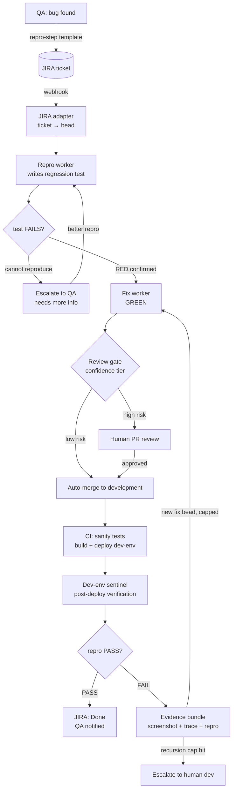
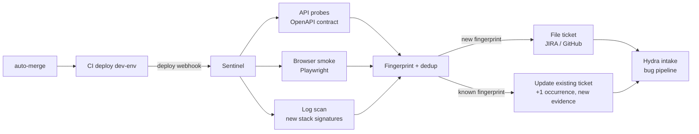
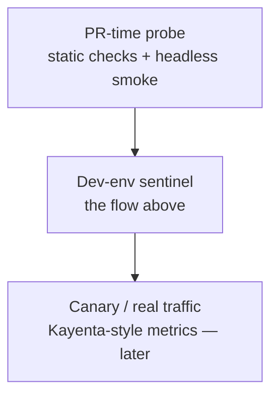
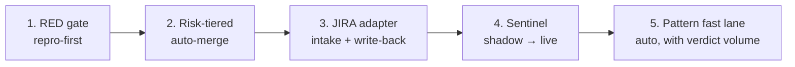

# Roadmap: Closing the Bug-Fix Loop End-to-End

**Status:** Planning — not scheduled for implementation
**Created:** 2026-08-03
**Owner:** TBD

This document is the agreed roadmap for automating the bug lifecycle from QA
report to verified close (~80% automation target), plus the same machinery
reused for verifying untested features. It will be refined over time; nothing
here is committed to a delivery date.

> **Guiding principle (from Meta SapFix/Sapienz and AutoCodeRover):** the loop
> closes only when a **machine-checkable oracle** exists. SapFix never deployed
> a patch without Sapienz-generated tests validating it; AutoCodeRover turns a
> bug report into a reproduction test *first* and uses it as the pass/fail
> oracle for every candidate fix. Every capability below exists to create or
> check that oracle.

---

## 1. The whole flow

Three exits, only one is a human handoff by design:

- **Cannot reproduce** → back to QA with a structured request (this is an
  exit, not a loop).
- **Recursion cap** → human dev with full attempt history.
- **Done** → QA notified.

---

## 2. Stage-by-stage: who does what

| # | Stage | Owner today | Automation target | Tooling |
|---|-------|-------------|-------------------|---------|
| 1 | QA finds bug, writes report | QA (human) | **Stays human** — but enforce repro-step template on intake | JIRA field template |
| 2 | Ticket created + assigned | Human | JIRA webhook → bead, auto-mapped to repo/project | JIRA Automation, webhook → Hydra adapter |
| 3 | Reproduction | Dev (human) | Repro worker: failing regression test (RED) as only deliverable | `br` bead chain, tdd-chain-validation |
| 4 | Fix | Dev (human) | Fix worker (GREEN), fix-specialist agent | Hydra worker, existing `bug`/`fix` routing |
| 5 | Review + merge | Dev (human) | Confidence-tiered auto-merge | Scope gate, verdict, graphify god-nodes |
| 6 | Build + deploy dev-env | CI/CD | Already automated | Existing CI pipeline |
| 7 | Post-deploy verification | QA (human) | Sentinel agent: probes + evidence | Playwright, OpenAPI contract tests, Sentry |
| 8 | Ticket close / reopen | QA (human) | Verdict → JIRA write-back (Done or reopened w/ evidence) | JIRA adapter (reverse path) |

The human share shrinks to: QA report writing, high-risk merge review, and
resistant bugs (recursion cap). That is the ~20%.

---

## 3. What gets built in Hydra

Capabilities that belong in the Hydra codebase (this repo):

### 3.1 Repro-first RED gate *(build first)*

- New bead phase/type `repro`: worker's only deliverable is a failing
  regression test derived from the ticket's repro steps.
- Chained: `repro → fix → refactor`. The fix worker cannot start until the
  repro bead closes with a failing test.
- Enforced via existing **tdd-chain-validation** machinery.
- If no repro steps exist, a repro agent attempts to construct them (browser
  automation / API replay); failure escalates to QA immediately — no guessing.

### 3.2 JIRA adapter

- Webhook receiver + poller; ticket ↔ bead mapping; repo/project routing.
- Reverse write: comments (verdict, AC mapping, changelog) and status
  transitions (In Progress → Done / Reopened).
- Same plumbing later serves GitHub Issues.
- Reference implementations: ai-bug-triage-agent, claude-code-jira-agent.

### 3.3 Confidence-tiered auto-merge

Auto-merge only when **all** hold:

1. Regression test flipped RED → GREEN,
2. Diff inside Target-Files scope gate,
3. All AC met, verdict `done`,
4. Low blast radius (graphify god-node check — touching an architectural hub
   forces human review).

Everything else routes to human PR review. SapFix's deployment rule, adapted.

### 3.4 Pattern fast lane (Getafix idea)

If Hindsight holds a *verified* pattern matching the bug class (same error
signature → same fix shape), auto-merge confidence bumps up. Foundation
already shipped: verdict-first retention (PR #105) + close-time extraction
(PR #120). Needs verdict volume.

### 3.5 Cross-run correlation

Link sentinel ticket ↔ merged PR ↔ original bead/verdict. Stored as Hindsight
patterns ("this fingerprint → this PR → this fix pattern"). The only truly
novel Hydra capability in this roadmap.

---

## 4. What gets built separately (runs in dev env)

The **sentinel** — a post-deploy verification agent living next to dev-env.
It is *not* part of the Hydra daemon; it is a standalone service triggered by
the CI deploy webhook.

### Capabilities

- **API probes** — OpenAPI spec → contract tests; schema drift detection;
  auth/500 sweeps on known endpoints.
- **Browser smoke** — Playwright: login + top user flows; console errors,
  failed network calls; screenshots → evidence bundle.
- **Log scan** — stack traces diffed against a baseline; only *new*
  signatures ticket. Fingerprint = exception type + top frames + message.
  **If Sentry (or similar) already runs, integrate its webhook instead of
  building log scraping** — fingerprinting/dedup is its core job.
- **Trigger on deploy webhook, not continuous polling.** "What broke since
  last deploy" is the useful diff, and blame attribution comes free (the
  merge that just deployed).

### Non-negotiables

- **Dedup is trust.** Same crash firing 10 tickets/day → QA ignores the agent
  within a week. Fingerprint → search open tickets → update existing.
- **Evidence bundle = repro steps.** Screenshot, stack trace, exact
  request/selector. If the ticket carries machine-usable repro, it feeds
  straight into the RED-gate repro worker — intake closes without humans.
- **Tiered severity.** Blocker → auto-revert PR + P1 ticket; degraded → P2
  ticket; noise → log only.
- **Read-only / seeded tenant.** Probing must not mutate real flows.
- **Shadow-mode rollout.** Weeks 1–2: tickets go to a "candidate" queue QA
  reviews. Tune false positives before letting it write to the real queue.

### Tooling

| Need | Options |
|------|---------|
| Browser automation | Playwright (preferred), Selenium |
| API contract testing | OpenAPI-driven (Schemathesis, Dredd), custom probes |
| Error fingerprinting | Sentry webhook (reuse if present), else custom log diff |
| Self-healing E2E | QA Wolf / Mabl-style selector repair |
| Canary analysis (later) | Kayenta-style metric comparison |

---

## 5. Three verification tiers

PR-time and dev-env are needed for the 80% target; canary is not.

---

## 6. Reuse: untested features

Same machinery, inverted expectation (full discussion in planning notes):

| | Bug | Untested feature |
|---|---|---|
| Oracle source | QA repro steps | PRD / acceptance criteria |
| Expected result | test FAILS (RED) → fix makes it PASS | test PASSES if feature works |
| On unexpected result | fix loop | auto-spawn bug bead |
| Loop end | test flips PASS | all AC have passing tests |

Rules that differ:

- **Bias separation** — the test-writer must not read the implementation;
  tests derive from AC text only. Same reason QA is a separate team.
- **Characterization vs specification** — passing tests on shipped untested
  features are characterization tests (they lock in current behavior,
  including bugs). Tag them; a QA repro test always outranks them.

---

## 7. Rollout order

Steps 1–2 close the middle of the loop (fix-and-test) using machinery that
mostly already exists in Hydra. Steps 3–4 close the ends (intake,
verification, write-back). Step 5 turns on by itself.

## 8. Prerequisite state (as of 2026-08-03)

- Live worker binary predates PR #120 — close-time pattern extraction is **not
  live**. Rebuild + redeploy before any dogfood run of this loop.
- Dogfood target projects need fresh `graphify-out` in the project root
  (workers run in worktrees that don't carry it — known visibility gap).
- Fix-recursion cap and fix-bead auto-spawn already exist in the shepherd
  layer; the FAIL→Fix loop in the diagram reuses them.

## 9. Open questions

- Exact JIRA project ↔ repo mapping rules (one adapter config knob per repo).
- Repro-step template: which fields are mandatory before a ticket can webhook
  into Hydra.
- Whether auto-revert on blocker severity is safe for the dev branch
  protection rules we run.
- Sentinel hosting: sidecar on the dev-env box vs. scheduled runner in CI.
